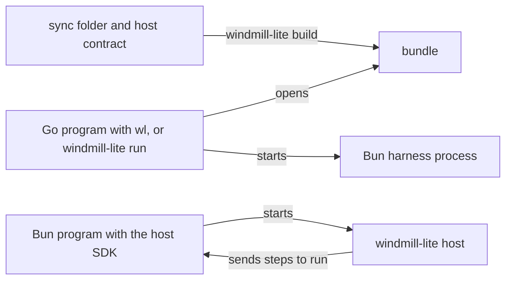

# windmill-lite

windmill-lite runs the flows and scripts of a Windmill folder with
Windmill's behaviour, but without a Windmill server: no job queue, no job
for each step, and no workers that pick jobs up. A Go or Bun program embeds
it, or the `windmill-lite` command runs a flow once.

**Current state:** windmill-lite runs [flows](docs/glossary.md#flow) whose
[script](docs/glossary.md#script) [steps](docs/glossary.md#step) are
TypeScript for [Bun](docs/glossary.md#bun), and
[root](docs/glossary.md#root) scripts in TypeScript, with
[Windmill](docs/glossary.md#windmill)'s loops, branches, subflows, retries,
timeouts, failure handling, [expressions](docs/glossary.md#expression),
resources and variables. It does not run steps in other languages yet, and
it has no network server. Its go-plugin adapter
([wl/plugin](wl/plugin/README.md) and `windmill-lite plugin`) runs flows
and scripts for a Go host, whose Go callbacks can answer a run's hooks over
go-plugin's broker; the gRPC and HTTP adapters are planned.

## Who it is for

Use windmill-lite when you have Windmill flows and scripts in a
[sync folder](docs/glossary.md#sync-folder), the folder that `wmill sync`
writes, and you want to run them:

- inside a Go program, through the [`wl`](wl/README.md) package;
- inside a Bun program, whose own process runs the steps, through the
  [Bun host SDK](harnesses/README.md);
- from the command line, with `windmill-lite run`.

Do not use it when you need:

- steps in Python, Deno, Go or Bash. Only Bun steps run: a step in another
  language fails the build with `unsupported_language`
  ([internal/ir](internal/ir/README.md#harness-classes));
- Windmill's server features: the UI, [job](docs/glossary.md#job) rows
  and logs as a record,
  schedules, triggers and apps. The build skips schedules, triggers and
  apps, and windmill-lite does not provide the others;
- durable suspend and approvals, workflow-as-code scripts or `aiagent`
  steps. windmill-lite does not support them, and rejects such a flow when
  it loads the folder;
- queues, worker tags, priorities or concurrency limits. windmill-lite
  reads them and ignores them;
- behaviour that only Windmill's Enterprise Edition shows.

The [equivalence contract](docs/design/0001-equivalence-contract.md#3-out-of-scope)
lists each limit with its reason.

## How it works



- **[Bundle](docs/glossary.md#bundle):** `windmill-lite build` compiles a
  sync folder and, optionally, a
  [host contract](docs/glossary.md#host-contract) into
  the program that the engine runs, the bundled Bun scripts and the
  folder's data, with a manifest of their digests
  ([internal/bundle](internal/bundle/README.md)).
- **[Engine](docs/glossary.md#engine):** the Go interpreter of flows. It
  evaluates expressions in QuickJS-ng, the
  JavaScript engine that Windmill uses, compiled into the binary
  ([internal/engine](internal/engine/README.md)).
- **[Harness](docs/glossary.md#harness):** a Bun process that runs each
  step's script for the engine: many
  [invocations](docs/glossary.md#invocation) in one process
  ([`warm`](docs/glossary.md#warm), the default), or one process for each
  invocation ([`fresh`](docs/glossary.md#fresh))
  ([harnesses/bun](harnesses/bun/README.md)).
- **`wl`:** the public Go package. `Open` opens a bundle, and `Run` runs a
  flow or a [root](docs/glossary.md#root) script ([wl](wl/README.md)).
- **The `windmill-lite` command:** `build`, `verify`, `run`, `selfcheck`,
  `host`, `plugin` and `version`
  ([cmd/windmill-lite](cmd/windmill-lite/README.md#usage)).
- **[Host mode](docs/glossary.md#host-mode):** a Bun program, the
  [host](docs/glossary.md#host), imports the host SDK. The SDK starts
  `windmill-lite host` as its engine, and runs the steps in the program's
  own process
  ([harnesses/bun](harnesses/bun/README.md#host-mode-and-the-host-sdk)).
- **The platform facade:** a step's stock `windmill-client` calls reach a
  Go facade, which serves resources, variables and the other routes that
  windmill-lite supports
  ([internal/platform/facade](internal/platform/facade/README.md)).
- **The [semantics reference](docs/glossary.md#semantics-reference):**
  Windmill's behaviour, written as numbered rules. CI records
  [fixtures](docs/glossary.md#fixture) on an unmodified Windmill, the
  [oracle](docs/glossary.md#oracle), and windmill-lite must match them
  ([docs/semantics](docs/semantics/README.md)).

## Quick start

This builds the engine from source, builds a bundle of a synthetic folder,
and runs its flow. You need Git, Go 1.27.3 or later, a C compiler for cgo,
and [Bun 1.4.3](https://github.com/oven-sh/bun/releases/tag/bun-v1.4.3).

1. Clone the repository:
   `git clone https://github.com/invakid404/windmill-lite.git`.
2. Change to its directory: `cd windmill-lite`.
3. Check that the expression engine starts:
   `go run ./cmd/windmill-lite selfcheck`.
4. Point `WL_BUN` at the Bun 1.4.3 executable:
   `export WL_BUN=/path/to/bun-1.4.3/bun`.
5. Install the dependencies of the
   [Bun build helper](harnesses/bun/build/README.md):
   `(cd harnesses/bun/build && "$WL_BUN" install --frozen-lockfile)`.
6. Point `WL_BUILD_HELPER` at the build helper:
   `export WL_BUILD_HELPER=$PWD/harnesses/bun/build/main.ts`.
7. Build the bundle into a file that does not exist yet. The command
   prints the bundle's digest:

   ```sh
   go run ./cmd/windmill-lite build internal/bundle/testdata/fixture/windmill \
     -contract internal/bundle/testdata/fixture/contract.yaml -o /tmp/fixture.wlb
   ```

8. Verify the bundle: `go run ./cmd/windmill-lite verify /tmp/fixture.wlb`.
9. Run the flow `f/app/main`. The command prints the run's outcome as
   JSON, with `"status": "success"`:

   ```sh
   go run ./cmd/windmill-lite run f/app/main --bundle /tmp/fixture.wlb \
     --args '{"name": "lite"}' -harness-runtime harnesses/bun/runtime
   ```

The [command's README](cmd/windmill-lite/README.md) describes every flag.
[Run the tests locally](docs/ci.md#run-the-tests-locally) gives the test
setup.

## Install the Bun host SDK

The Bun host SDK is the npm package `windmill-lite`. Its version is the
version of the engine that it works with, and each version is a
[GitHub Release](https://github.com/invakid404/windmill-lite/releases)
`v<version>` with the engine binaries.

Take the SDK, the engine and the bundle from the same version:

| Mismatch | What the engine does |
|---|---|
| The SDK's version is not the engine's | Refuses the host with `version_mismatch`. A development build of the engine accepts any SDK. |
| The host runs on a Bun other than 1.4.3 | Refuses the host with `runtime_mismatch` |
| Another engine version built the bundle | Does not open the bundle, and refuses the host with `engine_refused` |

These steps install version 0.5.0 on Linux amd64. For another version or
platform, change it in each step.

1. Install the package at that exact version:
   `bun add --exact windmill-lite@0.5.0`.
2. Download the engine from the release
   [v0.5.0](https://github.com/invakid404/windmill-lite/releases/tag/v0.5.0):

   ```sh
   curl -fLO https://github.com/invakid404/windmill-lite/releases/download/v0.5.0/windmill-lite-linux-amd64
   ```

3. Download the release's sums:

   ```sh
   curl -fLO https://github.com/invakid404/windmill-lite/releases/download/v0.5.0/SHA256SUMS
   ```

4. Check the engine against its sum:
   `grep windmill-lite-linux-amd64 SHA256SUMS | sha256sum --check`. On
   macOS, use `shasum -a 256 --check` in place of `sha256sum --check`.
5. Make it executable: `chmod +x windmill-lite-linux-amd64`.
6. Import the SDK in the host:
   `import { connect } from "windmill-lite/bun";`.

To build a bundle with a released engine, you also need the build helper
from a checkout of the release's tag
([harnesses/README.md](harnesses/README.md#build-a-bundle)). The same README
shows a host that runs a flow ([Run a flow from a host](harnesses/README.md#run-a-flow-from-a-host)), and the
[Bun harness README](harnesses/bun/README.md#host-mode-and-the-host-sdk)
describes `connect()` and its options.

## Where to go next

The [glossary](docs/glossary.md) defines the terms that these documents
use.

### Using windmill-lite

| Document | What it answers | For whom |
|---|---|---|
| [wl](wl/README.md) | How to open a bundle and run flows from Go, with hooks, budgets and host mode | Go hosts |
| [wl/storetest](wl/storetest/README.md) | How to check that a resource store of your own meets the contract | Go hosts with their own resource store |
| [wl/redisstore](wl/redisstore/README.md) | How to keep the state that steps write in Redis, from Go | Go hosts |
| [wl/plugin](wl/plugin/README.md) | How a Go host launches the engine as a go-plugin plugin, pins it and calls its `Runner` service | Go hosts |
| [docs/resource-stores.md](docs/resource-stores.md) | Which resource store to choose, memory or Redis, and how to set Redis up for it | Everyone who deploys windmill-lite |
| [harnesses](harnesses/README.md) | How to install the npm package and test a host's process-level code | Bun hosts |
| [harnesses/bun](harnesses/bun/README.md) | What `connect()` does, its options, host plugins, and how a step runs | Bun hosts |
| [cmd/windmill-lite](cmd/windmill-lite/README.md) | The commands and flags of `windmill-lite`, and its benchmarks | Everyone who builds or runs a bundle |
| [docs/semantics](docs/semantics/README.md) | Which Windmill behaviour windmill-lite matches, rule by rule | Everyone who needs Windmill's exact behaviour |
| [docs/glossary.md](docs/glossary.md) | What each project term means | Everyone |

### Working on windmill-lite

| Document | What it answers | For whom |
|---|---|---|
| [AGENTS.md](AGENTS.md) | The contributor rules: the clean room, fixtures, pull requests | Every contributor |
| [docs/writing.md](docs/writing.md) | How to write the documentation | Everyone who writes or reviews documentation |
| [docs/memoria.md](docs/memoria.md) | How the documentation gate works, and how to pass it | Every contributor |
| [docs/ci.md](docs/ci.md) | What each CI workflow checks, and how to read a failure | Every contributor |
| [docs/benchmarks.md](docs/benchmarks.md) | How to run the benchmarks, what each one measures, and how to compare two builds | Contributors who measure |
| [RELEASING.md](RELEASING.md) | How to release a version | The maintainer |
| [docs/design](docs/design/README.md) | The architecture decision records and why the design is what it is | Designers and reviewers |
| [cmd/wltest](cmd/wltest/README.md) | The runner of the [conformance cases](docs/glossary.md#conformance-case) and of the oracle: `record`, `stub`, `check` and `ledger` | Contributors to conformance |
| [conformance](conformance/README.md) | The shared conformance cases and their [recordings](docs/glossary.md#recording) | Contributors to conformance |
| [internal/conformance](internal/conformance/README.md) | The case formats, the normaliser and the comparator | Contributors to conformance |
| [internal/oracle](internal/oracle/README.md) | How the oracle records fixtures on Windmill | Contributors to conformance |
| [proto](proto/README.md) | The `Runner` service of the go-plugin adapter, and how to generate its Go code | Contributors to the go-plugin adapter |
| [internal/host](internal/host/README.md) | How the engine serves the `Runner` service over `wl`: requests, results and refusals | Contributors to the go-plugin adapter |
| [internal/wlext](internal/wlext/README.md) | What `wl` lends the engine's adapters beyond its public API | Contributors to the go-plugin adapter |
| [internal/openflow](internal/openflow/README.md) | The OpenFlow types and how Windmill decodes a flow | Contributors to the compiler |
| [internal/yamlx](internal/yamlx/README.md) | How windmill-lite parses sync-folder YAML as the `wmill` CLI does | Contributors to the compiler |
| [internal/syncfolder](internal/syncfolder/README.md) | How windmill-lite reads a sync folder | Contributors to the compiler |
| [internal/ir](internal/ir/README.md) | How a folder and a host contract compile to a program | Contributors to the compiler |
| [internal/racebuild](internal/racebuild/README.md) | Why a `-race` build stretches the flow suite's run limit and the harness watchdog, and by how much | Contributors who run the tests with `-race` |
| [internal/bundle](internal/bundle/README.md) | The bundle format, its build and its verification | Contributors to the build |
| [harnesses/bun/build](harnesses/bun/build/README.md) | How the Bun build helper bundles scripts and reads their signatures | Contributors to the build |
| [internal/engine](internal/engine/README.md) | How the engine runs a flow | Contributors to the engine |
| [internal/expr](internal/expr/README.md) | How the engine evaluates an expression | Contributors to the engine |
| [internal/expr/quickjs](internal/expr/quickjs/README.md) | The embedded QuickJS-ng engine, its limits and its pool | Contributors to the engine |
| [internal/jsonval](internal/jsonval/README.md) | The JSON value type and its jsonb canonicaliser | Contributors to the engine |
| [internal/harness](internal/harness/README.md) | The engine's side of the harness protocol | Contributors to the engine |
| [internal/platform](internal/platform/README.md) | Job identity and the platform services: resources, variables, the job registry | Contributors to the platform |
| [internal/platform/facade](internal/platform/facade/README.md) | Which of Windmill's API routes the facade serves | Contributors to the platform |
| [internal/bench](internal/bench/README.md) | What the benchmarks share | Contributors who measure |
| [scripts](scripts/README.md) | The documentation check, the release helper, the auto-ack scripts and the Redis test containers | Every contributor |

## Compatibility

| Item | Version |
|---|---|
| Windmill | Community Edition `v1.862.0`, the [pinned version](docs/semantics/README.md#pinned-version). Some [findings](docs/glossary.md#finding) are still verified at `v1.767.0` only. |
| Bun | 1.4.3 exactly, for builds, harnesses and hosts. Windmill `v1.862.0` runs Bun 1.4.4, a difference that the [equivalence contract](docs/design/0001-equivalence-contract.md#5-named-deviations) names. |
| Go, to build from source | 1.27.3 or later, with a C compiler |
| Node, for the SDK's test entry `windmill-lite/bun/testing` | 22 or later |
| Released engines | Linux amd64 and arm64, static binaries; macOS arm64 and amd64 |
| Redis, for the [Redis resource store](docs/resource-stores.md) | Tested with Redis 7.2, alone and through Sentinel; Redis Cluster is not supported |

## Contributing

Read [AGENTS.md](AGENTS.md) first. Its clean-room rule is a hard
constraint: Windmill's server is AGPLv3, so everyone who designs, reviews
or implements windmill-lite works without reading that source.

- Write documentation to [docs/writing.md](docs/writing.md).
- After your last edit, pass the documentation gate
  ([docs/memoria.md](docs/memoria.md)).
- Make the five required checks pass: `Go (ubuntu-latest)`,
  `Go (macos-latest)`, `Expression engine (ubuntu-24.04)`,
  `Expression engine (ubuntu-26.04)` and `memoria`
  ([docs/ci.md](docs/ci.md)).

## Licence

windmill-lite is released into the public domain under the
[Unlicense](LICENSE). It is not affiliated with Windmill Labs. These
vendored files keep their own licences:

| Path | What it is | Licence | Notice |
|---|---|---|---|
| `internal/openflow/schema/` | Windmill's OpenFlow schema | Apache-2.0 | [NOTICE](internal/openflow/schema/NOTICE) |
| `internal/oracle/openapi/` | Windmill's OpenAPI description | Apache-2.0 | [NOTICE](internal/oracle/openapi/NOTICE) |
| `internal/expr/quickjs/quickjs-ng/` | The QuickJS-ng sources | MIT | [NOTICE](internal/expr/quickjs/quickjs-ng/NOTICE) |
| `internal/expr/quickjs/mimalloc/` | The mimalloc sources | MIT | [NOTICE](internal/expr/quickjs/mimalloc/NOTICE) |
| `internal/jsonval/pglz.go`, `internal/jsonval/jsonb.go` | Go code ported from PostgreSQL | PostgreSQL License | [LICENSE.PostgreSQL](internal/jsonval/LICENSE.PostgreSQL) |

`wl/plugin` depends on hashicorp/go-plugin and hashicorp/yamux, which are
under the Mozilla Public License 2.0, as Go modules only: the repository
holds none of their files. For each such module that the engine links, the
release's `LICENSES.txt` also says where its source is
([release helper](scripts/README.md#release-helper)).
