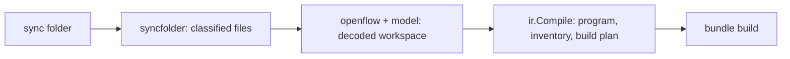

# 0002 · IR, loader and validation

**Status:** proposed · **Topic:** how a `wmill sync` folder becomes an
executable program, a script inventory and dependency information, and how
each step's language is recorded.

## Context

A sync folder holds scripts with `.script.yaml` metadata and locks,
`*.flow/flow.yaml` trees with inline scripts, resources, variables and
`wmill.yaml` ([SY-1](../semantics/openflow.md#sy-1) to
[SY-15](../semantics/openflow.md#sy-15)). Windmill decodes a flow with
effective rules that differ from its schema in both directions
([OF-1](../semantics/openflow.md#of-1), [OF-V1](../semantics/openflow.md#of-v1),
[OF-V2](../semantics/openflow.md#of-v2)), and a deployed flow differs from
what the folder says in five observable ways
([OF-3](../semantics/openflow.md#of-3)). No usable Go type set exists
([LIC-3](../semantics/licensing.md#lic-3)). A pulled folder is the full form,
which is not canonical; a hand-written folder may be in any state
([SY-6](../semantics/openflow.md#sy-6)).

## Options considered

1. **Generate Go types from the OpenFlow schema** (`openflow.openapi.yaml`,
   Apache-2.0). The schema is the field inventory, not the decoder: it misses
   aliases, null rules and cross-kind type checks. Rejected as the decoder;
   kept as the coverage reference.
2. **Interpret the YAML directly at run time.** Every run would re-apply
   defaults and re-derive collapse and language. Rejected.
3. **Hand-written types with the effective decoder rules, a separate compile
   step to an IR, and a coverage test against the vendored schema.** Chosen.

## Decision

### Pipeline

1. **`syncfolder`** finds the root (`wmill.yaml`), applies the filters
   ([SY-13](../semantics/openflow.md#sy-13), [SY-V2](../semantics/openflow.md#sy-v2)),
   maps file paths to Windmill paths ([SY-1](../semantics/openflow.md#sy-1)),
   pairs scripts with metadata and locks
   ([SY-2](../semantics/openflow.md#sy-2) to [SY-5](../semantics/openflow.md#sy-5)),
   resolves `!inline` references relative to the flow folder
   ([SY-7](../semantics/openflow.md#sy-7), [SY-V1](../semantics/openflow.md#sy-v1)),
   and reads resources, resource types and variables
   ([SY-10](../semantics/openflow.md#sy-10), [SY-11](../semantics/openflow.md#sy-11)).
   Items it recognises but does not run (schedules, triggers, apps) are
   listed and skipped ([SY-12](../semantics/openflow.md#sy-12)).
2. **YAML dialect.** The loader parses YAML into nodes with a Go YAML
   library and resolves scalars itself, to match the CLI's YAML 1.2 core
   schema ([SY-9](../semantics/openflow.md#sy-9)): `!inline` tags become
   strings, only `true`/`false` are booleans, `017` is 17, `<<` is a literal
   key, duplicate keys are errors, and numbers keep their source text until a
   typed field needs them. This answers [Q-OF-6](../semantics/openflow.md#q-of-6):
   the library's own scalar resolution is never used, and fixtures pin each
   rule.
3. **`openflow`** decodes flow values with the effective rules
   ([OF-5](../semantics/openflow.md#of-5) to [OF-16](../semantics/openflow.md#of-16),
   [OF-V1](../semantics/openflow.md#of-v1), [OF-V2](../semantics/openflow.md#of-v2)):
   unknown fields ignored, recognised fields type-checked even on kinds that
   do not use them, null versus omission per field, the `input_transform` and
   `custom_debounce_key` aliases, integer widths, and the restricted
   `timeout`/`parallelism` objects. Decode errors carry Windmill's prefixes
   (`Invalid flow value:`, `Module '<id>':`) and the two server checks
   (exponential base, workspace path) ([OF-2](../semantics/openflow.md#of-2)).
   Tests compare messages by "contains", as the reference does.
   A **schema-coverage test** loads the vendored `openflow.openapi.yaml`
   (Apache-2.0, notice kept) and fails when a schema property is neither
   mapped nor listed as ignored, so a new pin cannot slip through silently.
4. **`ir.Compile`** turns the decoded workspace into the program the engine
   runs.

### Normalising to the reference configuration

`ir.Compile` applies, once, everything a successful deploy would have
applied ([0001](0001-equivalence-contract.md) §1):

- container defaults ([OF-6](../semantics/openflow.md#of-6),
  [OF-7](../semantics/openflow.md#of-7)); with the `strict` option an absent
  for-loop `skip_failures` or `branchall` branch `skip_failure` is an error
  instead ([Q-CF-13](../semantics/control-flow.md#q-cf-13));
- the `bun` → `bunnative` switch by header annotation
  ([SY-V3](../semantics/openflow.md#sy-v3)), with the exact spelling rules;
- the while-loop `parallel` fields dropped ([OF-8](../semantics/openflow.md#of-8));
- the `<id>-v` virtual step after a final `sleep`, at every level (a final
  `suspend` would add it too, but `suspend` is rejected at load)
  ([OF-17](../semantics/openflow.md#of-17));
- `delete_after_use` dropped ([OF-12](../semantics/openflow.md#of-12)).

A module without an `id` gets a derived one (`wl` plus a hash of its
position) rather than Windmill's random six characters. Folders produced by a
deploy always carry ids, so this matters only for hand-written folders
(deviation D6).

### The IR

The IR is a tree of plain Go values, serialisable to JSON for the bundle and
for golden tests:

- **`Program`**: the flows (by path) and scripts (by id) of the bundle, the
  host contract it was built against (below), and the deviations in effect.
- **`Flow`**: its module list, failure module, preprocessor module and the
  flow-level fields that matter at run time (`skip_expr`, `flow_env`,
  `early_return`, `cache_ttl`, `same_worker`, the whole-flow `timeout`)
  ([OF-16](../semantics/openflow.md#of-16)).
- **`Module`**: id, its occurrence number when the id repeats within its
  module list (ids are not unique in Windmill, [OF-2](../semantics/openflow.md#of-2);
  [0011](0011-differential-testing.md) uses the occurrence in identities),
  kind and the envelope, each field already decoded. Kinds:
  `Script` (by path), `RawScript` (inline), `Identity`, `Subflow` (by path),
  `ForLoop`, `WhileLoop`, `BranchOne`, `BranchAll`, and `Provided` for a
  mandatory host-provided call site (below). Container bodies are
  nested module lists. Each container records whether it **collapses**
  under the deployed rules ([FX-46](../semantics/execution.md#fx-46),
  [CF-8](../semantics/control-flow.md#cf-8)), computed once, so the engine
  never re-derives it.
- **`Transform`**: `Static` (the raw JSON text, verbatim,
  [JE-40](../semantics/expressions.md#je-40)) or `Expr`.
- **`Expr`**: a compiled expression ([0003](0003-semantics-placement.md)):
  its site kind, the text as written, the trimmed text, the shortcut that
  can answer it (computed where it depends only on the text, deferred where
  it depends on the preceding id), the rewritten engine source, the mode, and
  the names it binds ([JE-5](../semantics/expressions.md#je-5) to
  [JE-15](../semantics/expressions.md#je-15)). Expressions are compiled once
  per bundle, never per run.
- **`Leaf`** (for `Script` and `RawScript`): a reference into the script
  inventory, plus the step's **harness class**.

### Language and harness class

Each leaf's language is static ([OF-13](../semantics/openflow.md#of-13)):
a rawscript's `language` field, or for a path script the file-name rules of
[SY-3](../semantics/openflow.md#sy-3) with `defaultTs` and the `//native`
switch. The IR maps languages to harness classes:

| Languages | Harness class | Boundary mode |
|---|---|---|
| `bun` | `bun` | Bun ([WR-13](../semantics/languages.md#wr-13), [WR-18](../semantics/languages.md#wr-18)) |
| `bunnative`, `nativets` | `bun` | native (deviation D5); its rules wait for a semantics request (README) |
| `python3`, `deno`, `go`, `bash` (`later`) | one class each | per [WR-33](../semantics/languages.md#wr-33) to [WR-35](../semantics/languages.md#wr-35) |
| anything else | none | load error `unsupported_language: <lang>` naming the step |

The harness class per leaf is all the engine needs: placement is decided per
leaf by the pool key ([0004](0004-harness-protocol.md)), and host scopes are
entered per run ([0008](0008-host-hooks.md)). The charter's *segments* (runs
of same-language steps chained in one process) were weighed and are not
recorded in the IR; [0003](0003-semantics-placement.md) explains why.

### Script inventory and dependency information

For every script and rawscript the inventory records: its Windmill path, or
`<flow path>/<module id>` for an inline step; its language and harness class;
the content digest; the lock text, preserved byte for byte
([OF-15](../semantics/openflow.md#of-15)); the bundling mode (bundled,
`//nobundling`, codebase) ([WR-27](../semantics/languages.md#wr-27)); the
parsed annotations ([WR-31](../semantics/languages.md#wr-31)); the import base
([WR-29](../semantics/languages.md#wr-29)); the relative-import closure within
the folder ([WR-28](../semantics/languages.md#wr-28)); the `.script.yaml`
schema; and a **dependency set id**: the digest of the lock for a
`//nobundling` script, a fixed id for bundled scripts (their dependencies are
inlined), the codebase's id for codebase scripts. Harness pools are keyed by
harness class, runtime pin and dependency set
([0004](0004-harness-protocol.md)).

Signatures are parsed by the Bun build helper, not by Go, because that parse
is TypeScript-specific and the harness must agree with it
([WR-6](../semantics/languages.md#wr-6), [WR-8](../semantics/languages.md#wr-8),
[WR-39](../semantics/languages.md#wr-39)). The helper records **every export**,
not only `main` and `preprocessor`, because `_ENTRYPOINT_OVERRIDE` can name
any export at run time, from a flow input
([WR-12](../semantics/languages.md#wr-12)). For each exported function
declaration the manifest records the parameter names and which parameters
hydrate to `Date`; an export the signature parser does not recognise (an
arrow function, a `const` holding a function) is recorded with an empty
parameter list, which is how Windmill's parser sees it (the
[WR-V1](../semantics/languages.md#wr-v1) fallback) ([0010](0010-packaging.md)).
Whether an export exists and is a function is checked by the harness after
loading, not at build ([0004](0004-harness-protocol.md)).

### Host contract and mandatory host-provided call sites

Some hosts must replace call sites whose targets windmill-lite cannot run,
for example a subflow that suspends. Runtime interception alone cannot help:
the loader would reject the flow before any hook ran. So the build takes a
**host contract** as a second input, next to the sync folder: a file that
lists the bundle's **roots** (the flows and scripts the host will run) and
its **provided sites**, each a selector ([0008](0008-host-hooks.md)) with
the form of its provider (a static value, or a named provider the host
registers at run time) and `mandatory: true`.

1. The loader walks the dependency closure from the roots only. At a
   provided site it stops: the site's target (a by-path subflow or script)
   is **opaque**: it is not loaded, validated or bundled, and need not be in
   the folder, unless another, non-provided path also reaches it.
2. Validation then applies to everything still reachable. A `suspend`
   reachable only through provided sites is therefore not an error; one
   reachable any other way still is (`unsupported_feature`, naming the path).
3. The IR replaces each provided site with a `Provided` module that keeps
   the original envelope (transforms, `skip_if`, `stop_after_if`, retry,
   `continue_on_error`), so the orchestration around the site is the real one.
4. `wl.Open` fails with `missing_provider` (naming the site) when a named
   provider is not registered, so a run can never reach an unprovided site.
5. A mandatory provider cannot decline. If it returns *decline* anyway, the
   run latches `provider_declined` (H5) and fails closed.

Policy case: a synthetic root calls a by-path subflow that contains
`suspend`, at a site the host contract provides. With the provider
registered, the run succeeds with the provider's value and the root's
orchestration around the site (its `stop_after_if`) applies to it; without
the contract entry, load fails with `unsupported_feature`/`suspend` naming
the path; with the entry but no registered provider, `wl.Open` fails with
`missing_provider`.

### Validation

Load fails, naming the step and the rule, when:

1. Windmill itself would reject the value (OF-2 messages);
2. the flow uses an out-of-scope feature ([0001](0001-equivalence-contract.md) §3);
3. a by-path script or flow is not in the folder, is filtered out, or is a
   `hub/` path with no host resolver ([SY-15](../semantics/openflow.md#sy-15));
4. a step's language has no harness class;
5. a bundled Bun script imports a bare package and has no lock. An empty
   lock is not an error by itself; windmill-lite does not generate locks in
   its first release (this answers [Q-OF-5](../semantics/openflow.md#q-of-5)
   for Bun);
6. a `script.hash` pins a version other than the folder's script
   ([OF-14](../semantics/openflow.md#of-14)).

### Codebase scripts

A codebase script is a Bun-family path script matched by a `codebases`
entry of `wmill.yaml` ([SY-8](../semantics/openflow.md#sy-8)). Windmill's
CLI bundles it with esbuild, platform `node`, packages inlined, format `cjs`
(target `node20.15.1`) or `esm`, with the entry's `external`, `inject`,
`define`, `loader` and `banner` ([WR-30](../semantics/languages.md#wr-30)) and
its `assets` ([SY-8](../semantics/openflow.md#sy-8)). Windmill runs a CJS
bundle under Node, and CE refuses codebase scripts (`codebase is an EE
feature`, or on a standalone instance `(standalone bundle test mode) could
not find codebase at <path>`, WR-30).
Decisions:

1. **Bundler.** esbuild through its Go API (MIT), pinned to the version the
   pinned CLI uses, with the settings above. Until the reference states that
   version and the default `format`, the build uses the CLI's documented
   defaults and records the esbuild version in the manifest (semantics
   request 2, README). A `customBundler` entry is refused at load
   (`unsupported_feature`).
2. **Runtime.** CJS and ESM codebase bundles run in the Bun harness;
   running CJS on Bun's CommonJS loader instead of Node is deviation D13. A
   Node harness class was weighed and rejected: host mode needs steps in the
   host's Bun process, and CE cannot record codebase behaviour either way.
   Cases for D13 run the same esbuild CJS bundle under Node and under the Bun
   harness and compare results, error objects and module-load failures
   (`__dirname`, `require` of JSON and of the bundle's own files, `module.exports`
   shapes).
3. **Assets.** `assets[{from,to}]` are extracted once per harness process
   into its working directory (D10) before any invocation. Two scripts whose
   assets map different content to the same relative path fail the build
   with `asset_collision`.
4. **Parity with the CLI.** Milestone C2b checks the bundles: the pinned
   `wmill` CLI, run as a black box against a recording HTTP stub, produces
   the codebase bundles it would upload, and windmill-lite's esbuild output
   for the same fixture must match them after normalising paths. If the CLI
   needs more of a server than a stub can answer, the check compares the
   esbuild settings and the semantics request's answer instead, and says so
   in the case.

Proposed loader divergences from the CLI, each labelled in the loader's
diagnostics: reject dotted logical paths and always use the `wmill.yaml`
directory as root ([SY-1](../semantics/openflow.md#sy-1),
[SY-V4](../semantics/openflow.md#sy-v4)); accept inline paths anywhere inside
the flow folder and reject paths that escape the sync root
([SY-7](../semantics/openflow.md#sy-7)); treat two files mapping to one path
as an error ([PA-1](../semantics/openflow.md#pa-1)). Only the first refuses
folders the CLI accepts: the CLI truncates a dotted logical path to its first
segment, which silently renames the item. The others change nothing about
how an accepted folder runs.

## Consequences

- The engine receives a fully decided program: no defaults, collapse flags or
  languages are computed during a run.
- Bundle identity covers the IR, so a changed `stop_after_if` changes the
  digest ([0010](0010-packaging.md)).
- windmill-ts (Unlicense) is prior art for the folder walk and the schema
  clean-ups ([PA-1](../semantics/openflow.md#pa-1) to
  [PA-3](../semantics/openflow.md#pa-3), [WA-60](../semantics/client-api.md#wa-60));
  it may be consulted and copied, but it lacks flows, locks and inline
  scripts, so the loader is new code.
- The metadata-only Apache packages (`windmill-yaml-validator`,
  `windmill-utils-internal`) are not used until the open licence question is
  answered ([Q-OF-7](../semantics/openflow.md#q-of-7)); the loader is written
  from the `SY-` findings either way.

## Spec IDs relied on

OF-1 to OF-18, OF-V1, OF-V2, OF-V4, SY-1 to SY-15, SY-V1 to SY-V4, PA-1 to
PA-3, FX-4, FX-39, FX-46, CF-6, CF-8, JE-5 to JE-15, JE-40, WR-6, WR-8,
WR-12, WR-13, WR-18, WR-27 to WR-31, WR-33 to WR-35, WR-39, WR-V1, WA-60,
LIC-3, Q-OF-5, Q-OF-6, Q-OF-7, Q-CF-13.
