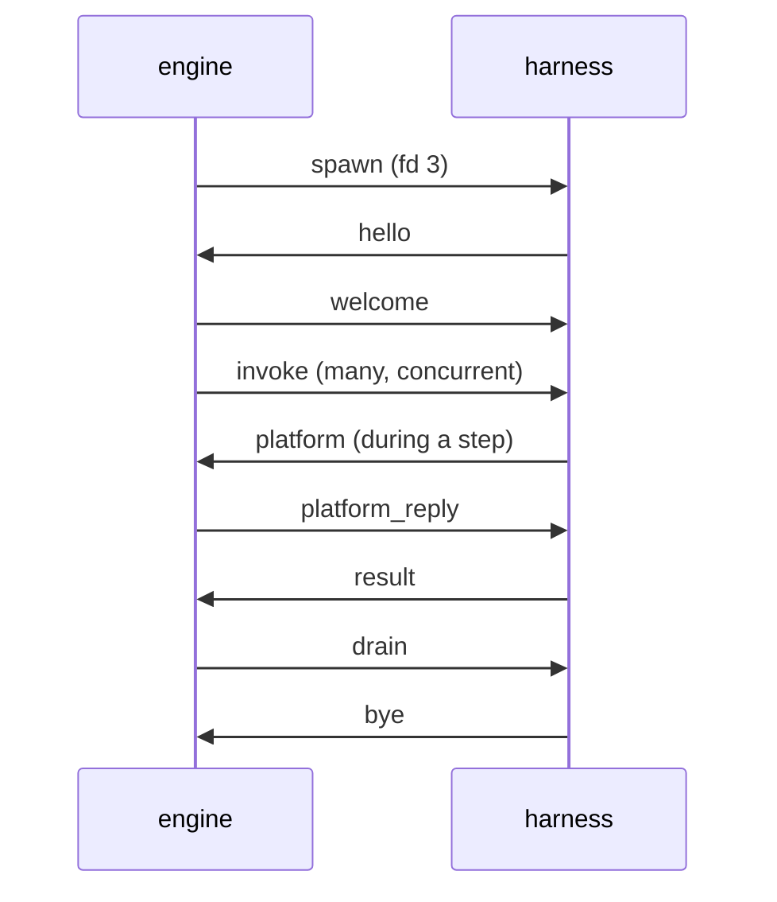

# 0004 · Harness protocol

**Status:** proposed · **Topic:** the transport between the Go engine and a
language harness, the message shapes, process lifecycle, pooling, parallel
loops, and how cancellation and deadlines reach every step and wait.

## Context

[0003](0003-semantics-placement.md) makes the harness a step runner that the
engine drives once per step. The harness must reproduce what one Windmill
job sees ([WR-1](../semantics/languages.md#wr-1) to
[WR-22](../semantics/languages.md#wr-22),
[WR-37](../semantics/languages.md#wr-37)) while many invocations share one
warm process. The `WM_*` environment and platform-call attribution are
process-global in Bun and must be made per-invocation
([WA-31](../semantics/client-api.md#wa-31)); in a shared process, log output
must be attributed per invocation too, because an escaped failure's error
quotes the step's last log lines ([WR-20](../semantics/languages.md#wr-20)). Windmill kills a step's
process on timeout and cancellation; a warm process cannot be killed for one
step without failing the others.

## Options considered

- **Transport.** stdio is unusable for messages because user code prints to
  stdout, which Windmill merges into logs ([WR-23](../semantics/languages.md#wr-23)).
  gRPC adds an HTTP/2 stack to Bun and buys nothing: payloads are JSON text
  either way. A Unix socket or a socketpair with length-prefixed frames
  measured 12.5 µs p50 for a small step and 18.4 µs for 3 KB
  ([0003](0003-semantics-placement.md)). TCP loopback adds a port and an
  authentication problem.
- **Encoding.** Protobuf would wrap JSON values in bytes fields and add a
  code generator to the harness. JSON envelopes with the values embedded raw
  let Go pass values through without decoding them.

## Decision

### Transport and framing

1. The engine starts a harness with a **socketpair**; the child gets its end
   as file descriptor 3. stdin is `/dev/null`; stdout and stderr are kept
   for diagnostics that no invocation owns.
2. A **frame** is a 4-byte big-endian length followed by that many bytes of
   UTF-8 JSON: one object with a `t` (type) field. Values that are JSON in
   the semantics (arguments, results, errors, platform bodies) are embedded
   as raw JSON text and never re-encoded by Go.
3. A message larger than 1 MiB is sent as a sequence of `part` frames of at
   most 1 MiB each, so `cancel`, `platform_reply` and other small frames are
   not stuck behind a large result. The largest message accepted is 512 MiB,
   above Windmill's 500 MB default result limit
   ([WR-15](../semantics/languages.md#wr-15)); hosts may lower it.
4. Every request carries an `id` unique per sender; replies echo it.
   Invocations, platform calls and host calls are multiplexed on one socket.

### Messages

| `t` | Direction | Fields | Purpose |
|---|---|---|---|
| `hello` | harness → engine | `proto`, `harness` (kind, version), `runtime` (for Bun, `Bun.version`), `caps` (`fetch`, `native`, `fresh`, `host`), `bundle` (digest of what it loaded) | handshake |
| `welcome` | engine → harness | `proto`, `engine`, `bundle`, `config` (module-state mode, facade origin, log limits) or `reject` with a reason | handshake result |
| `invoke` | engine → harness | `id`, `run`, `site` (typed path, [0011](0011-differential-testing.md)), `script` (inventory id), `entry` (a validated export name, below), `args` (raw JSON object), `env` (the invocation's `WM_*` and other job variables), `boundary` (`bun` or `native`) | run one step |
| `result` | harness → engine | `id`, `outcome` (`ok`, `error`, `escaped`, `empty`), `body` (raw JSON: the serialised result, or the error object), `tail` (the last log text for `escaped`), `settled` (false when the outcome was fixed while the entrypoint call goes on: an intercepted `process.exit`, D11, or an attributed process-level error, item 2 of the failure model below) | step outcome |
| `late` | harness → engine | `id`, `kind` (`result`, `error`, `log`), `body`, `settled` (true on the one late result or error that says how an entrypoint call ended after it was abandoned or after its outcome was fixed early) | something an already settled or abandoned invocation produced (D9) |
| `cancel` | engine → harness | `id`, `reason` (`timeout`, `canceled`, `run_ended`) | abandon one invocation |
| `log` | harness → engine | `id`, `lines` | attributed output, batched |
| `platform` | harness → engine | `id`, `inv` (invocation id), `method`, `url`, `headers`, `body` | an intercepted `fetch` to the platform facade ([0007](0007-platform-interface.md)) |
| `platform_reply` | engine → harness | `id`, `status`, `headers`, `body` | its answer |
| `host_call` / `host_reply` | either way | `id`, `hook`, `site`, `payload` | a host plugin hook ([0008](0008-host-hooks.md)) |
| `run` / `run_done` / `run_cancel` | harness → engine / back / harness → engine | the JSON mapping of the `Run` request, `Run` response and `Cancel` request messages of `runner.proto` ([0009](0009-host-adapters.md)) | host mode: a harness that is also the host submits runs |
| `ping` / `pong` | either way | in-flight count, abandoned count, process-level error count, event-loop lag, RSS | health |
| `part` | either way | `id`, `seq`, `last`, `chunk` | one piece of a message over 1 MiB |
| `drain` / `bye` | engine → harness / back | — | orderly shutdown |

**Entrypoints.** `entry` is `main`, `preprocessor` (the flow preprocessor
step), or the value of `_ENTRYPOINT_OVERRIDE` when the arguments carry one
([WR-12](../semantics/languages.md#wr-12)). The two checks happen where
Windmill makes them:

1. **The name**, in the engine, before any invocation: a name that does not
   match `^[A-Za-z_][A-Za-z0-9_]*$` fails the step with Windmill's
   `Invalid entrypoint override …` text, before any wrapper runs.
2. **The export**, in the harness, after the script's module has loaded, as
   the wrapper does after its import: top-level code, import failures and
   their logs come first; then an export that is missing or not a function
   fails the step with `<name> function is missing` (`main function is
   missing` for `main`, `preprocessor function is missing` for the
   preprocessor), in the wrapper-catch shape.

The harness binds arguments with the signature the manifest records for that
export ([0002](0002-ir-and-loader.md)), hydrates its `Date` parameters, and
applies the [WR-V1](../semantics/languages.md#wr-v1) fallback when an
override is present and the parsed parameter list is empty, which includes
arrow-function exports, since the parser does not recognise them. Cases: a
script that is not workflow-as-code exports `alternate(when: Date)`, and a
step whose arguments carry `_ENTRYPOINT_OVERRIDE: "alternate"` receives a
hydrated `Date`; an arrow `preprocessor` receives the flow input's
non-underscore values (WR-12/b).

The engine maps a `result` to Windmill's stored value with the rules of
[WR-21](../semantics/languages.md#wr-21) and [WR-V5](../semantics/languages.md#wr-v5)
(a pre-shaped `ManualFailure` stays as is, everything else is wrapped as
`{"error": …}`, non-JSON text becomes `Non serializable error: <text>`):

| `outcome` | Harness saw | Stored error |
|---|---|---|
| `ok` | the entrypoint returned | none; the result text is `body` |
| `error` | the wrapper caught a throw | `body` is the [WR-18](../semantics/languages.md#wr-18) object (Bun), or the native boundary's error object (D5) |
| `escaped` | `throw null`/`undefined`, a module evaluation or import failure, a failing error handler, a non-zero `process.exit`, or an attributed process-level error (below) | [WR-20](../semantics/languages.md#wr-20): `ExecutionErr`, `exit code for "bun run": <code>, last log lines:\n<tail>`, with `exit_code` |
| `empty` | `process.exit(0)`, or no result | [WR-V2](../semantics/languages.md#wr-v2): `InternalErr` without `step_id` |

A harness process that dies fails its in-flight invocations as `escaped`
with its real exit code, or as `process terminated by signal: …`
([WR-4](../semantics/languages.md#wr-4)). For the escaped cases the reference
predicts exit code 1 but has not recorded Bun 1.3.10's exit status for
`throw null`, top-level throws and unhandled rejections
([Q-WR-2](../semantics/languages.md#q-wr-2)); the harness reports exit code 1
until that is recorded.

### The shared-process failure model

A warm process runs many invocations at once, so anything that would end a
Windmill job's process must instead end only that invocation. Measured on
Bun 1.3.10 and 1.4.2 (prototype outside the repository): without handlers,
one detached `Promise.reject` exits the process with code 1 and a concurrent
200 ms timer never fires; with handlers the process survives. Inside the
handlers, a throw from a timer sees the throwing invocation's
`AsyncLocalStorage` store, but an unhandled rejection and a throw from a
microtask see none.

1. **Handlers.** Before any step module loads, the harness installs
   `uncaughtException` and `unhandledRejection` handlers that never exit.
2. **Attribution.** An error whose context names an invocation is
   attributed to it. If that invocation is still in flight, it fails as
   `escaped` with exit code 1 and its log tail, which is what the process
   exit would have done to that job on Windmill. Its entrypoint call may
   still be pending (the error came from a timer while the call awaits
   something else), so that `result` frame has `settled` false, and the
   call settles when it ends or its process does. If the invocation's
   outcome is already fixed, the error is reported as a `late` frame and
   recorded in the run trace; the outcome stands (D9).
3. **Unattributable errors** (rejections, microtask throws) fail no
   invocation, because the harness cannot know whose they are and never
   guesses. Each is counted in `pong`, logged with its text and stack, and
   attached as a warning to every run that had an invocation in flight in
   that process at that moment (D9).
4. **Work after the result** (unawaited promises, timers, open handles)
   keeps running; Windmill cuts it off at `process.exit`
   ([WR-2](../semantics/languages.md#wr-2)). Its output and errors are
   reported as `late` (D9).
5. **Working directory.** Each harness process the engine spawns gets one
   private directory, created at spawn, as its working directory for all
   invocations ([WR-1](../semantics/languages.md#wr-1) gives each job its
   own; D10). In host mode the SDK does not change the host's working
   directory: the host passes a writable directory to the SDK and must have
   made it its working directory before connecting; the SDK checks both and
   refuses to connect with `workdir_not_writable` or `workdir_mismatch`.
   Codebase assets are extracted into it before the first invocation
   ([0002](0002-ir-and-loader.md)).
6. **`process.exit`** is replaced per invocation. The call fixes the
   invocation's outcome (`empty` for code 0 with no result written,
   `escaped` otherwise) and throws a sentinel. `finally` blocks run and a
   `catch` can swallow the sentinel and keep going; whatever the code does
   afterwards is reported as `late` (D11).
7. **Child processes and other output paths.** The harness wraps
   `child_process.spawn`, `exec`, `execFile` (and their sync forms) and
   `Bun.spawn`/`Bun.spawnSync` so that a child started without an explicit
   environment receives the invocation's view, not the process environment.
   Output written through `Bun.stdout`, a raw file descriptor or a child's
   inherited stdio is not attributed: it reaches the process log, not the
   invocation's log tail.
8. **`fresh` mode** restores Windmill's behaviour for all of the above: one
   process per invocation, its own working directory, and the process ends
   with the invocation ([0006](0006-module-state.md)).

Each of D9, D10 and D11 has a case that runs in `warm` and in `fresh` and
expects the two to differ as stated.

**Settlement.** An invocation settles when its entrypoint call can run no
more code. The harness reports it on exactly one frame: the `result` frame,
normally, or else the `late` frame that says how the call ended after it was
abandoned or after its outcome was fixed early (an intercepted
`process.exit`, D11, or an attributed error, item 2 above), each with
`settled` set. An invocation that never
reached a harness settles at once, and one whose process ends first settles
with the process. Work the call left running (D9) is not part of
settlement. The engine releases the resources that step code can reach when
a run's invocations have all settled (`onRunSettled`, host mode item 5
below), so a late error from detached work, or the engine giving up on a
step, never releases them.

### Per-invocation identity, logs and environment

- The harness runs each invocation inside an `AsyncLocalStorage` context
  holding its `env`, its abort signal and its log buffer.
- `process.env` is replaced by a view that answers from the current
  invocation first; bundles rewrite `Bun.env` and `import.meta.env` to
  `process.env` at build time ([WA-31](../semantics/client-api.md#wa-31)).
  This mechanism is gated: the walking skeleton (milestone W1) runs the
  16-way isolation test of [Q-WA-4](../semantics/client-api.md#q-wa-4) on the
  pinned Bun before anything depends on it.
- `console.*`, `process.stdout.write` and `process.stderr.write` are
  attributed to the current invocation. Lines are merged, empty lines
  dropped ([WR-23](../semantics/languages.md#wr-23)), batched into `log`
  frames, and the last 600 characters are kept for the WR-20 tail.
- `globalThis.fetch` is wrapped before any plugin or step module loads:
  requests to the facade origin become `platform` frames attributed to the
  invocation; all other requests pass through unchanged. Host plugins that
  wrap `fetch` themselves wrap this one, so facade requests pass through the
  plugin's wrapper first and must be passed on.
- **Platform transports.** In `warm` and host-mode processes, `fetch` is the
  only way to reach the platform. The facade origin in `BASE_URL` is a
  loopback port that the engine binds but never listens on, so any other
  transport (`node:http`, a raw socket) gets "connection refused". Nothing
  records the refusal: the kernel refuses the connection before any
  windmill-lite code sees it, and the step sees only the error its client
  library raises (which a script may catch and ignore). The stock
  client cannot carry an invocation's identity over such a transport,
  because it captures its token at import
  ([WA-1](../semantics/client-api.md#wa-1), [WA-31](../semantics/client-api.md#wa-31)).
  In `fresh` mode the port does listen, because the process is the
  invocation ([0007](0007-platform-interface.md)). Each process receives its
  own `BASE_URL` at spawn, so a host that runs some scripts `fresh` and the
  rest `warm` gives the two kinds of process different facade origins: the
  listening one for `fresh` processes, the non-listening one for warm ones.
- The base environment of the process follows [WR-22](../semantics/languages.md#wr-22)
  and [WA-2](../semantics/client-api.md#wa-2): `PATH`, `HOME`, `TZ`,
  `FORCE_COLOR=1`, `DO_NOT_TRACK=1`, `BUN_INSTALL_CACHE_DIR`,
  `BUN_RUNTIME_TRANSPILER_CACHE_PATH=0`, `NODE_PATH` where Windmill would set
  it, and `BASE_URL` pointing at the facade origin on `127.0.0.1` (Windmill's
  value is its internal URL with `localhost` replaced by `127.0.0.1`).
  `BASE_INTERNAL_URL` is not set for Bun, as in Windmill. Both are set before
  any step module loads, because the client captures its base URL at import
  ([WA-1](../semantics/client-api.md#wa-1)).

### Lifecycle

1. **Handshake.** The engine rejects a harness whose protocol version,
   runtime pin or bundle digest differs from the bundle manifest
   ([0010](0010-packaging.md)).
2. **Loading.** In `warm` mode a script's module is evaluated on its first
   invocation, inside that invocation's context, so top-level code sees a job
   environment as it would in Windmill ([WR-2](../semantics/languages.md#wr-2)).
   Host-provided modules are registered before that
   ([0010](0010-packaging.md)). A host may ask for eager loading to move the
   cost off the first run. [0006](0006-module-state.md) covers the modes.
3. **Serving.** A process serves any number of concurrent invocations,
   unless the host sets a cap (below).
4. **Drain.** The engine stops routing new invocations, waits for in-flight
   ones, sends `drain`, and the harness exits after `bye`.

### Pooling (processes the engine spawns)

A pool is keyed by **(harness class, runtime pin, dependency set,
module-state mode)** ([0002](0002-ir-and-loader.md)). All bundled Bun scripts
share one dependency set, so a Bun-only bundle normally needs one pool.

- Default size is one process per pool: Bun steps are mostly asynchronous
  I/O and run concurrently on one event loop. A host can set a minimum and a
  maximum.
- **No in-flight cap by default.** The reference for parallel containers is
  a Windmill with enough workers ([0001](0001-equivalence-contract.md) §1),
  and any cap changes outcomes, not only timing: children that wait on each
  other, or parents that wait on runs they dispatched locally, never finish
  if the cap keeps their partners from starting. A host may still set a cap
  per process, in spawned processes and in host mode alike; it is deviation
  D15, recorded in the run trace. Abandoned invocations never count toward
  it. Cases (`policy`, windmill-lite only, because the reference behaviour
  is the contract's enough-workers assumption): three parallel children
  that wait on one barrier, and three parents that each dispatch a run
  locally and wait for it, both completing with no cap and both timing out
  at the step timeout with a cap of 2.
- Routing prefers the run's process (affinity), then the least-loaded one.
  When the event loop of a process lags past a threshold (a CPU-bound step),
  the pool starts another process, up to the maximum.

### Host mode

In host mode ([0009](0009-host-adapters.md)) the only process that can run a
host's steps is the host itself, because the host's scopes live there
([0008](0008-host-hooks.md) H11). The rules for spawned processes therefore
change:

1. **No taint, no recycle.** The engine never stops routing to the host
   process (D2). An abandoned invocation keeps running until it settles.
2. **Reporting.** Abandoned invocations are counted in `pong`, flagged
   `abandoned` on their module in the run trace, and exposed to the host
   through the SDK's `health()`, with the age of the oldest one.
3. **Draining.** The SDK's `drain(timeout)` refuses new runs (`run` frames
   are answered `draining`), waits for in-flight runs up to `timeout`, and
   then lets the host exit. Runs still in flight at the deadline end with the
   host; their callers get whatever the host's own transport gives on exit.
   A host drains when it decides it is unhealthy but still responsive, for
   example after too many abandoned invocations.
4. **The watchdog.** A host whose event loop is blocked (a step spinning in
   a synchronous loop) cannot answer anything, including its own health
   checks, so recovery cannot depend on it. The engine is a separate process
   and keeps running: when the host misses pings for `watchdog.killAfter`
   (default 30 s, set by the host when it connects; `0` disables it), the
   engine writes a diagnostic line to its own stderr naming the host's
   in-flight runs, sends `SIGKILL` to the host process (whose pid it learned
   in the handshake) and exits. It reports no run outcomes: the only receiver
   of those was the host. A step that blocks the event loop for longer than
   `killAfter`, even one that would have finished, therefore ends the host
   and every run in it (D2); a host that runs long synchronous steps raises
   or disables the threshold. The only thing the
   host's supervisor needs is to restart the host when it exits, which
   supervisors already do. Callers with requests in flight on the killed host
   get the transport error their side gives when a server dies; the next
   generation is admitted when it is up, by the supervisor's own rule.
   **Spawned processes.** A `warm` process the engine spawned is handled the
   same way: after the same silence the engine kills it, fails all its
   in-flight invocations as `escaped` with the signal (co-resident ones
   included, which were already stalled while the event loop was blocked)
   and starts a replacement (D2). A `fresh` process is exempt: it is the
   invocation, so only the step's own `timeout` ends it, with
   [WR-37](../semantics/languages.md#wr-37)'s text, as on Windmill.
5. **Run resources.** `onRunEnd` fires when a run's outcome is decided;
   `onRunSettled` fires when the run's abandoned invocations have all
   settled, which may be never. A resource that an abandoned invocation may
   still use (a pooled client, a lease) is released only at `onRunSettled` or
   when the process exits, never on a timer, because abandoned code can
   resume at any time and a timer would hand the resource to two users.
   Resources that no step code can reach (host-side bookkeeping) may be
   released at `onRunEnd`.
6. **Losing the host.** If the host process exits, its in-flight runs are
   lost with it: their callers are the host's own callers. The engine fails
   them as `harness_lost` and does not try to move them, because their scopes
   existed only in that process.

Measured (prototype outside the repository, Bun 1.4.2): a Bun host that
heartbeats a Go child every 100 ms and then spins forever was killed by the
child 1.04 s after its last heartbeat, with a 1 s threshold; a supervisor
that only restarts on exit then served a new call on the next generation.

Validation (milestones W1 and F3b, with a public test supervisor that only
restarts on exit): two concurrent host-mode runs, one of whose steps never
settles: after that step's timeout, the other run's next step completes, a
new run afterwards succeeds, and health reports one abandoned invocation.
A step that spins forever, with a second run active: the engine kills the
host within `watchdog.killAfter` plus one second, the second run's caller
sees the host's exit, and a run on the restarted host succeeds. A resource
held by an abandoned invocation is not released before `onRunSettled`.

**Case `watchdog/finite-cpu`** (C3b for `fresh` and `warm`, F3b for host
mode): a step computes synchronously for 2 s and returns, with
`watchdog.killAfter` 1 s and a step `timeout` of 10 s.

- **`fresh`:** the step completes with its result; the watchdog does not
  apply.
- **`warm`:** the engine kills the process after about 1 s; the step, and a
  second invocation already in the same process awaiting a timer, fail as
  `escaped` with `process terminated by signal: SIGKILL`; the next
  invocation runs on a replacement process.
- **host mode:** the engine kills the host after about 1 s, and its
  in-flight runs end with it; a run on the restarted host succeeds.
- **With the watchdog disabled** (`killAfter` 0), the step completes in all
  three.

### Parallel loops

The engine owns concurrency. A parallel `forloopflow` or `branchall` starts
child runs as goroutines; `parallelism` releases eligibility in index order
([CF-7](../semantics/control-flow.md#cf-7)); results are collected in index
order whatever the completion order ([CF-4](../semantics/control-flow.md#cf-4)).
Beyond `parallelism`, the only limit is a host-set cap, if any (D15).

### Cancellation and deadlines

1. Every run has a Go context carrying the host's cancellation and
   deadlines ([0008](0008-host-hooks.md)). The engine checks it at every
   module start and completion, every loop iteration and branch launch,
   every `sleep`, every retry delay and every expression evaluation.
   `sleep` and retry delays are timers on that context, so a cancellation
   ends them at once ([FX-23](../semantics/execution.md#fx-23),
   [FX-38](../semantics/execution.md#fx-38)).
2. A step's `timeout` ([FX-24](../semantics/execution.md#fx-24)) is a timer
   in the engine. When it fires, or the run is canceled, the engine sends
   `cancel` and completes the module at once with Windmill's error
   ([WR-37](../semantics/languages.md#wr-37)), for example
   `{"error":{"message":"execution error:\njob process terminated due to timeout after exceeding job-specific duration limit","name":"ExecutionErr","step_id":"a"}}`.
   The "job-specific" wording appears only when the requested timeout is
   below the instance cap, which the host configures (default 604800 s).
   That text is the process-executor path, which is the one Bun steps take;
   in a collapsed loop the loop module's timeout applies to each iteration;
   identity modules and child-flow containers have no deadline, and the
   in-process executors' different text (`later`) applies to the languages
   that use them ([FX-24](../semantics/execution.md#fx-24),
   [FX-25](../semantics/execution.md#fx-25)).
3. Cancellation completes the run as `Canceled` and skips the failure module
   ([FX-38](../semantics/execution.md#fx-38), [CF-28](../semantics/control-flow.md#cf-28)),
   with FX-38's one exception: when an error stop and the cancel coincide in
   a flow that has a failure module, the continue decision still continues
   the flow, and what it asks for starts: a retry when one is due, the next
   module under `continue_on_error`, or else the failure module
   ([FX-19](../semantics/execution.md#fx-19); the precedence of
   [0008](0008-host-hooks.md)).
4. **Abandonment (deviation D2).** The harness aborts the invocation's
   signal and later reports anything it produces as `late`. In a process the
   engine spawned, the process is marked **tainted**: it gets no new
   invocations, returns to service when every abandoned invocation has
   settled, and is recycled once it has no other in-flight work, so no
   unrelated step is killed. Host mode follows the section above instead.
   Effects of an abandoned step can happen after its module has failed, which
   cannot happen on Windmill; host plugins can tie outbound I/O to the
   invocation's signal to narrow the window.

## Consequences

- One socket per harness process carries everything; Go never decodes step
  values to route them, and large messages cannot block small ones.
- Concurrency and timing live in one place (the engine), so parallel-loop
  order, `parallelism` and deadlines are implemented once.
- A shared process changes what can happen after a step's result and where
  its files go (D9 to D11); every such difference is reported, never silent,
  and `fresh` mode removes them.
- Host mode keeps the host's scopes and gives up killing steps; a wedged host
  is still recovered, by the engine's watchdog and the host's supervisor.
- The protocol is language-neutral; a Python harness implements the same
  frames.
- Milestone K1 added the `settled` field and the settlement rule. Without
  them the engine could not tell an abandoned call that ended from one that
  only produced late output, so `onRunSettled` had no reliable trigger. An
  outcome fixed before the call ends (D11, or an attributed error that
  fails the invocation at once) does not settle it either.
- Milestone K1 widened the FX-38 exception in §Cancellation and deadlines
  item 3 from "the failure module" to whatever the continue decision asks
  for, to match FX-19 and the precedence of [0008](0008-host-hooks.md).

## Spec IDs relied on

WR-1, WR-2, WR-4, WR-12, WR-13, WR-15, WR-18, WR-20 to WR-23, WR-37, WR-V1,
WR-V2, WR-V5, WA-1, WA-2, WA-31, Q-WA-4, Q-WR-2, FX-19, FX-23, FX-24, FX-25, FX-38,
CF-4, CF-7, CF-28.
