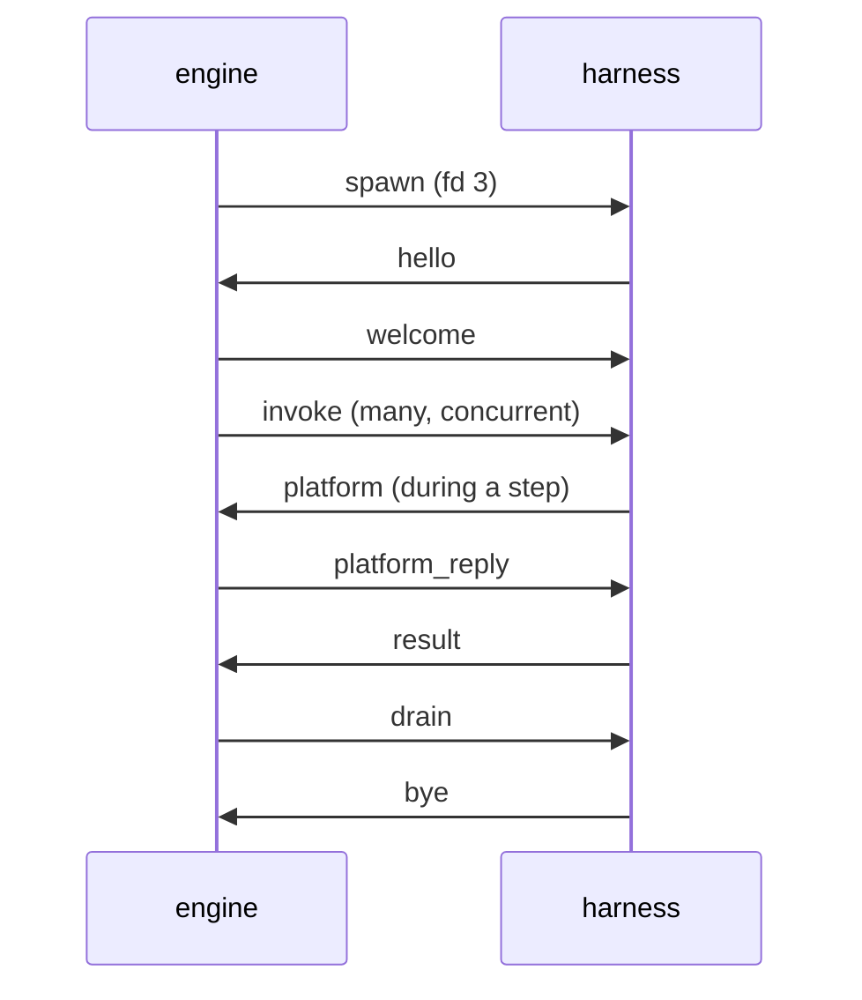

# 0004 · Harness protocol

**Status:** proposed · **Topic:** the transport between the Go engine and a
language harness, the message shapes, process lifecycle, pooling, parallel
loops, and how cancellation and deadlines reach every step and wait.

## Context

[0003](0003-semantics-placement.md) makes the harness a step runner that the
engine drives once per step. The harness must reproduce what one Windmill
job sees ([WR-1](../semantics/languages.md#wr-1) to
[WR-22](../semantics/languages.md#wr-22),
[WR-37](../semantics/languages.md#wr-37)) while many invocations share one
warm process. The `WM_*` environment and platform-call attribution are
process-global in Bun and must be made per-invocation
([WA-31](../semantics/client-api.md#wa-31)); in a shared process, log output
must be attributed per invocation too, because an escaped failure's error
quotes the step's last log lines ([WR-20](../semantics/languages.md#wr-20)). Windmill kills a step's
process on timeout and cancellation; a warm process cannot be killed for one
step without failing the others.

## Options considered

- **Transport.** stdio is unusable for messages because user code prints to
  stdout, which Windmill merges into logs ([WR-23](../semantics/languages.md#wr-23)).
  gRPC adds an HTTP/2 stack to Bun and buys nothing: payloads are JSON text
  either way. A Unix socket or a socketpair with length-prefixed frames
  measured 12.5 µs p50 for a small step and 18.4 µs for 3 KB
  ([0003](0003-semantics-placement.md)). TCP loopback adds a port and an
  authentication problem.
- **Encoding.** Protobuf would wrap JSON values in bytes fields and add a
  code generator to the harness. JSON envelopes with the values embedded raw
  let Go pass values through without decoding them.

## Decision

### Transport and framing

1. The engine starts a harness with a **socketpair**; the child gets its end
   as file descriptor 3. stdin is `/dev/null`; stdout and stderr are kept
   for diagnostics that no invocation owns.
2. A **frame** is a 4-byte big-endian length followed by that many bytes of
   UTF-8 JSON: one object with a `t` (type) field. Values that are JSON in
   the semantics (arguments, results, errors, platform bodies) are embedded
   as raw JSON text and never re-encoded by Go.
3. The default maximum frame is 512 MiB, above Windmill's 500 MB default
   result limit ([WR-15](../semantics/languages.md#wr-15)); hosts may lower it.
4. Every request carries an `id` unique per sender; replies echo it.
   Invocations, platform calls and host calls are multiplexed on one socket.

### Messages

| `t` | Direction | Fields | Purpose |
|---|---|---|---|
| `hello` | harness → engine | `proto`, `harness` (kind, version), `runtime` (for Bun, `Bun.version`), `caps` (`fetch`, `native`, `fresh`, `host`, `segments`), `bundle` (digest of what it loaded) | handshake |
| `welcome` | engine → harness | `proto`, `engine`, `bundle`, `config` (module-state mode, facade origin, log limits) or `reject` with a reason | handshake result |
| `invoke` | engine → harness | `id`, `run`, `site` (typed path, [0011](0011-differential-testing.md)), `script` (inventory id), `entry` (`main` or `preprocessor`), `args` (raw JSON object), `env` (the invocation's `WM_*` and other job variables), `boundary` (`bun` or `native`) | run one step |
| `result` | harness → engine | `id`, `outcome` (`ok`, `error`, `escaped`, `empty`), `body` (raw JSON: the serialised result, or the error object), `tail` (the last log text for `escaped`) | step outcome |
| `cancel` | engine → harness | `id`, `reason` (`timeout`, `canceled`, `run_ended`) | abandon one invocation |
| `log` | harness → engine | `id`, `lines` | attributed output, batched |
| `platform` | harness → engine | `id`, `inv` (invocation id), `method`, `url`, `headers`, `body` | an intercepted `fetch` to the platform facade ([0007](0007-platform-interface.md)) |
| `platform_reply` | engine → harness | `id`, `status`, `headers`, `body` | its answer |
| `host_call` / `host_reply` | either way | `id`, `hook`, `site`, `payload` | a host plugin hook ([0008](0008-host-hooks.md)) |
| `run` / `run_done` | harness → engine / back | `id`, `target`, `args`, `options` / `id`, `status`, `result`, `trace` | host mode: a harness that is also the host submits runs |
| `ping` / `pong` | either way | in-flight count, RSS | health |
| `drain` / `bye` | engine → harness / back | — | orderly shutdown |

The engine maps a `result` to Windmill's stored value with the rules of
[WR-21](../semantics/languages.md#wr-21) and [WR-V5](../semantics/languages.md#wr-v5)
(a pre-shaped `ManualFailure` stays as is, everything else is wrapped as
`{"error": …}`, non-JSON text becomes `Non serializable error: <text>`):

| `outcome` | Harness saw | Stored error |
|---|---|---|
| `ok` | the entrypoint returned | none; the result text is `body` |
| `error` | the wrapper caught a throw | `body` is the [WR-18](../semantics/languages.md#wr-18) object (Bun), or the native boundary's error object (D5) |
| `escaped` | `throw null`/`undefined`, a module evaluation or import failure, a failing error handler | [WR-20](../semantics/languages.md#wr-20): `ExecutionErr`, `exit code for "bun run": <code>, last log lines:\n<tail>`, with `exit_code` |
| `empty` | the script called `process.exit(0)` or left no result | [WR-V2](../semantics/languages.md#wr-v2): `InternalErr` without `step_id` |

A harness process that dies fails its in-flight invocations as `escaped`
with its real exit code, or as `process terminated by signal: …`
([WR-4](../semantics/languages.md#wr-4)). The process does not exit for a
step's `process.exit`: the harness intercepts it per invocation and reports
`empty` (or `escaped` for a non-zero code), as Windmill's result file would.

### Per-invocation identity, logs and environment

- The harness runs each invocation inside an `AsyncLocalStorage` context
  holding its `env`, its abort signal and its log buffer.
- `process.env` is replaced by a view that answers from the current
  invocation first; bundles rewrite `Bun.env` and `import.meta.env` to
  `process.env` at build time ([WA-31](../semantics/client-api.md#wa-31)).
  This mechanism is gated: milestone C3 runs the 16-way isolation test of
  [Q-WA-4](../semantics/client-api.md#q-wa-4) on the pinned Bun before
  anything depends on it.
- `console.*`, `process.stdout.write` and `process.stderr.write` are
  attributed to the current invocation. Lines are merged, empty lines
  dropped ([WR-23](../semantics/languages.md#wr-23)), batched into `log`
  frames, and the last 600 characters are kept for the WR-20 tail.
- `globalThis.fetch` is wrapped: requests to the facade origin become
  `platform` frames attributed to the invocation; all other requests pass
  through unchanged.
- The base environment of the process follows [WR-22](../semantics/languages.md#wr-22)
  and [WA-2](../semantics/client-api.md#wa-2): `PATH`, `HOME`, `TZ`,
  `FORCE_COLOR=1`, `DO_NOT_TRACK=1`, `BUN_INSTALL_CACHE_DIR`,
  `BUN_RUNTIME_TRANSPILER_CACHE_PATH=0`, `NODE_PATH` where Windmill would set
  it, and `BASE_URL` pointing at the facade on `127.0.0.1` (Windmill's value
  is its internal URL with `localhost` replaced by `127.0.0.1`).
  `BASE_INTERNAL_URL` is not set for Bun, as in Windmill. Both are set before any step module loads, because the client
  captures its base URL at import ([WA-1](../semantics/client-api.md#wa-1)).

### Lifecycle

1. **Handshake.** The engine rejects a harness whose protocol version,
   runtime pin or bundle digest differs from the bundle manifest
   ([0010](0010-packaging.md)).
2. **Loading.** In `warm` mode a script's module is evaluated on its first
   invocation, inside that invocation's context, so top-level code sees a job
   environment as it would in Windmill ([WR-2](../semantics/languages.md#wr-2)).
   A host may ask for eager loading to move that cost off the first run.
   [0006](0006-module-state.md) covers the modes.
3. **Serving.** A process serves any number of concurrent invocations.
4. **Drain.** The engine stops routing new invocations, waits for in-flight
   ones, sends `drain`, and the harness exits after `bye`.

### Pooling

A pool is keyed by **(harness class, runtime pin, dependency set,
module-state mode)** ([0002](0002-ir-and-loader.md)). All bundled Bun scripts
share one dependency set, so a Bun-only bundle normally needs one pool.

- Default size is one process per pool: Bun steps are mostly asynchronous
  I/O and run concurrently on one event loop. A host can set a minimum and a
  maximum.
- Routing prefers the run's process (affinity), then the least-loaded one.
  When the event loop of a process lags past a threshold (a CPU-bound step),
  the pool starts another process, up to the maximum.
- In host mode the host's own process runs that host's runs, because the
  host's scopes live there ([0008](0008-host-hooks.md)).

### Parallel loops

The engine owns concurrency. A parallel `forloopflow` or `branchall` starts
child runs as goroutines; `parallelism` releases eligibility in index order
([CF-7](../semantics/control-flow.md#cf-7)); results are collected in index
order whatever the completion order ([CF-4](../semantics/control-flow.md#cf-4)).
The harness has no limit of its own beyond a host-set cap on in-flight
invocations per process.

### Cancellation and deadlines

1. Every run has a Go context carrying the host's cancellation and
   deadlines ([0008](0008-host-hooks.md)). The engine checks it at every
   module start and completion, every loop iteration and branch launch,
   every `sleep`, every retry delay and every expression evaluation.
   `sleep` and retry delays are timers on that context, so a cancellation
   ends them at once ([FX-23](../semantics/execution.md#fx-23),
   [FX-38](../semantics/execution.md#fx-38)).
2. A step's `timeout` ([FX-24](../semantics/execution.md#fx-24)) is a timer
   in the engine. When it fires, or the run is canceled, the engine sends
   `cancel` and completes the module at once with Windmill's error
   ([WR-37](../semantics/languages.md#wr-37)), for example
   `{"error":{"message":"execution error:\njob process terminated due to timeout after exceeding job-specific duration limit","name":"ExecutionErr","step_id":"a"}}`.
   The "job-specific" wording appears only when the requested timeout is
   below the instance cap, which the host configures (default 604800 s).
   That text is the process-executor path, which is the one Bun steps take;
   identity modules and child-flow containers have no deadline, and the
   in-process executors' different text (`later`) applies to the languages
   that use them ([FX-24](../semantics/execution.md#fx-24),
   [FX-25](../semantics/execution.md#fx-25)).
3. Cancellation completes the run as `Canceled` and skips the failure module
   ([FX-38](../semantics/execution.md#fx-38), [CF-28](../semantics/control-flow.md#cf-28)),
   with FX-38's one exception: when an error stop and the cancel coincide in
   a flow that has a failure module, the continue decision still requests the
   failure module.
4. **Abandonment (deviation D2).** The harness aborts the invocation's
   signal, discards its late result and marks the process **tainted**. A
   tainted process gets no new invocations. It returns to service when every
   abandoned invocation has settled, and it is recycled once it has no other
   in-flight work. No unrelated step is killed. Effects of an abandoned step
   can therefore happen after its module has failed, which cannot happen on
   Windmill; host plugins can tie outbound I/O to the invocation's signal to
   narrow the window.

## Consequences

- One socket per harness process carries everything; Go never decodes step
  values to route them.
- Concurrency and timing live in one place (the engine), so parallel-loop
  order, `parallelism` and deadlines are implemented once.
- D2 is the one place where windmill-lite's process model shows. A host that
  needs kill semantics runs the `fresh` mode ([0006](0006-module-state.md)),
  which uses one process per invocation and can kill it.
- The protocol is language-neutral; a Python harness implements the same
  frames.

## Spec IDs relied on

WR-1, WR-2, WR-4, WR-13, WR-15, WR-18, WR-20 to WR-23, WR-37, WR-V2, WR-V5,
WA-1, WA-31, Q-WA-4, FX-23, FX-24, FX-38, CF-4, CF-7, CF-28.
