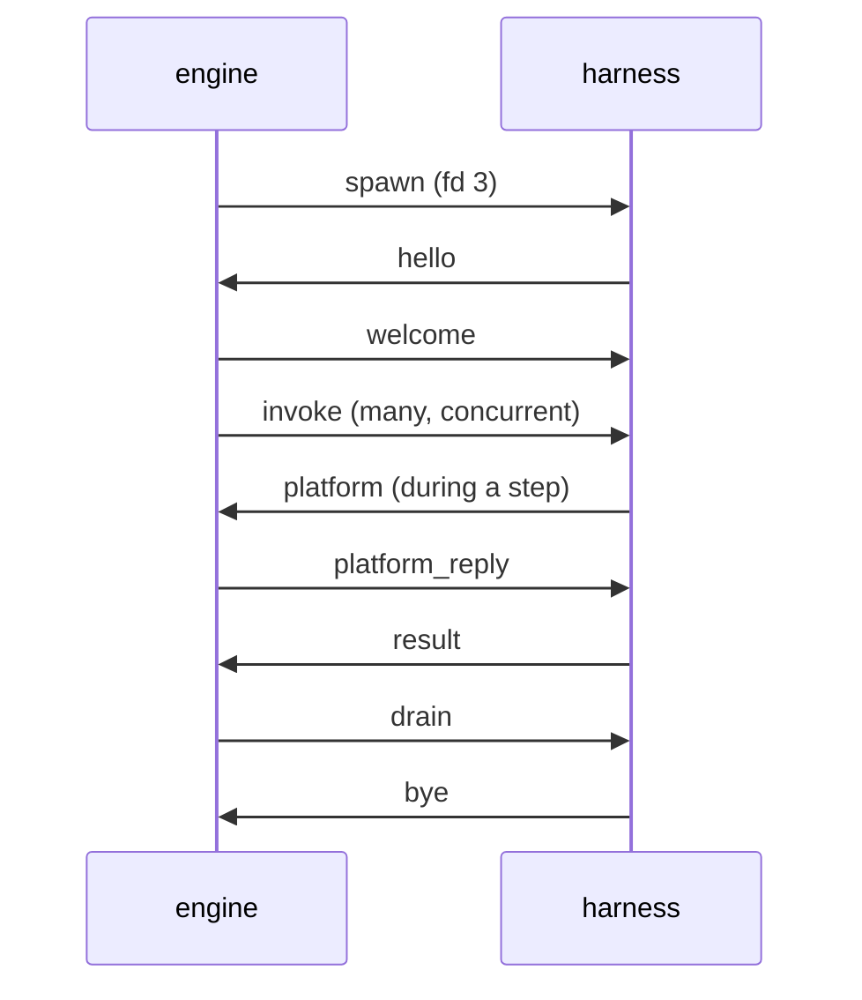

# 0004 · Harness protocol

**Status:** proposed · **Topic:** the transport between the Go engine and a
language harness, the message shapes, process lifecycle, pooling, parallel
loops, and how cancellation and deadlines reach every step and wait.

## Context

[0003](0003-semantics-placement.md) makes the harness a step runner that the
engine drives once per step. The harness must reproduce what one Windmill
job sees ([WR-1](../semantics/languages.md#wr-1) to
[WR-22](../semantics/languages.md#wr-22),
[WR-37](../semantics/languages.md#wr-37)) while many invocations share one
warm process. The `WM_*` environment and platform-call attribution are
process-global in Bun and must be made per-invocation
([WA-31](../semantics/client-api.md#wa-31)); in a shared process, log output
must be attributed per invocation too, because an escaped failure's error
quotes the step's last log lines ([WR-20](../semantics/languages.md#wr-20)). Windmill kills a step's
process on timeout and cancellation; a warm process cannot be killed for one
step without failing the others.

## Options considered

- **Transport.** stdio is unusable for messages because user code prints to
  stdout, which Windmill merges into logs ([WR-23](../semantics/languages.md#wr-23)).
  gRPC adds an HTTP/2 stack to Bun and buys nothing: payloads are JSON text
  either way. A Unix socket or a socketpair with length-prefixed frames
  measured 12.5 µs p50 for a small step and 18.4 µs for 3 KB
  ([0003](0003-semantics-placement.md)). TCP loopback adds a port and an
  authentication problem.
- **Encoding.** Protobuf would wrap JSON values in bytes fields and add a
  code generator to the harness. JSON envelopes with the values embedded raw
  let Go pass values through without decoding them.

## Decision

### Transport and framing

1. The engine starts a harness with a **socketpair**; the child gets its end
   as file descriptor 3. stdin is `/dev/null`; stdout and stderr are kept
   for diagnostics that no invocation owns.
2. A **frame** is a 4-byte big-endian length followed by that many bytes of
   UTF-8 JSON: one object with a `t` (type) field. Values that are JSON in
   the semantics (arguments, results, errors, platform bodies) are embedded
   as raw JSON text and never re-encoded by Go. Envelopes are written
   **canonically**: `t` first, then the fields in the order of the table
   below, strings escaped exactly as JavaScript's `JSON.stringify` escapes
   them, integers in decimal; readers accept any order. Go and every harness
   therefore write the same bytes for the same message, which the shared
   golden frames in `conformance/protocol/` check on both sides. Readers
   also decode alike: keys match exactly, only the fields of the message's
   own type are read, a null field counts as absent (except a raw value,
   which may be JSON null), and an integer field holds a number with an
   integral value within ±(2^53−1), however it is spelled.
3. A message larger than 1 MiB is sent as a sequence of `part` frames of at
   most 1 MiB each, so `cancel`, `platform_reply` and other small frames are
   not stuck behind a large result. The largest message accepted is 512 MiB,
   above Windmill's 500 MB default result limit
   ([WR-15](../semantics/languages.md#wr-15)); hosts may lower it, and the
   engine passes the limit in the welcome.
   - A part's `chunk` is the padded standard base64 of a piece of the
     message's payload bytes; its `id` names the **part stream**, unique per
     sender among its streams, so that streams and whole frames interleave.
     Pieces come in order from `seq` 0, and the one with `last` completes the
     message, which is never itself a part.
   - A sender queues whole frames ahead of part frames and gives its part
     streams turns, one part frame each, so a small frame waits behind at
     most one part frame.
   - Messages about one invocation (`invoke`, `cancel`, `result`, `late`,
     `log`, `warning`, and a `platform` call, about the invocation its `inv`
     names) keep their order: one queued while a part stream about the same
     invocation is open waits for that stream's last part. A `cancel` never
     reaches a harness before the large `invoke` it cancels, a `late`
     frame never reaches the engine before the large `result` it follows,
     and a `result` never reaches it before a large platform call its
     invocation made first.
   - A frame over 1 MiB, a part stream out of order and a message over the
     limit are protocol errors, as is any frame that does not decode. A
     protocol error ends the connection; the engine then kills the harness,
     and its in-flight invocations fail as escaped.
4. Every request carries an `id` unique per sender; replies echo it.
   Invocations, platform calls and host calls are multiplexed on one socket.

### Messages

| `t` | Direction | Fields | Purpose |
|---|---|---|---|
| `hello` | harness → engine | `proto`, `harness` (kind, version), `runtime` (for Bun, `Bun.version`), `caps` (`fetch`, `native`, `fresh`, `host`), `bundle` (digest of what it loaded), `pid` (its process id), `workdir` (host mode: the host's working directory, host mode item 7), `plugin` (raw: the declaration of the host plugin it loaded, §Host plugins) | handshake |
| `welcome` | engine → harness | `proto`, `engine`, `bundle`, `config` (module-state mode, `heartbeat_ms`, `max_message`; facade origin and log limits with the milestones that use them) or `reject` (`code`, `message`) | handshake result |
| `invoke` | engine → harness | `id`, `run`, `site` (typed path, [0011](0011-differential-testing.md)), `script` (inventory id), `entry` (a validated export name, below), `args` (raw JSON object), `env` (the invocation's `WM_*` and other job variables), `boundary` (`bun` or `native`), `around` (the host plugin's around wrappers for its site, by index, §Host plugins) | run one step |
| `result` | harness → engine | `id`, `outcome` (`ok`, `error`, `escaped`, `empty`), `body` (raw JSON: the serialised result, or the error object), `origin` (`harness`, for an `error` whose object the harness generated in place of the worker's; absent for the step code's own), `tail` and `exit_code` (for `escaped`: the last log text, and the exit code the job's process would have had), `settled` (false when the outcome was fixed while the entrypoint call goes on: an intercepted `process.exit`, D11, or an attributed process-level error, item 2 of the failure model below) | step outcome |
| `late` | harness → engine | `id`, `kind` (`result`, `error`, `log`), `body`, `settled` (true on the one late result or error that says how an entrypoint call ended after it was abandoned or after its outcome was fixed early) | something an already settled or abandoned invocation produced (D9) |
| `cancel` | engine → harness | `id`, `reason` (`timeout`, `canceled`, `run_ended`) | abandon one invocation, and kill its child processes (failure model item 7) |
| `child` | harness → engine | `id` (the invocation), `pid` (from 2 to 2^31 − 1, so that a negated kill target never narrows to `0`, `-1` or another pid), `token` (the group's guardian's, when it has one: letters, digits and dashes, at most 64) | a child process the invocation started in a warm or host process, the leader of a process group of its own, written before the step's code goes on, on the socket of a spawned harness or on a host's child channel (fd 4); the engine kills the group when the invocation is abandoned and when the process ends (failure model item 7) |
| `log` | harness → engine | `id`, `lines` | attributed output, batched |
| `warning` | harness → engine | `id`, `code` (`unattributed_error`, `left_behind`, `native_untracked`; `plugin_error` and `latch`, which latch the run, §Host plugins), `message`, `left` (for `left_behind`: an object of counts by kind), `untracked` (for `native_untracked`: an object of counts by kind) | a process-level error no invocation's context raised, sent to each invocation in flight when it happened (failure model item 3); what an invocation still had when it settled, sent just before the frame that settles it (item 4); or what the native boundary handed a native invocation but does not track, sent just before that frame too (D5 in [0001](0001-equivalence-contract.md)) |
| `platform` | harness → engine | `id`, `inv` (invocation id), `method`, `url`, `headers`, `body` | an intercepted `fetch` to the platform facade ([0007](0007-platform-interface.md)) |
| `platform_reply` | engine → harness | `id`, `status`, `headers`, `body` | its answer |
| `host_call` / `host_reply` | engine → harness / back | `host_call`: `id`, `hook`, `run`, `site` (`""` for a hook of the run as a whole), `payload` (raw object); `host_reply`: `id`, then `payload` (raw object) or `error` (`code`: `plugin_error` or `unknown_hook`, `message`) | a host plugin hook ([0008](0008-host-hooks.md), §Host plugins) |
| `run` / `run_done` / `run_cancel` | harness → engine / back / harness → engine | the JSON mapping of the `Run` request, `Run` response and `Cancel` request messages of `runner.proto` ([0009](0009-host-adapters.md)): `run` has `id`, `kind`, `path`, `args` and `intercept`, then the run's budgets and latches (§Host plugins): `write_capable` (raw, an array of selectors), `fatal_error_names`, `deadline_ms`, `pre_write_deadline_ms` and `clock` (`real` or `record`); `run_done` has `id`, then `status`, `result`, `may_have_mutated` and `warnings` (raw, an array of `code` and `message`), `latched` (a latched run's error), `deviations` (the run-time deviations of its trace), or for a run the engine did not start `error` (`code`: `draining` or `refused`, `message`) | host mode: a harness that is also the host submits runs |
| `run_settled` | engine → harness | `id` | host mode: one of the host's runs has settled, after its `run_done` (host mode item 5) |
| `ping` / `pong` | either way | `id`; from a harness also `in_flight`, `abandoned`, `errors` (process-level errors no invocation owned), `lag_ms` (event-loop lag), `rss` | health; a harness also pings on its own every `heartbeat_ms` |
| `part` | either way | `id`, `seq`, `last`, `chunk` | one piece of a message over 1 MiB |
| `drain` / `bye` | engine → harness / back; in host mode harness → engine / back | — | orderly shutdown; in host mode the host's drain (host mode item 3) |

**Entrypoints.** `entry` is `main`, `preprocessor` (the flow preprocessor
step), or the value of `_ENTRYPOINT_OVERRIDE` when the arguments carry one
([WR-12](../semantics/languages.md#wr-12)). The two checks happen where
Windmill makes them:

1. **The name**, in the engine, before any invocation: a name that does not
   match `^[A-Za-z_][A-Za-z0-9_]*$` fails the step with Windmill's
   `Invalid entrypoint override …` text, before any wrapper runs.
2. **The export**, in the harness, after the script's module has loaded, as
   the wrapper does after its import: top-level code, import failures and
   their logs come first; then an export that is missing or not a function
   fails the step with `<name> function is missing` (`main function is
   missing` for `main`, `preprocessor function is missing` for the
   preprocessor), in the wrapper-catch shape.

An export whose recorded signature did not parse (a rest parameter,
[WR-7](../semantics/languages.md#wr-7)) fails the step before its module
loads, as Windmill's worker fails the job before its process starts, with
[WR-37](../semantics/languages.md#wr-37)'s object
(`{"message":"execution error:\n<parse error>","name":"ExecutionErr","step_id":…}`),
reported as an `error` outcome.

The harness binds arguments with the signature the manifest records for that
export ([0002](0002-ir-and-loader.md)), hydrates its `Date` parameters, and
applies the [WR-V1](../semantics/languages.md#wr-v1) fallback when an
override is present and the parsed parameter list is empty, which includes
arrow-function exports, since the parser does not recognise them. Cases: a
script that is not workflow-as-code exports `alternate(when: Date)`, and a
step whose arguments carry `_ENTRYPOINT_OVERRIDE: "alternate"` receives a
hydrated `Date`; an arrow `preprocessor` receives the flow input's
non-underscore values (WR-12/b).

The engine maps a `result` to Windmill's stored value with the rules of
[WR-21](../semantics/languages.md#wr-21) and [WR-V5](../semantics/languages.md#wr-v5)
(a pre-shaped `ManualFailure` stays as is, everything else is wrapped as
`{"error": …}`, non-JSON text becomes `Non serializable error: <text>`):

| `outcome` | Harness saw | Stored error |
|---|---|---|
| `ok` | the entrypoint returned | none; the result text is `body` |
| `error` | the wrapper caught a throw, or the harness failed the step as the worker would before running it | `body` is the [WR-18](../semantics/languages.md#wr-18) object (Bun), or the native boundary's error object (D5); with `origin` `harness` it is an error the harness generated: [WR-37](../semantics/languages.md#wr-37)'s signature error, or a native job's transpile or load failure or `//proxy` refusal, an `execution error:` of [WR-43](../semantics/languages.md#wr-43) |
| `escaped` | `throw null`/`undefined`, a module evaluation or import failure, a failing error handler, a non-zero `process.exit`, or an attributed process-level error (below) | [WR-20](../semantics/languages.md#wr-20): `ExecutionErr`, `exit code for "bun run": <code>, last log lines:\n<tail>`, with `exit_code` |
| `empty` | `process.exit(0)`, or no result | [WR-V2](../semantics/languages.md#wr-v2): `InternalErr` without `step_id` |

A harness process that dies fails its in-flight invocations as `escaped`
with its real exit code, or as `process terminated by signal: …`
([WR-4](../semantics/languages.md#wr-4)). For the escaped cases the reference
predicts exit code 1 but has not recorded Bun 1.3.10's exit status for
`throw null`, top-level throws and unhandled rejections
([Q-WR-2](../semantics/languages.md#q-wr-2)); the harness reports exit code 1
until that is recorded.

### The shared-process failure model

A warm process runs many invocations at once, so anything that would end a
Windmill job's process must instead end only that invocation. Measured on
Bun 1.3.10 and 1.4.2 (prototype outside the repository): without handlers,
one detached `Promise.reject` exits the process with code 1 and a concurrent
200 ms timer never fires; with handlers the process survives. Inside the
handlers, a throw from a timer sees the throwing invocation's
`AsyncLocalStorage` store, but an unhandled rejection and a throw from a
microtask see none.

1. **Handlers.** Before any step module loads, the harness installs
   `uncaughtException` and `unhandledRejection` handlers that never exit.
2. **Attribution.** An error whose context names an invocation is
   attributed to it. If that invocation is still in flight, it fails as
   `escaped` with exit code 1 and its log tail, which is what the process
   exit would have done to that job on Windmill. Its entrypoint call may
   still be pending (the error came from a timer while the call awaits
   something else), so that `result` frame has `settled` false, and the
   call settles when it ends or its process does. If the invocation's
   outcome is already fixed, the error is reported as a `late` frame and
   recorded in the run trace; the outcome stands (D9).
3. **Unattributable errors** (rejections, microtask throws) fail no
   invocation, because the harness cannot know whose they are and never
   guesses. Each is counted in `pong`, logged with its text and stack, and
   attached as a warning to every run that had an invocation in flight in
   that process at that moment (D9), as a `warning` frame for each
   invocation then in flight.
4. **Work after the result.** Windmill cuts it off at `process.exit`
   ([WR-2](../semantics/languages.md#wr-2)). A warm process cannot exit,
   so it fences each invocation when the invocation settles (D9):
   - Its pending `setTimeout`, `setInterval` and `setImmediate` handles,
     on `globalThis` and on `node:timers`, are cleared. A timeout that
     fired and was re-armed with `refresh()` is pending again, and still
     the invocation's.
   - Its requests in flight through the `fetch` view are aborted with an
     `AbortError`. A request is in flight until there is positive evidence
     that its body's transfer has ended, since the body may still be
     arriving after the headers. The one evidence is a reading method
     (`text`, `json` and the rest) of the response, or of a clone made
     while the body was unused, that consumed the body (it was unused when
     called) and fulfilled: such a read fulfils only once the source has
     reached its end. No stream, reader or pipe event, no rejection and no
     cancellation counts, since each can come from one consumer while the
     source still feeds another. A body read any other way, whose read
     fails, or that is never read, stays counted until settlement: the
     count may be too high, never too low, and settlement's abort changes
     nothing for a body that has arrived. The step gets Bun's own
     response; only its reading methods and `clone` are own properties
     calling the native ones, so its body, stream, readers and pipes, and
     their locking, `bodyUsed`, `clone`, `tee` and validation, are Bun's.
     A response with no body (a 204, 205 or 304, or the answer to `HEAD`)
     ends it at once.
   - Its later log writes are dropped, and its later platform calls are
     refused with a `TypeError`.
   - Its child processes still running in a warm or host process, each the
     leader of a process group of its own that stands for the job's group
     (item 7), are killed with their groups by the engine, which owns
     them, when it handles the frame that settles the invocation, together
     with whatever they started there, even after the child itself exited
     ([WR-55](../semantics/languages.md#wr-55)).
   - A handle that its queued code creates after settlement is cleared at
     once, and a child it starts then is announced and killed by the
     engine at once.

   Just before the frame that settles the invocation, a `warning` with
   code `left_behind` reports what the fence is about to revoke. Its
   `left` field counts each kind: `timeout`, `interval`, `immediate`,
   `fetch`, `child` for a child's process group that still has a process
   in it, and `detached` for a child the step itself started in a session
   of its own that still runs, which is left to run, as it is on Windmill,
   outside the job's group. The warning is sent in `fresh` mode too, where
   the exit then cuts the work off and the engine waits for the job's
   group (item 8), so a script that leaves work behind is flagged in both
   modes. The counts come from the invocation's own registry, since Bun
   1.3.10's `process._getActiveHandles()` lists nothing.

   Killing a `child` at settlement is windmill-lite's reading. On
   Windmill a process left in the job's group after the script returns
   holds the job open until it exits (WR-55): the result is not stored
   and the flow does not move on. A warm process cannot wait for it
   without letting the step's code run after it settles, which the fence
   exists to prevent, so it reports the child and kills it; `fresh` mode
   waits as Windmill does. This is an open question to the semantics team
   ([README](README.md)).

   The fence does not reach:
   - promise continuations already queued, `Bun.sleep` and
     `node:timers/promises` waits included (what they do through the
     fenced channels is refused);
   - sockets and clients the step opened itself, and shared objects;
   - a child the step started detached, in a session of its own, and
     processes `Bun.$` starts, which the harness does not wrap;
   - what a synchronous child call left running after its child exited,
     which stays in the harness's group until the process ends (item 7);
   - CPU work.

   Their errors are reported as `late` (D9). Work started in a process
   scope, or while a step module evaluates (item 2 of the lifecycle),
   belongs to no invocation and is never fenced.
5. **Working directory.** Each harness process the engine spawns gets one
   private directory, created at spawn, as its working directory for all
   invocations ([WR-1](../semantics/languages.md#wr-1) gives each job its
   own; D10). In host mode the SDK does not change the host's working
   directory: the host passes a writable directory to the SDK and must have
   made it its working directory before connecting; the SDK checks both and
   refuses to connect with `workdir_not_writable` or `workdir_mismatch`,
   and the engine checks them again (host mode item 7).
   Codebase assets are extracted into it before the first invocation
   ([0002](0002-ir-and-loader.md)).
6. **`process.exit`** is replaced per invocation. The call fixes the
   invocation's outcome (`empty` for code 0 with no result written,
   `escaped` otherwise) and throws a sentinel. `finally` blocks run and a
   `catch` can swallow the sentinel and keep going; whatever the code does
   afterwards is reported as `late` (D11).
7. **Child processes and other output paths.** The harness wraps
   `child_process.spawn`, `exec`, `execFile` and `fork` (and the sync
   forms) and `Bun.spawn`/`Bun.spawnSync`, so that a child started without
   an explicit environment receives the invocation's view, not the process
   environment. On Bun 1.3.10, `spawnSync`, `execSync` and `Bun.spawn`
   would otherwise pass the process's own environment, since they read
   neither `process.env` nor its view. Output written through
   `Bun.stdout`, a raw file descriptor or a child's inherited stdio is not
   attributed: it reaches the process log, not the invocation's log tail.
   The wrappers, like the timer fence's, replace the functions on the
   builtins' CommonJS objects before any step module loads. On Bun 1.3.10
   the first named import of a builtin fixes its named bindings for every
   later importer, so the host SDK reaches `node:child_process` through
   `require`. A host whose own modules import `node:child_process` or
   `node:timers` by name before it connects leaves steps' named imports of
   them unwrapped; default imports and `require` always see the wrappers.

   **Process groups** ([WR-55](../semantics/languages.md#wr-55)). Each
   Windmill job leads its own process group, which the children it starts
   join unless they start a session of their own; a timeout or a
   cancellation kills the group, and a normal exit kills nothing. A `fresh`
   process is its job's process and leads such a group (item 8). In a warm
   or host process the steps share the harness's group, so a child an
   invocation starts leads a group of its own instead, which stands for the
   job's: the wrapper starts it detached and registers it as `child`, its
   group being what is alive and what is killed, so a child's own children
   are reached after it has exited. On Bun 1.3.10 every `node:child_process`
   function starts its child through `Bun.spawn` (the asynchronous ones) or
   `Bun.spawnSync` (the sync ones), once each, and passes `detached` on
   only from `spawn` and `fork`, the functions that honour a step's own
   `detached`; `exec`, `execFile` and the sync forms ignore it, so their
   children are in the job's group on Windmill. The wrapper of `Bun.spawn`
   therefore registers every asynchronous child, once, and gives each its
   group. A child the step started detached where Bun honours it registers
   as `detached` and is never killed.

   A group's id is reused by the kernel once the group has ended, so the
   id alone does not name the group. The wrapper starts each grouped child
   through a `/bin/sh -c` prologue: the shell, the group's leader, runs a
   subshell that starts a guardian in the background, in the group, and
   exits; the shell reaps the subshell and then execs the step's command,
   which keeps the shell's pid, its stdio and its place, so `child.pid`,
   the child's streams and its exit status are the command's. The
   guardian's parent is gone before the command starts, so it is no child
   of the command, and a command that waits for all its children
   (`wait()`, `waitpid(-1)`) does not wait for it. The guardian closes
   descriptors 0 to 9, the ones a spawn's stdio and IPC pipes take (dash,
   Linux's `/bin/sh`, names none above 9), so it holds none of the
   child's pipes,
   and sleeps for `999999999.<token>` seconds, with a random token the
   `child` frame carries. While it lives, the kernel cannot give the
   group's id to another process. A command that cannot be run as given
   (no executable at that path, or none PATH finds), or a spawn with an
   `argv0` of its own, is started without a guardian, so it fails or runs
   exactly as Bun runs it.

   The engine owns those groups, since the harness's event loop, which the
   step can block, cannot be relied on to kill them. Before the step's
   code goes on, the harness announces each group in a `child` frame,
   written synchronously: through a spawned harness's socket descriptor,
   after what its socket already took (a Bun socket keeps no buffer of its
   own), and by a host on a channel of its own, the engine's fd 4, since a
   host's socket may hold bytes it has not written yet, which a
   synchronous write would overtake, and a step can back that socket up
   and then block the loop. The engine alone signals those groups; the
   harness only counts them for the `left_behind` warning, a guarded child
   while its own process runs. The engine holds each group with the
   members it last saw in it, pid and start time, and finds the guardian
   among them by the token in its arguments: its `sleep` operand, or,
   from its fork until its exec, a word of the prologue's script, which
   it carries as a copy of the shell; the group's leader carries the
   script too until it execs the step's command, so only the operand
   makes the leader a guardian. So a step's command that exits at once
   cannot leave the engine a group in which it knows no process. A look
   that finds neither the guardian nor a member it saw before, while a
   member other than the leader runs and reads no arguments, as in the
   middle of an exec, is undecided: the group is kept as it was and
   looked at again, and a kill looks again for up to 200 ms before it
   gives the group up. It signals a group only while
   it is the original: while the guardian is among its members, or, for a
   group without one, while a member it saw before is still there, the
   same process, since a group's id is not given to a new process while
   the group has a member. A group that took the id after the original
   ended has no process with the token and shares no member with it, so
   it is never signalled; the only instant left open is between a look at
   the members and the signal that follows it. A group without a guardian
   whose members all came and went between two looks (every 50 ms in its
   first second, every 250 ms after) is given up and left running, rather
   than risk another owner's processes. When only its guardian is left,
   the engine kills the guardian and forgets the group. Every kill of a
   group, the release's included, looks at its members afresh under the
   group's own lock and ends the group for good, so a group is killed
   once, by whichever path comes first, and no path signals its id from
   a look that another path's kill made out of date. The guardian is an
   orphan from its start, adopted by PID 1 or the nearest subreaper,
   which is the engine when it runs as PID 1 of a container without an
   init, or as a subreaper; so is what a member leaves when it exits. The
   engine reaps those it is the parent of, or each would stay a zombie
   until the engine exits: what it kills, after the kill and after the
   harness process has gone too, and a descendant that exits while its
   group still runs. It waits for each by its own pid, without blocking,
   only while the pid is still the process it saw in the group (the same
   start time) and only when it is that process's parent, so no wait
   takes the exit status of another of its children, an `exec.Cmd`'s
   included. The engine
   kills an invocation's announced groups when it abandons the invocation
   (its timeout or cancellation), at its settlement, when the process
   ends, a watchdog's kill included, and at once for a group announced
   after any of these. Every process the engine spawns leads a
   process group of its own, which its kill and its end reach. A
   synchronous call's child gets no group of its own, because its pid is
   known only once it has exited, too late to announce: it stays in the
   harness's group, which the end of the process kills, so a call that
   blocks the event loop past the watchdog ends with the process. What a
   synchronous child leaves running after it exits stays in that group
   too, unattributed, and runs until the process ends. The call itself
   goes on after a timeout (D2). windmill-lite has no log limit, the third
   kill trigger WR-55 names.
8. **`fresh` mode** restores Windmill's behaviour for all of the above:
   - **One process per invocation**, in its own working directory. The
     engine starts the process for the invocation, and the process offers
     the `fresh` capability and refuses a second `invoke`.
   - **Exit after the result.** The process exits as soon as its result
     frame has been written to the socket, however large, as the wrapper
     exits after writing `result.json`.
   - **No handlers, no interception.** An uncaught error or an unhandled
     rejection ends it with exit code 1, and `process.exit` ends it with
     its code, at the call: the harness writes the invocation's log, and
     whatever else it had queued, straight to its socket, waiting for the
     socket if it is full, and then exits, so no `catch` or `finally`
     block of the step runs. An exit 0 before any result is
     [WR-V2](../semantics/languages.md#wr-v2)'s empty result.
   - **Killed, not abandoned.** The engine kills it on timeout or
     cancellation, so the invocation settles with the process and reports
     nothing late.
   - **Its own process group** ([WR-55](../semantics/languages.md#wr-55)).
     The engine spawns it as the leader of a process group, which the
     step's children join, and its kill reaches the whole group. A settled
     result is held until the process has exited and no process is left in
     its group, so a background child holds the job open as on Windmill.
     The result is released only when the group empties by itself: a
     timeout or a cancellation meanwhile kills the group and ends the step
     with its error, and any other kill (the engine's, a pool's close at
     its deadline) or a failed connection fails it as killed by `SIGKILL`,
     settled with the process, although the script returned. A child that
     started a session of its own is not waited for. The engine is not the
     orphans' parent, so it watches the group with signal 0, and reaps
     them when it is their parent (PID 1 of a container, or a subreaper),
     as Windmill's worker does: each by its own pid, never by the group's
     id, which another process of the engine's may hold by then.
   - **No watchdog.**

   See [0006](0006-module-state.md).

Each of D9, D10 and D11 has a case that runs in `warm` and in `fresh` and
expects the two to differ as stated.

**Settlement.** An invocation settles when its entrypoint call can run no
more code. The harness reports it on exactly one frame: the `result` frame,
normally, or else the `late` frame that says how the call ended after it was
abandoned or after its outcome was fixed early (an intercepted
`process.exit`, D11, or an attributed error, item 2 above), each with
`settled` set. An invocation that never
reached a harness settles at once, and one whose process ends first settles
with the process. Work the call left running (D9) is not part of
settlement. The engine releases the resources that step code can reach when
a run's invocations have all settled (`onRunSettled`, host mode item 5
below), so a late error from detached work, or the engine giving up on a
step, never releases them.

### Per-invocation identity, logs and environment

- The harness runs each invocation inside an `AsyncLocalStorage` context
  holding its `env`, its abort signal and its log buffer.
- `process.env` is replaced by a view that answers from the current
  invocation first; bundles rewrite `Bun.env` and `import.meta.env` to
  `process.env` at build time ([WA-31](../semantics/client-api.md#wa-31)).
  This mechanism is gated: the walking skeleton (milestone W1) runs the
  16-way isolation test of [Q-WA-4](../semantics/client-api.md#q-wa-4) on the
  pinned Bun before anything depends on it. On Bun 1.3.10 it passed 16 of
  16 on every channel. The view also reaches `Bun.env` and
  `import.meta.env` at run time: their object, which assigning
  `process.env` leaves in place, takes a prototype that answers from the
  current invocation, and a variable the process already has becomes an
  accessor. Code the build does not rewrite, such as an unbundled
  dependency or a host's own module, is therefore covered too; the build's
  define rewrite ([0010](0010-packaging.md)) stays.
- `console.*`, `process.stdout.write` and `process.stderr.write` are
  attributed to the current invocation. A console call is formatted by a
  Console of the invocation's own (Node's, without colours), so its
  counters, timers and groups are its own. Lines are merged, empty lines
  dropped ([WR-23](../semantics/languages.md#wr-23)), batched into `log`
  frames that go out before any other frame about the invocation, and the
  last 600 characters are kept for the WR-20 tail. An escaped outcome's
  tail is the invocation's log, ending with the error the process would
  have printed on its way out. Once the invocation has settled, its writes
  are dropped (failure model item 4). Outside every invocation, writes
  reach the process's own streams, as do the harness's diagnostics.
- `globalThis.fetch` is wrapped before any plugin or step module loads.
  Requests to the facade origin become `platform` frames attributed to the
  invocation; one made after the invocation settled is refused. Every other
  request passes through, with a signal of the fence's added to its own, so
  that the invocation's settlement aborts it. Host plugins that wrap
  `fetch` themselves wrap this one, so facade requests pass through the
  plugin's wrapper first and must be passed on.
- **Platform transports.** In `warm` and host-mode processes, `fetch` is the
  only way to reach the platform. The facade origin in `BASE_URL` is a
  loopback port that the engine binds but never listens on, so any other
  transport (`node:http`, a raw socket) gets "connection refused". Nothing
  records the refusal: the kernel refuses the connection before any
  windmill-lite code sees it, and the step sees only the error its client
  library raises (which a script may catch and ignore). The stock
  client cannot carry an invocation's identity over such a transport,
  because it captures its token at import
  ([WA-1](../semantics/client-api.md#wa-1), [WA-31](../semantics/client-api.md#wa-31)).
  In `fresh` mode the port does listen, because the process is the
  invocation ([0007](0007-platform-interface.md)). Each process receives its
  own `BASE_URL` at spawn, so a host that runs some scripts `fresh` and the
  rest `warm` gives the two kinds of process different facade origins: the
  listening one for `fresh` processes, the non-listening one for warm ones.
- The base environment of the process follows [WR-22](../semantics/languages.md#wr-22)
  and [WA-2](../semantics/client-api.md#wa-2): `PATH`, `HOME`, `TZ`,
  `FORCE_COLOR=1`, `DO_NOT_TRACK=1`, `BUN_INSTALL_CACHE_DIR` (the engine's
  `WINDMILL_DIR`, or `/tmp/windmill`, then `/cache_nomount/bun`),
  `BUN_RUNTIME_TRANSPILER_CACHE_PATH=0`, `NODE_PATH` when the engine has one,
  as the worker copies its own, and `BASE_URL` pointing at the facade origin on `127.0.0.1` (Windmill's
  value is its internal URL with `localhost` replaced by `127.0.0.1`).
  `BASE_INTERNAL_URL` is not set for Bun, as in Windmill. Both are set before
  any step module loads, because the client captures its base URL at import
  ([WA-1](../semantics/client-api.md#wa-1)).

### Lifecycle

1. **Handshake.** The engine rejects a harness whose protocol version,
   runtime pin or bundle digest differs from the bundle manifest
   ([0010](0010-packaging.md)).
2. **Loading.** In `warm` mode a script's module is evaluated on its first
   invocation, inside that invocation's context, so top-level code sees a
   job environment as it would in Windmill
   ([WR-2](../semantics/languages.md#wr-2)). Its logs are that invocation's
   too, and a throw fails it. What the evaluation starts (timers,
   requests, children) is the module's, not the invocation's: it is not
   fenced or reported when the invocation settles. Module state outlives
   invocations in `warm` mode (D1), and a client a module makes at load
   keeps its maintenance timers that way. Once the loading invocation has
   settled, what that work writes goes to the process's own streams and it
   cannot reach the platform, as with work in a process scope; its errors
   are still attributed to the loading invocation, as `late`. Host-provided modules are
   registered before that ([0010](0010-packaging.md)). A host may ask for
   eager loading to move the cost off the first run.
   [0006](0006-module-state.md) covers the modes.
3. **Serving.** A process serves any number of concurrent invocations,
   unless the host sets a cap (below).
4. **Drain.** The engine stops routing new invocations, waits for in-flight
   ones, sends `drain`, and the harness exits after `bye`.

### Pooling (processes the engine spawns)

A pool is keyed by **(harness class, runtime pin, dependency set,
module-state mode)** ([0002](0002-ir-and-loader.md)). All bundled Bun scripts
share one dependency set, so a Bun-only bundle normally needs one pool.

- Default size is one process per pool: Bun steps are mostly asynchronous
  I/O and run concurrently on one event loop. A host can set a minimum and a
  maximum.
- **No in-flight cap by default.** The reference for parallel containers is
  a Windmill with enough workers ([0001](0001-equivalence-contract.md) §1),
  and any cap changes outcomes, not only timing: children that wait on each
  other, or parents that wait on runs they dispatched locally, never finish
  if the cap keeps their partners from starting. A host may still set a cap
  per process, in spawned processes and in host mode alike; it is deviation
  D15, recorded in the run trace. Abandoned invocations never count toward
  it. Cases (`policy`, windmill-lite only, because the reference behaviour
  is the contract's enough-workers assumption): three parallel children
  that wait on one barrier, and three parents that each dispatch a run
  locally and wait for it, both completing with no cap and both timing out
  at the step timeout with a cap of 2.
- Routing prefers the run's process (affinity), then the least-loaded one.
  When the event loop of a process lags past a threshold (a CPU-bound step),
  the pool starts another process, up to the maximum.
- Processes that are tainted or being recycled (§Cancellation and deadlines
  item 4) do not count toward the maximum: they are leaving the pool, and a
  replacement takes the new invocations, so one abandoned step does not
  stall a pool of one. A tainted process whose abandoned invocations settle
  returns to service only if the pool is below its maximum without it,
  counting processes still starting; otherwise it takes no new invocations
  and leaves once idle. A cap (D15) counts an invocation until its outcome
  is fixed, not until its Reporter has heard of it.

### Host mode

In host mode ([0009](0009-host-adapters.md)) the only process that can run a
host's steps is the host itself, because the host's scopes live there
([0008](0008-host-hooks.md) H11). The rules for spawned processes therefore
change:

1. **No taint, no recycle.** The engine never stops routing to the host
   process (D2). An abandoned invocation keeps running until it settles.
2. **Reporting.** Abandoned invocations are counted in `pong`, flagged
   `abandoned` on their module in the run trace, and exposed to the host
   through the SDK's `health()`, with the age of the oldest one.
3. **Draining.** The SDK's `drain(timeout)` refuses new runs (`run` frames
   are answered `draining`), waits for in-flight runs up to `timeout`, and
   then lets the host exit. Runs still in flight at the deadline end with the
   host; their callers get whatever the host's own transport gives on exit.
   A host drains when it decides it is unhealthy but still responsive, for
   example after too many abandoned invocations. On the wire the host sends
   `drain`: from then on the engine answers each `run` with a `run_done`
   whose `error` is `draining`, and once the runs in flight have ended it
   answers `bye`; the SDK also refuses new runs itself. Neither overtakes
   the run messages it closes: `drain` goes out only after every `run` the
   host sent before it has gone out whole, and `bye` only after every
   `run_done` queued before it has, however large, while unrelated small
   frames keep their priority. So a host that exits once `drain(timeout)`
   resolves has the outcome of every run the engine took, unless the
   timeout came first. Recycle triggers
   that the host sets (resident memory over a threshold on consecutive
   heartbeats, more script modules loaded than a cap, more pooled entries
   retired and not released than a cap, which the host's pooled-connection
   layer counts) are reported through `health()` for the host to act on;
   the SDK never drains on its own.
4. **The watchdog.** A host whose event loop is blocked (a step spinning in
   a synchronous loop) cannot answer anything, including its own health
   checks, so recovery cannot depend on it. The engine is a separate process
   and keeps running: when the host misses pings for `watchdog.killAfter`
   (default 30 s, set by the host when it connects; `0` disables it), the
   engine writes a diagnostic line to its own stderr naming the host's
   in-flight runs, sends `SIGKILL` to the host process (whose pid it learned
   in the handshake) and exits. It reports no run outcomes: the only receiver
   of those was the host. A step that blocks the event loop for longer than
   `killAfter`, even one that would have finished, therefore ends the host
   and every run in it (D2); a host that runs long synchronous steps raises
   or disables the threshold. The only thing the
   host's supervisor needs is to restart the host when it exits, which
   supervisors already do. Callers with requests in flight on the killed host
   get the transport error their side gives when a server dies; the next
   generation is admitted when it is up, by the supervisor's own rule.
   **Spawned processes.** A `warm` process the engine spawned is handled the
   same way: after the same silence the engine kills it, fails all its
   in-flight invocations as `escaped` with the signal (co-resident ones
   included, which were already stalled while the event loop was blocked)
   and starts a replacement (D2). A `fresh` process is exempt: it is the
   invocation, so only the step's own `timeout` ends it, with
   [WR-37](../semantics/languages.md#wr-37)'s text, as on Windmill.
   - **Silence** is measured from the frames the engine receives, of any
     type, and a harness sends a `ping` with its health every
     `heartbeat_ms` on its own, so a live harness never looks silent
     because the engine's own writes are stuck behind a large message.
   - **The target.** Before it signals, the engine knows its target is the
     process that speaks the protocol. A spawned harness whose `hello`
     names another pid than the one the engine started (a wrapper that
     forks it) is rejected with `pid_mismatch`, and the signal goes through
     the process handle the engine holds, which cannot reach a reused pid (a
     pidfd on Linux; elsewhere Go does not signal a child it has reaped). In
     host mode, where the engine is the host's child, it checks that the
     host is still its parent (`getppid()` equals the handshake pid); on
     Linux it also opens a pidfd of the host at the handshake, once that
     check holds, and signals through it, so the moment between the check
     and the signal cannot reach a process that took the pid. The parent
     check is the watchdog's: with the watchdog off (`killAfter` 0) the
     engine signals no one, so a host it is not the child of is served
     (`wltest check --mode host` keeps the engine in its own process).
5. **Run resources.** `onRunEnd` fires when a run's outcome is decided;
   `onRunSettled` fires when the run's abandoned invocations have all
   settled, which may be never. A resource that an abandoned invocation may
   still use (a pooled client, a lease) is released only at `onRunSettled` or
   when the process exits, never on a timer, because abandoned code can
   resume at any time and a timer would hand the resource to two users.
   Resources that no step code can reach (host-side bookkeeping) may be
   released at `onRunEnd`. A host-mode run's outcome is its `run_done`; when
   it has settled, the engine sends `run_settled` after it, which the SDK
   reports to the run's `onSettled`, in the scope the run was submitted in
   ([0008](0008-host-hooks.md) H11).
6. **Losing the host.** If the host process exits, its in-flight runs are
   lost with it: their callers are the host's own callers. The engine fails
   them as `harness_lost` and does not try to move them, because their scopes
   existed only in that process.
7. **The working directory** (failure model item 5). The host passes the
   engine the directory it passed the SDK, and its hello names its working
   directory; the engine refuses the host in the handshake with
   `workdir_not_writable` when the directory is not one it (the host's
   child, with its user) can write, and with `workdir_mismatch` when it is
   not the host's working directory once both are resolved without
   symbolic links. So a host that does not use the SDK is held to the same
   rule; both sides run the cases of `conformance/protocol/host`. The
   engine writes each invocation's `args.json` there, as in a warm
   process's own directory (set before the welcome goes out, since the
   host may submit a run as soon as it reads it), and since the host was
   not spawned with the base environment, each invocation carries the
   facade's origin as `BASE_URL`. An engine that cannot serve the host at all (the bundle
   does not open) refuses it in the handshake too, with `engine_refused`
   and its reason.

Measured (prototype outside the repository, Bun 1.4.2): a Bun host that
heartbeats a Go child every 100 ms and then spins forever was killed by the
child 1.04 s after its last heartbeat, with a 1 s threshold; a supervisor
that only restarts on exit then served a new call on the next generation.

Validation (milestones W1 and F3b, with a public test supervisor that only
restarts on exit): two concurrent host-mode runs, one of whose steps never
settles: after that step's timeout, the other run's next step completes, a
new run afterwards succeeds, and health reports one abandoned invocation.
A step that spins forever, with a second run active: the engine kills the
host within `watchdog.killAfter` plus one second, the second run's caller
sees the host's exit, and a run on the restarted host succeeds. A resource
held by an abandoned invocation is not released before `onRunSettled`.

**Case `watchdog/finite-cpu`** (C3b for `fresh` and `warm`, F3b for host
mode): a step computes synchronously for 2 s and returns, with
`watchdog.killAfter` 1 s and a step `timeout` of 10 s.

- **`fresh`:** the step completes with its result; the watchdog does not
  apply.
- **`warm`:** the engine kills the process after about 1 s; the step, and a
  second invocation already in the same process awaiting a timer, fail as
  `escaped` with `process terminated by signal: SIGKILL`; the next
  invocation runs on a replacement process.
- **host mode:** the engine kills the host after about 1 s, and its
  in-flight runs end with it; a run on the restarted host succeeds.
- **With the watchdog disabled** (`killAfter` 0), the step completes in all
  three.

### Host plugins

A host plugin ([0008](0008-host-hooks.md)) is TypeScript the harness runs:
the host's own in host mode, or a module the runtime names, which each
`warm` process the engine spawns loads before its hello. Its hello carries
the plugin's **declaration**: the hooks it answers, each with its
selectors, a static interception with its value. The engine checks the
declaration (selectors well formed and unambiguous, every provider the
host contract names provided) and refuses a harness whose declaration it
cannot use with `plugin_mismatch`; a pool holds its later processes to its
first one's declaration. From the declaration the engine builds the same
hooks a Go host passes, so selectors match in Go only: each call of a
declared hook is a `host_call`, naming the entry it is for by its index,
answered by a `host_reply`.

1. **Answering.** The harness runs the hook outside every invocation, in
   host mode inside the scope the host had when it submitted the run
   (H11). A hook that throws, or answers what the hook does not answer,
   replies `plugin_error`; a hook or entry the plugin does not declare
   replies `unknown_hook`. Either error latches the run (H5), as a Go
   hook's error does.
2. **Waiting.** A `host_call` waits for its reply no longer than the plugin
   timeout (60 s by default; the runtime's option): then the hook fails
   with `host_call_timeout`, which latches the run. When the run's own
   context ends first, the hook returns that cause, which latches nothing.
   A reply that comes after the engine stopped waiting is dropped, however
   many calls ended meanwhile: the engine remembers each such call until
   its reply comes, which the harness sends once the hook has run. One to
   no `host_call`, or a second one to a call, is a protocol error, as is a
   `host_call` from a harness. A hook runs in the run's scope from the
   moment its `host_call` is sent until its reply comes, which may be
   after the engine stopped waiting for it, or until the harness exits:
   the run does not settle, and its resources are not released
   (`run_settled` in host mode), while any of its hooks runs, whatever
   ended the wait, a step that settled meanwhile included. A hook of a run
   that has settled is not called; a hook of the settlement itself
   (`onRunSettled`) holds nothing.
3. **`around`.** The engine names on each `invoke` the plugin's around
   wrappers whose selectors match the invocation's site; the harness runs
   the step inside them, outermost first. A wrapper that throws, or never
   runs the step, is reported in a `warning` with code `plugin_error`,
   ahead of the frame that settles the invocation, and the engine latches
   the run on it. A wrapper's `next()` runs the step only while the
   wrapper runs and the engine waits for the invocation: a first call
   after the wrapper has returned, or after the invocation was abandoned,
   starts nothing and rejects. An invocation with around wrappers never
   reaches a harness without a plugin.
4. **Where.** Every hook call goes to the run's process in a `warm` pool
   (or the least loaded), and to the host in host mode. A `fresh` runtime
   takes no plugin: its processes live for one step. A hook's payload
   carries what a Go hook gets: a record (H6) or trace (H9) has every
   field of the engine's, the arguments before and after H2 and after
   resolution, the carried value, timings, deviations and the platform
   calls of the run's steps included.
5. **The step API.** Step code reaches its run's latch and signal through
   `wl` on `globalThis` (H4, H5), which needs no import, so a script that
   guards it (`globalThis.wl?.latch(e)`) still runs on Windmill.
   `wl.latch(error)` sends a `warning` with code `latch` and the error's
   text (`<name>: <message>` for an Error), after what the step wrote and
   ahead of the frame that settles it, and the engine latches the run on
   it, a script job's too. `wl.signal()` is the invocation's abort signal,
   which aborts with the `cancel`'s reason when the engine abandons the
   step: its timeout, the run's cancellation or deadlines, the run's end.
   Both throw a `TypeError` outside an open invocation; a hook latches by
   throwing, and an `around` wrapper, which runs inside the invocation,
   may call both. A native step's realm (D5) has no `wl`.
6. **A host's budgets.** A host-mode `run` carries what a Go host gives in
   its run options (F2b): the run's own write-capable selectors (H3) and
   fatal error names (H7), ahead of the plugin's; its hard and pre-write
   deadlines (H4), in milliseconds from the engine's receipt; and its
   clock (H10). The hard deadline bounds the run until it has settled, so
   steps a latch or a cancellation left running are abandoned at it.
   `run_done` reports `may_have_mutated` and the trace's `deviations`.

### Parallel loops

The engine owns concurrency. A parallel `forloopflow` or `branchall` starts
child runs as goroutines; `parallelism` releases eligibility in index order
([CF-7](../semantics/control-flow.md#cf-7)); results are collected in index
order whatever the completion order ([CF-4](../semantics/control-flow.md#cf-4)).
Beyond `parallelism`, the only limit is a host-set cap, if any (D15).

### Cancellation and deadlines

1. Every run has a Go context carrying the host's cancellation and
   deadlines ([0008](0008-host-hooks.md)). The engine checks it at every
   module start and completion, every loop iteration and branch launch,
   every `sleep`, every retry delay and every expression evaluation.
   `sleep` and retry delays are timers on that context, so a cancellation
   ends them at once ([FX-23](../semantics/execution.md#fx-23),
   [FX-38](../semantics/execution.md#fx-38)).
2. A step's `timeout` ([FX-24](../semantics/execution.md#fx-24)) is a timer
   in the engine. When it fires, or the run is canceled, the engine sends
   `cancel` and completes the module at once with Windmill's error
   ([WR-37](../semantics/languages.md#wr-37)), for example
   `{"error":{"message":"execution error:\njob process terminated due to timeout after exceeding job-specific duration limit","name":"ExecutionErr","step_id":"a"}}`.
   The "job-specific" wording appears only when the requested timeout is
   below the instance cap, which the host configures (default 604800 s).
   That text is the process-executor path, which is the one Bun steps take;
   in a collapsed loop the loop module's timeout applies to each iteration;
   identity modules and child-flow containers have no deadline, and the
   in-process executors' different text (`later`) applies to the languages
   that use them ([FX-24](../semantics/execution.md#fx-24),
   [FX-25](../semantics/execution.md#fx-25)).
3. Cancellation completes the run as `Canceled` and skips the failure module
   ([FX-38](../semantics/execution.md#fx-38), [CF-28](../semantics/control-flow.md#cf-28)),
   with FX-38's one exception: when an error stop and the cancel coincide in
   a flow that has a failure module, the continue decision still continues
   the flow, and what it asks for starts: a retry when one is due, the next
   module under `continue_on_error`, or else the failure module
   ([FX-19](../semantics/execution.md#fx-19); the precedence of
   [0008](0008-host-hooks.md)).
4. **Abandonment (deviation D2).** The harness aborts the invocation's
   signal and later reports anything it produces as `late`. In a process the
   engine spawned, the process is marked **tainted**: it gets no new
   invocations, returns to service when every abandoned invocation has
   settled, and is recycled once it has no other in-flight work, so no
   unrelated step is killed. Host mode follows the section above instead.
   Effects of an abandoned step can happen after its module has failed, which
   cannot happen on Windmill; host plugins can tie outbound I/O to the
   invocation's signal to narrow the window.

## Consequences

- One socket per harness process carries everything; Go never decodes step
  values to route them, and large messages cannot block small ones.
- Concurrency and timing live in one place (the engine), so parallel-loop
  order, `parallelism` and deadlines are implemented once.
- A shared process changes what can happen after a step's result and where
  its files go (D9 to D11); every such difference is reported, never silent,
  and `fresh` mode removes them.
- Host mode keeps the host's scopes and gives up killing steps; a wedged host
  is still recovered, by the engine's watchdog and the host's supervisor.
- The protocol is language-neutral; a Python harness implements the same
  frames.
- Milestone K1 added the `settled` field and the settlement rule. Without
  them the engine could not tell an abandoned call that ended from one that
  only produced late output, so `onRunSettled` had no reliable trigger. An
  outcome fixed before the call ends (D11, or an attributed error that
  fails the invocation at once) does not settle it either.
- Milestone K1 widened the FX-38 exception in §Cancellation and deadlines
  item 3 from "the failure module" to whatever the continue decision asks
  for, to match FX-19 and the precedence of [0008](0008-host-hooks.md).
- Milestone C1 fixed the wire details the table had left open: canonical
  envelopes, base64 part chunks with their own stream ids and the sender's
  queueing rule, the protocol-error rule, `pid` in `hello` (host mode item
  4 already relied on it), `exit_code` in an escaped `result` (the code of
  an intercepted non-zero `process.exit`, D11, and Q-WR-2's 1 must reach the
  engine), `heartbeat_ms` and `max_message` in the welcome, and the
  harness's own heartbeat pings, so that the watchdog measures silence from
  received frames (review item cl P4-3, which also asked for the pid
  check above). It also fixed the decoding rules both sides share, the
  ordering of messages about one invocation, and that a tainted process
  does not count toward the pool's maximum and does not take it past the
  maximum when it returns (§Pooling).
- Milestone W1, the walking skeleton, fixed what platform calls and host
  mode need on the wire. `platform` carries `headers` as an object of
  strings and an optional `body`, the body's bytes in padded base64 so that
  binary uploads and downloads stay exact, as does `platform_reply`, whose
  `status` is a final HTTP status (200 to 599). The welcome's `facade` names the origin to intercept.
  `run` carries `id`, `kind` (`flow` or `script`), `path`, raw `args` and an
  optional raw `intercept` (H1's static form, [0008](0008-host-hooks.md)),
  and `run_done` carries `status` and an optional raw `result`. These
  fields stand in for the JSON mapping of `runner.proto` until F5 defines
  it. A run's `id` is its id in the engine, so the host finds the scope of
  each invocation by its `run`. W1 also recorded how host mode starts: the
  SDK passes the engine a socketpair as fd 3 (Node's extra `"pipe"` stdio,
  a socket on Bun 1.3.10), and since FU6 a second one as fd 4 for its
  steps' `child` frames. A host-mode hello must offer the `host`
  capability and name the engine's parent, and the watchdog signals only
  while `getppid()` still names it (review item cl P4-3). A protocol error
  from a host ends the connection, and with it the engine, rather than
  signalling the host: the host-mode rules kill a host only through the
  watchdog. It also recorded that the environment view covers `Bun.env` at
  run time (§Per-invocation identity, logs and environment).
- Milestone C3a implemented the step runtime's rules and fixed what they
  left open:
  - **`warning`**, a new message, carries an unattributed process-level
    error to each invocation in flight (failure model item 3), so the
    engine's `Reporter.Warning` hears of it; health's `errors` counts only
    those, not attributed ones. Its message is cut to fit `max_message`,
    and the handlers never throw (item 1): a throw from one would reach the
    other, and one from there ends the process.
  - **A signature that did not parse** fails the step before its module
    loads (§Entrypoints).
  - **`process.exit`** checks its code as Bun 1.3.10 does: a safe integer
    (within ±(2^53 − 1)), or a string other than `""` that `Number` reads
    as one (`" "` is 0), modulo 256 (`process.exit(258)` exits 2), no code
    being `process.exitCode` or 0; any other code makes Bun throw before it
    exits, so the call throws Bun's own error, which the wrapper catches,
    and fixes no outcome. The outcome's `result` frame has `settled` false; the
    call's end is the settling `late` frame, without a body when the
    sentinel ended it. An exit during a module's evaluation fails every
    invocation of that script with that exit, as every Windmill job of it
    would. `process.reallyExit`, `process.abort` and a signal still end the
    process (item 6 replaces `process.exit` only).
  - **Attribution** uses the invocation's `AsyncLocalStorage` store: an
    error raised in a running invocation's context fixes it as `escaped`
    with `settled` false; in one whose outcome is fixed, that was
    abandoned, or that has settled, it is a `late` error that settles
    nothing.
  - **The per-invocation registry.** The store holds the invocation's
    resource registry, which the runtime settles with the invocation, so
    the settle-time fence that milestone C3b adds to D9 (timers and
    `fetch` requests an invocation started) registers there and needs no
    global table. Its counts are the leak report: Bun 1.3.10's
    `process._getActiveHandles()` lists nothing.
  - **The process scope.** `globalThis[Symbol.for("windmill-lite.processScope")].capture()`
    returns a runner for the caller's async context without the
    invocation's store, so a pooled client or a host-provided module that
    captures it at load, and runs its factories through it, starts its
    maintenance timers in no invocation: they are never attributed, and
    never fenced. A factory a step calls runs in the step's context unless
    it re-enters the captured scope; loading outside every invocation is
    not enough. The API is published when the harness runtime's module is
    evaluated, so it exists before a spawned harness registers its
    host-provided copies, and in host mode as soon as the host imports the
    host SDK.
  - **Host-provided modules in a spawned harness** are the bundle's copies,
    registered in the manifest's `host_modules` order before any step loads
    and before the harness's `hello`, once every process-wide hook (the
    process scope included) is installed ([0010](0010-packaging.md), D12).
  - **Signatures by name.** The build records the signature of every
    top-level function declaration, exported or not, beside every export's
    ([0002](0002-ir-and-loader.md)), so an entrypoint whose declaration
    does not parse fails before its module loads even when the module does
    not export it ([WR-7](../semantics/languages.md#wr-7)). A codebase
    script's callable export that its metadata does not sign (CommonJS
    source has no static export list) is called with an empty parameter
    list, as Windmill's parser gives a function it does not find in the
    script's content (milestone C2b; [0010](0010-packaging.md)).
  - **Results above `max_message`** stay a protocol refusal (an `escaped`
    outcome whose tail says so). Windmill's size limits are applied at
    completion ([WR-15](../semantics/languages.md#wr-15), `later`), by the
    engine, not by the harness.
- Milestone C3n added the native boundary. The Bun harness's `hello`
  offers `native`, and the engine refuses a native invocation to a harness
  whose `hello` does not.
  - **A realm per invocation.** An invocation with boundary `native` runs in
    a `node:vm` context of its own, with the native runtime's globals and
    rules ([WR-40](../semantics/languages.md#wr-40) to
    [WR-45](../semantics/languages.md#wr-45); D5 in
    [0001](0001-equivalence-contract.md)). Its timers and fetches are
    registered with the invocation and released when it settles.
  - **Outcomes.** A native invocation ends `ok` or `error`, never `escaped`
    or `empty`: a thrown value is the `{message, stack, name}` object, and a
    failure before the module runs (a transpile, signature, load or link
    failure, a `//proxy` header) is the worker's `execution error:` object,
    both as an `error` body. A script built for one boundary and invoked
    with the other escapes, naming the mismatch.
  - **Attribution by realm.** Item 2 of the failure model cannot attribute a
    rejection nobody handles, which carries no async context; for a native
    invocation the promise's realm names it. The web APIs reach a realm
    through a boundary that fails closed (D5): each promise a web API
    hands an invocation is tracked for it, in place, when the boundary
    hands it over, and so is every continuation `then` derives from it,
    so a rejection nobody handles of what `Response.json()`, `File.text()`,
    a stream's iterator or `crypto.subtle` returned, or of a continuation
    of it, is attributed to that invocation and warns no other. The
    promise stays the same object, so a rejection the web API's own code
    handles (a stream's iteration, `closed`) stays handled.
  - **`native_untracked`.** What the boundary hands an invocation and
    cannot track, an object of a class WR-45 does not list or a harness
    function, is counted on it, and the harness sends the count as a
    `warning` with code `native_untracked`, its `untracked` field counting
    by kind as `left_behind`'s `left` does, just before the frame that
    settles the invocation, so it reaches the run's trace. One handed out in no
    invocation's context goes to every invocation in flight, as an
    unattributed error does, but health does not count it; one handed out
    after the invocation settled is a diagnostic line.
  - **The facade origin is required.** The engine refuses a native
    invocation to a process with no facade origin, which a native step
    reads as `BASE_URL` and `BASE_INTERNAL_URL`
    ([WR-45](../semantics/languages.md#wr-45)), so the preamble always has
    both. A fetch is the invocation's until
    its response's body ends, and is aborted when the invocation settles
    first. Such a rejection, a throw from
    one of its timers and a throw from a microtask it queued fail a running
    native invocation with that value's WR-43 object (`settled` false), as
    they fail a native job, and are `late` errors after its outcome.
  - **The step's timeout** gives the boundary's text: WR-37's for Bun,
    `Query timeout after (>Ns)` for native
    ([WR-44](../semantics/languages.md#wr-44); `engine.TimeoutError`).

- Milestone C3b added the settle-time fence, per-invocation logs,
  child-process wrapping and `fresh` mode, and fixed what they left open:
  - **The fence** (failure model item 4) narrows D9 as the anchor decided
    on 2026-10-28. It never touches sockets or shared objects, so a client
    kept in module state keeps working; connections are a pooled layer's,
    made in its captured process scope.
  - **`left_behind`**, a new warning code with a `left` field, reports
    what an invocation still had when it settled.
  - **Step-module evaluation** runs in the loading invocation's context
    but outside its fence (lifecycle item 2). The alternative, running it
    in a process scope, was weighed and rejected: the stock client reads
    its configuration at import
    ([WA-1](../semantics/client-api.md#wa-1)), top-level logs belong to
    the job, and a top-level throw must fail it. Fencing what evaluation
    starts was rejected too: it would clear the maintenance timers of
    every client a module makes at load after the first run, which is the
    breakage the owner's correction of the fence forbids.
  - **The environment view** keeps a step's `Bun.env.X = …` write of a
    variable the process lacks in the invocation's copy (a `set` trap on
    the prototype). A delete through `Bun.env`, and a write of an
    unshadowed process variable, still reach the process: an ordinary
    object cannot trap them. Enumerating `Bun.env` lists the process's
    variables; `process.env`, which the build's define rewrite puts in its
    place, and a child's environment list the invocation's.
  - **`fresh` mode** (failure model item 8). The engine treats the exit 0
    of a fresh process before any result as
    [WR-V2](../semantics/languages.md#wr-v2)'s empty result, and kills a
    fresh process whose invocation it stops waiting for. Case
    `watchdog/finite-cpu` holds in `fresh` and `warm`
    (`TestBunWatchdogFiniteCPU`).
- Milestone FU5 added `origin` to the `result` frame. An `error` outcome's
  object is the step code's, except where the harness fails the step as
  Windmill's worker does before or around running it: WR-37's signature
  error, and a native job's transpile error, load failure and `//proxy`
  refusal (WR-43's second form). Those are messages windmill-lite
  generates in place of the worker's, so the engine must record them as
  generated for [0001](0001-equivalence-contract.md) §2 to strip the
  oracle's Rust location from them (D14). The harness knows which errors
  it wrote, so it says so; the engine cannot tell a Bun step's generated
  object from a user's throw of the same shape. The field is optional and
  only an `error` outcome carries it, so a decoder that ignores it reads
  the frame as before.

- Milestone PF1 wired the platform facade of
  [0007](0007-platform-interface.md) to the protocol, and fixed what it
  needed:
  - **Platform order.** A `platform` frame keeps its order with the
    messages about the invocation its `inv` names (§Transport and framing
    item 3), and the engine hands each one to the facade on the
    connection's reader, in frame order, answering it on a goroutine of its
    own. The facade has therefore seen every call whose frame came before
    a step's result when the engine reads that result, which the 501
    policy relies on.
  - **The facade in the welcome.** A warm or host-mode process is told the
    facade origin and intercepts it; a fresh one is not, and reaches the
    facade's listening origin over TCP. Each spawned process gets its
    facade origin as `BASE_URL`, appended last, over any value of the same
    name (§Per-invocation identity, the base environment).
  - **Intercepted replies** carry the reason phrase Go's `net/http` writes
    for their status as `statusText`, as the TCP transport's do.

- Milestone FU6 followed the reference's revision of 2026-10-29 (SC2):
  - **Process groups** ([WR-55](../semantics/languages.md#wr-55); failure
    model items 4, 7 and 8). Before, child processes were outside the
    fence and left running. A `fresh` process now leads its job's group,
    which its kill reaches and its outcome waits for. In a warm or host
    process each child an invocation starts asynchronously leads a group
    of its own, announced in a new `child` frame: the engine kills it when
    it abandons the invocation and when the process ends, without the
    harness's event loop, which the step may block; the harness's `cancel`
    and settlement kill it too, and `left_behind` counts a child the step
    started detached as `detached`, the one kind left running. A
    synchronous call's child stays in the harness's group, which the end
    of the process kills. A held fresh result is released only when its
    group empties by itself. Killing at settlement where Windmill would
    wait is the reading recorded as an open question in the
    [README](README.md). A host announces its groups on a channel of its
    own (fd 4). The engine alone signals a child group, the harness only
    reporting it: each group starts with a guardian that keeps its id
    reserved, the engine holds a group with the members it last saw and
    signals it only while the guardian or such a member is still there, and
    a `child` frame's pid is checked against the kernel's 32-bit range, so
    no kill reaches a group that took a child's id after its own ended or
    a special target.
    Each child is now registered once: before, one started through
    `node:child_process` was counted twice, by its own wrapper and by
    `Bun.spawn`'s.
  - **The base environment** ([WR-22](../semantics/languages.md#wr-22)/b)
    has `BUN_INSTALL_CACHE_DIR=<WINDMILL_DIR>/cache_nomount/bun`, with the
    engine's `WINDMILL_DIR`, `/tmp/windmill` when it has none, and the
    engine's `NODE_PATH` only when it has one; a script's own `NODE_PATH`
    entry then does not reach the step.

- Milestone F2c defined `host_call` and `host_reply` (the table had them
  "either way", with no `run`, reply form or errors): calls go from the
  engine to the harness only, carry the run whose scope a host re-enters,
  and are answered with a payload or an error. It added the hello's
  `plugin`, the invoke's `around` and run_done's `latched`, and §Host
  plugins. It also carried F2b's budgets and latches over the protocol:
  the step API's `latch` warning, the `run`'s `write_capable`,
  `fatal_error_names`, `deadline_ms`, `pre_write_deadline_ms` and
  `clock`, and run_done's `deviations`, without which a host-mode run had
  no write-capable site, deadline or record clock and never reported
  `may_have_mutated`.
- A `run` frame also carries the run's own halts, `halt_before` and
  `halt_after`: arrays of selectors, which both codecs check as they check
  `write_capable`, and which end that run alone `halted`
  ([0008](0008-host-hooks.md) H8). The halts of a host plugin, in its
  hello, apply to every run of its host.
- Milestone F3b gated host mode (ADR 0012): the flow suite runs on a Bun
  host that embeds the SDK and runs the steps in its own process, the
  never-settling-step, watchdog, `watchdog/finite-cpu` and resource-release
  tests and the H11 policy case run on a compiled host under a supervisor
  that only restarts it on exit. It made the handshake's parent check the
  watchdog's only, added the `retired` recycle trigger, and made the
  harness version the release a host's SDK shares with its engine
  (`version_mismatch`, [0009](0009-host-adapters.md)); the hello's
  `harness.version` is now that release, `dev` in the repository.
- Milestone F3a completed host mode on the engine's `wl` library and real
  bundles: `hello` gained `workdir` and the engine checks the host's
  working directory (host mode item 7, with the `engine_refused` reject
  for a bundle it cannot open); `run_done` gained `may_have_mutated`,
  `warnings` and, for a run the engine did not start, `error` in place of
  `status`; `run_settled` carries `onRunSettled` to the host (item 5); the
  host drains its engine with `drain` and `bye` in the reverse direction
  (item 3); a host-mode invocation carries `BASE_URL` and has its
  `args.json` written; and on Linux the watchdog signals the host through
  a pidfd (item 4). The recycle triggers are the host's (item 3).

## Spec IDs relied on

WR-1, WR-2, WR-4, WR-7, WR-12, WR-13, WR-15, WR-18 to WR-23, WR-37, WR-40 to
WR-45, WR-55, WR-V1, WR-V2, WR-V5, WA-1, WA-2, WA-31, Q-WA-4, Q-WR-2, FX-19, FX-23, FX-24, FX-25, FX-38,
CF-4, CF-7, CF-28.
