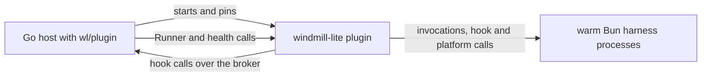

# Host adapters and typed methods

**Status:** Accepted · **Topic:** how a host drives windmill-lite
(hashicorp/go-plugin first, then plain gRPC, HTTP, a CLI, an embedded Go
library, and a host written in Bun), and how each flow and script becomes a
typed method. For go-plugin, it also covers how the host launches, checks
and supervises the engine.

The Go library `wl` is the only engine API, and every adapter is a thin
transport over it: go-plugin, the [Bun host SDK](../glossary.md#bun-host-sdk)
for hosts written in Bun, plain gRPC, HTTP and a CLI. Typed client methods,
which are planned, are to be generated from each flow's or script's schema,
to help callers without changing what a run does.

In the go-plugin adapter, the engine binary is the plugin. It serves the
versioned `windmill_lite.v1.Runner` gRPC service with standard gRPC health,
and a Go host launches, pins, checks and supervises it with the package
`wl/plugin`.

**Not built yet:**

- the plain gRPC and HTTP adapters;
- typed methods (`windmill-lite gen`).

## Context

Hosts differ in language and in how much of windmill-lite they want to own.
A Go service may want the engine in its own process; another may want it as a
separate, pinned plugin binary; a host written in TypeScript may need its run
scopes and plugins to live in the same process as the steps
([host hooks](0008-host-hooks.md#the-hooks), H11). The engine API must be one thing, with
adapters as thin transports over it.

Windmill does not validate inputs against a flow's `schema`: the schema has
no server-side execution semantics ([OF-18](../semantics/openflow.md#of-18)).
Scripts differ only when they opt in with a `schema_validation` annotation.
Types derived from schemas can therefore help callers but must not change
what a run does.

A Go service may run its plugins with
[hashicorp/go-plugin](https://github.com/hashicorp/go-plugin), a library
that starts each plugin as a child process and calls it over gRPC on a
private socket. Such a host wants the engine as one more plugin: pinned by
checksum, admitted only once it is healthy and of the expected build, given
no new work once it reports that it no longer serves, and replaced.

Such a host may also admit work per tenant, keep per-call state while a run
proceeds, and give each call a budget of its own. Without an adapter, each
such host writes the plugin server, its health, drain and version pairing
itself, around a host-mode program of its own.

## Decision

### The core: a Go library

Package `wl` (import path `github.com/invakid404/windmill-lite/wl`) is the
only engine API. In outline:

1. `wl.Open(bundle, options)` loads a bundle, verifies its manifest
   ([packaging](0010-packaging.md)), and starts harness pools lazily, or
   at once with a warm start
   ([harness protocol](0004-harness-protocol.md#pooling-processes-the-engine-spawns)).
2. `runtime.Run(ctx, target, args, runOptions)` runs a flow or script by path
   and returns its status, final result, `mayHaveMutated` flag, trace and
   warnings. `runOptions` carries the run's kind, job id, seed, hooks
   ([host hooks](0008-host-hooks.md)), per-run platform providers
   ([platform interface](0007-platform-interface.md)), pre-write deadline,
   clock, jitter source and run data
   ([H11](0008-host-hooks.md#the-hooks)); the hard deadline is the
   context's.
   - A per-run module-state override is planned. Until then
     `wl.Options.ModuleState` sets the override once per runtime, since one
     harness pool and one engine hold one mode.
   - A canceled run's result names its cause, such as its deadline
     ([harness protocol](0004-harness-protocol.md#cancellation-and-deadlines)).
3. `runtime.BuildInfo()` reports the bundle digest, engine and harness
   versions, the Bun version, the host contract and the deviations in effect.
4. `runtime.Close()` drains the pools.

Every adapter below is a transport over these calls.

### Adapters, in order of delivery

1. **go-plugin**. The engine binary,
   started as `windmill-lite plugin`, serves the `windmill_lite.v1.Runner`
   gRPC service to a Go host that launches it with hashicorp/go-plugin,
   and `wl/plugin` gives the host the client side and an optional
   supervisor ([The go-plugin adapter](#the-go-plugin-adapter)).
2. **Bun host SDK** (host mode). A TypeScript package for hosts that are
   themselves Bun programs: the host process is also the Bun harness. It
   starts the engine binary the host names as a child on a socketpair
   (`windmill-lite host`, which opens the bundle with `wl` in host mode,
   `wl.Options.Host`), with the bundle digest from the bundle's manifest,
   registers host plugins as in-process functions, and submits runs (`run`
   frames, [harness protocol](0004-harness-protocol.md#host-mode)).
   The steps of those runs execute in the host process, inside the scopes
   captured at submission (H11). This is the adapter for a host whose
   per-run state lives in `AsyncLocalStorage`.
   - Its `run`, `run_done` and `run_cancel` frames carry the fields that
     they share with the `Runner` messages under the same names, so the
     go-plugin service and host mode share one schema
     ([The Runner service](#the-runner-service)).
   - It registers the host's instances of the host-provided modules
     ([packaging](0010-packaging.md#host-provided-modules)) before any step loads.
   - `health()` reports in-flight, abandoned and unattributed-error counts;
     `drain(timeout)` stops new runs and lets the host exit; `onRunSettled`
     complements `onRunEnd` (a run's `onSettled`); and the connect options
     set the engine's watchdog (`watchdog.killAfter`, default 30 s), which
     kills the host when its event loop stops answering
     ([harness protocol](0004-harness-protocol.md#host-mode)), and recycle triggers that
     `health()` reports. The host's supervisor only has to restart the host
     when it exits.
   - The host passes a writable working directory, which must already be its
     working directory; the SDK extracts codebase assets there and refuses to
     connect otherwise (`workdir_not_writable`, `workdir_mismatch`), and the
     engine checks the same again in the handshake.
   - **Consumption.** A host installs the SDK from npm, as the subpath
     `windmill-lite/bun` of the package `windmill-lite`, which bundles the
     harness runtime it imports ([The npm package](#the-npm-package)). The
     package's version is the engine's version, and the handshake rejects
     any other pairing. A host can instead vendor the SDK with the harness
     runtime, from the commit of the engine it runs, and check the copy's
     provenance ([Vendoring the Bun host SDK](#vendoring-the-bun-host-sdk)).
   - **Types.** The npm package ships type declarations, which a host's
     `tsc` checks as declarations only. A host that vendors the SDK, with
     the harness runtime it imports, typechecks them with its own program.
     So the SDK and the runtime use only names that the pinned Bun's type
     declarations (`@types/bun`) define, with or without the DOM library,
     and CI typechecks them that way (`harnesses/bun/test/typecheck`).
3. **Plain gRPC** (planned). The same `Runner` service and health on a Unix
   or TCP socket, without the go-plugin handshake, for hosts in other
   languages and for an engine that runs as a long-lived service that
   something else supervises. It lacks what go-plugin adds: the host's
   checksum pin of the executable, the host's ownership of the process, and
   the broker, so callbacks there would need a stream in both directions.
4. **HTTP** (planned): `POST /v1/run/{f|p}/{path}` with the arguments as
   the body, answering with the run's status, result and, on request, its
   trace; `GET /v1/build-info`; `GET /healthz`. Not Windmill's API:
   windmill-lite does not pretend to be a Windmill server. It serves a
   caller with only an HTTP client, and has no callbacks, so its hooks are
   settings in the request or a host plugin in the bundle.
5. **CLI.** `windmill-lite run <path> --bundle <b> --args <json|@file>`,
   printing the outcome as JSON and exiting non-zero on failure; used by the
   conformance runner and for debugging.

### The go-plugin adapter

The go-plugin adapter has two halves. The `windmill-lite plugin` command
serves a bundle as a go-plugin plugin over `wl`. The Go
package `wl/plugin` is what a host imports to launch, check, call and
supervise that command. Their contract is the
`Runner` service and standard gRPC health.

Which process starts which, and who calls whom:

#### The plugin command

`windmill-lite plugin -config <file>` serves one bundle until its host
stops it. Its one flag names its configuration, a JSON file that the host
writes. It opens the bundle with `wl.Open`, in the module state that the
bundle's manifest records, and never in host mode, since its host is no Bun
process. A host plugin that the manifest names loads with the bundle, and
the configuration names no plugin of its own.

| Field | What it sets | Default |
|---|---|---|
| `bundle` | The bundle: a directory or a `.wlb` file | required |
| `digest` | The digest that the bundle must have | any |
| `bun`, `harness_runtime` | The Bun executable of the harness processes, and the harness runtime that the bundle was built for, as `wl.Options` names them | `bun` on the engine's `PATH`; none, which only a bundle without steps can open |
| `data_dir` | The runtime's data directory | a temporary directory |
| `resources`, `variables` | Host values by path, as in a bundle's `data/` ([platform interface](0007-platform-interface.md#services)) | none |
| `resource_store` | `memory`, or Redis with its URL ([wl/redisstore](../../wl/redisstore/README.md)) | `memory` |
| `identity` | The workspace and the user of every job ([platform interface](0007-platform-interface.md#job-identity)) | windmill-lite's placeholders |
| `providers` | For each named provider of the host contract: a static value, or `broker` for the host's hooks service | none |
| `plugin_timeout_ms` | The bound of each hook call, to a host plugin or over the broker | 60000 |
| `read_cache` | The read cache of each run ([D21](0001-equivalence-contract.md#5-named-deviations)) | off |
| `pool` | A `warm` pool's size, cap, bound on live processes, pinned runs, recycle triggers and warm start ([harness protocol](0004-harness-protocol.md#pooling-processes-the-engine-spawns)) | one process, no cap |
| `result_polls_for_all_jobs` | Whether the result polls answer for every job of a live run that the job read answers for ([platform interface](0007-platform-interface.md#services)) | off |
| `foreign_windmill_origins` | The origins of real Windmill instances, whose requests from steps lose windmill-lite's job ids ([platform interface](0007-platform-interface.md#async-dispatch)) | none |
| `engine_recycle_rss` | The engine's own resident set, in bytes, at which it stops serving | off |
| `drain_timeout_ms` | How long a drain lets the runs in flight go on | 60000 |
| `max_message_bytes` | The largest gRPC message in either direction | 536870912, the harness protocol's limit |
| `bytes_total` | The runtime's byte total, which every run's reservations share ([harness protocol](0004-harness-protocol.md#pooling-processes-the-engine-spawns)) | off |
| `labels` | Names and values that build information echoes, such as a deployment's region | none |

- **Secrets by reference.** A secret variable's value names a variable of
  the engine's environment (`value_env`), and so does the resource store's
  URL (`url_env`), which may hold a credential. A secret written in the
  file refuses the start, naming the field but not the value.
- **Reading them.** The engine reads each reference once, at start, and
  writes the value to no file, build information or diagnostic. A variable
  that is not set fails the start, naming the variable. A resource reaches a
  secret through a `$var:` reference to a secret variable, as on Windmill
  ([WA-12](../semantics/client-api.md#wa-12)).
- **The launch environment.** A go-plugin host usually starts its plugin
  with a literal environment (go-plugin's `SkipHostEnv`), so it puts
  exactly the referenced variables there.
- **The configuration's digest** is the SHA-256 of the file's bytes. It
  covers every setting and every secret's reference, but no secret's value.
- **The sockets.** go-plugin makes a private directory for its sockets,
  passes it to the plugin as `PLUGIN_UNIX_SOCKET_DIR` and removes it in its
  `Kill` only when the host starts the plugin through a runner of its own
  (`ClientConfig.RunnerFunc`). With go-plugin's default runner, the plugin's
  socket and the host's broker sockets go to each process's temporary
  directory.
- **The private directory.** So `wl/plugin`'s `ClientConfig` starts the
  engine through a runner of its own, under a fresh base directory of mode
  `0700` (`UnixSocketConfig.TempDir`). go-plugin then puts the plugin's
  socket and both sides' broker sockets in a directory of mode `0700`
  inside it, and `wl/plugin` removes the base directory once the plugin has
  exited or failed to start.
- **What protects each socket.** The command sets its umask to `0077`
  before it serves, so the engine's sockets have no group or other
  permission. It starts each harness process with the umask that it was
  started with, so steps see the umask they see under `wl`. The host's
  broker sockets are made by the host process, under its own umask, so the
  `0700` directories are what protect them.

#### The Runner service

The engine serves `windmill_lite.v1.Runner`, which
`proto/windmill_lite/v1/runner.proto` defines. Version 1 has four calls:

| Call | What it does |
|---|---|
| `GetBuildInfo` | Returns the build identity ([Build identity and pinning](#build-identity-and-pinning)) |
| `Run` | Runs a flow or a root script of the bundle to its end, as `Runtime.Run` does, and returns its outcome: one unary call per run |
| `Cancel` | Cancels a run in flight by its id, with a reason and a canceler, which the run's `Canceled` error names ([FX-38](../semantics/execution.md#fx-38)). Host mode's `run_cancel` carries the same two fields. An id of no run in flight answers `NOT_FOUND` |
| `GetRun` | Says whether the engine still holds the run of a hooks registration, by its id and token: in flight, or ended and not yet released ([Hooks across the plugin boundary](#hooks-across-the-plugin-boundary)) |

Beside it, on the same connection, the engine serves
`windmill_lite.v1.HooksControl`, a service of its own so that `Runner`'s
calls stay as they are. Its one call, `ReleaseHooks`, says that the host has
let a broker connection of runs' hooks go, by its broker id, and the engine
closes its side at once
([Hooks across the plugin boundary](#hooks-across-the-plugin-boundary)).

A `RunRequest` holds:

| Field | Meaning |
|---|---|
| `id`, `kind`, `path`, `args` | The run's job id (empty: a new UUID), `flow` or `script`, the target's path, and the arguments, a JSON object |
| `deadline_ms`, `pre_write_deadline_ms` | Optional: absent means no deadline. The hard and the pre-write deadline, in milliseconds from the engine's receipt; 0 or less is a deadline that has passed ([Deadlines and outcomes](#deadlines-and-outcomes)) |
| `write_capable`, `halt_before`, `halt_after`, `fatal_error_names`, `intercept`, `clock` | The run's own hooks and budgets, as host mode's `run` frame carries them: write-capable sites ([H3](0008-host-hooks.md#the-hooks)), halts ([H8](0008-host-hooks.md#the-hooks)), fatal error names ([H7](0008-host-hooks.md#the-hooks)), static interceptions ([H1](0008-host-hooks.md#the-hooks)) and the clock ([H10](0008-host-hooks.md#the-hooks)) |
| `run_data` | JSON that host plugins read as `wl.run.data` ([H11](0008-host-hooks.md#the-hooks)) |
| `identity`, `resources`, `variables` | The run's own workspace and user, and its own values by path ([H13](0008-host-hooks.md#the-hooks)), in place of the runtime's |
| `hooks` | The broker id of the host's hooks service, and the hooks that it answers for this run ([Hooks across the plugin boundary](#hooks-across-the-plugin-boundary)) |
| `pin`, `limits` | Whether the run keeps one harness process, and its own limits ([Process affinity and limits](#process-affinity-and-limits)) |
| `trace` | How much of the trace the result carries: `none` (the default), `summary` or `full`, the levels of a host plugin's run-end hooks |

A `RunResult` holds:

| Field | Meaning |
|---|---|
| `id`, `status` | The run's id, and `success`, `failure`, `canceled`, `skipped`, `latched` or `halted` |
| `result` | The final result in its stored form ([FX-36](../semantics/execution.md#fx-36)) |
| `may_have_mutated` | Whether the launch of the first write-capable module was approved ([H3](0008-host-hooks.md#the-hooks)), in a failed or canceled run too. That step may have started even when it then failed before its code ran, so only `false` means that no write-capable step started. For a root script's run, whose writes windmill-lite cannot see, it is `true` once the script's invocation was sent |
| `cancel_cause` | For a canceled run: `deadline`, `pre_write_deadline`, `canceled`, `closing` or `flow_timeout` |
| `latched` | A latched run's error ([H5](0008-host-hooks.md#the-hooks)) |
| `warnings`, `deviations` | The run's warnings, and the deviations of its trace |
| `trace` | The trace at the level that the request asked for |
| `answer` | For a flow run, the run-end answer of the bundle's host plugin: the JSON text of the answer that its `onRunEnd` returned. Empty means no answer, and the text `null` an answer of JSON null ([harness protocol](0004-harness-protocol.md#host-plugins) item 10) |

- **JSON values.** Arguments, results, run data, selectors and the trace
  are JSON text in `bytes` fields, which neither side decodes to pass on
  ([JSON at step boundaries](0005-json-step-boundaries.md)).
- **Host mode's frames.** The `run`, `run_done` and `run_cancel` frames
  carry the fields that they share with these messages under the same
  names, with the JSON values embedded raw. So they are not proto3's JSON
  mapping, which would write a `bytes` field as base64
  ([harness protocol](0004-harness-protocol.md#messages)).
- **Flow and script runs.** A root script's run takes `id`, `kind`,
  `path`, `args`, `deadline_ms`, `identity`, `run_data`, `pin` and the
  `trace` level `none`. A request that sets any other field for a script
  refuses the run, naming the field; a flow run takes every field.
- **The first-write boundary.** Only a flow tells a write that may have
  happened from one that did not, at its marked write-capable sites. A host
  that classifies retries by that boundary runs a flow, not a root script.
- **No field is ignored.** A request that sets a field which the engine
  does not serve refuses the run, naming the field, rather than running
  without it. So does a field that the engine does not know, from a newer
  host, and so does a field of the configuration, which refuses the start.
- **Runs that do not start.** Every run that starts answers a `RunResult`,
  a failed, canceled or latched one included. A run that does not start
  answers a gRPC error, as the list below gives, with a detail
  (`google.rpc.ErrorInfo`, domain `windmill-lite`, reason
  `RUN_NOT_STARTED`) that marks the refusal as the engine's own.
- **An unknown outcome.** Any other error, such as a lost connection or a
  transport's `UNAVAILABLE`, does not say whether the run started, so the
  host treats the run as one that may have mutated.

| gRPC code | When |
|---|---|
| `UNAVAILABLE` | The engine is not serving yet, or it drains (`draining`, as in host mode) |
| `ALREADY_EXISTS` | A run with that id is in flight, a run that a step dispatched included |
| `NOT_FOUND` | No flow, and no root script, of the bundle has that path. A flow that only another flow calls by path runs, as `Runtime.Run` runs it |
| `INVALID_ARGUMENT` | The engine refuses the request, such as a malformed selector or arguments that are not a JSON object (`refused`, as in host mode) |

`Cancel` is in version 1 because gRPC's own cancellation of a `Run` call
cancels the run with Windmill's default reason and canceler. Only `Cancel`
names them, and it also lets code that did not make the call cancel the
run. `RunStream`, module events while a run proceeds, waits for a later
minor version: adding a call keeps version 1, and until then a Go host
observes modules through its hooks on the broker.

#### Handshake and versions

| Setting | Value |
|---|---|
| Protocol | gRPC only; go-plugin's `net/rpc` protocol is refused |
| Magic cookie | `WINDMILL_LITE_PLUGIN`, with a fixed value that `wl/plugin` exports: a check that the engine was started as a plugin, not authentication |
| Protocol version | The major version of `Runner`: 1 |
| Plugin name | `runner` |
| TLS | Off by default, since the socket is private; a host may turn on go-plugin's `AutoMTLS` |
| Message size | `max_message_bytes` on both sides |

Additive changes, such as a new field or a new call, keep version 1. A
breaking change defines `windmill_lite.v2.Runner` beside it: the engine
serves both versions through go-plugin's `VersionedPlugins` while hosts
move, and go-plugin picks the highest version that both sides list. A
bundle needs no version of its own here, since the engine opens only a
bundle that its own version built (`ErrEngineVersion`).

#### Health, readiness and drain

go-plugin's server registers the standard gRPC health service itself, and
sets its service `plugin` to `SERVING` for good (go-plugin v1.8.0,
`GRPCServer.Init`). A second health service cannot be registered on that
server. So the engine builds the server that go-plugin uses
(`ServeConfig.GRPCServer`) with interceptors that answer
`grpc.health.v1.Health`'s `Check`, `List` and `Watch` from the engine's own state,
for the services `""`, `plugin` and `windmill_lite.v1.Runner`.

| Engine state | Health | A new `Run` |
|---|---|---|
| Starting | `NOT_SERVING` | `UNAVAILABLE` |
| Serving | `SERVING` | runs |
| Draining, for good | `NOT_SERVING` | `UNAVAILABLE` (`draining`); the runs in flight go on |

- **The health methods.** The interceptors answer `Check`, `Watch` and
  `List`, the methods of the health service in the gRPC release that the
  engine builds with, and a method they do not know answers
  `UNIMPLEMENTED`. So go-plugin's fixed `SERVING` never reaches a caller.
- **Other service names.** `Check` of another name answers `NOT_FOUND`, and
  `Watch` of one streams `SERVICE_UNKNOWN`, as gRPC's own health server
  does. A `Watch` that is open sends each change of state.

- **Readiness.** The engine completes go-plugin's handshake at once, and
  starts `wl.Open` once the handshake line is written. It serves, `GetBuildInfo` included, only once `wl.Open` has returned and,
  with the pool's warm start, its minimum of harness processes has started.
  A start that fails writes its reason to standard error, which go-plugin
  passes to the host's logger, and exits with status 1.
- **What starts a drain:** `SIGTERM`; the engine's resident set at or over
  `engine_recycle_rss` on two consecutive samples, taken every second; a
  warm pool that cannot start a harness process; or the bound on the tokens
  that `GetRun` answered `gone` for. A harness process that
  grows or is tainted is replaced inside the pool, so it does not end the
  engine.
- **A drain** refuses new runs and lets the runs in flight, those that
  steps dispatched included, go on for up to `drain_timeout_ms`. The engine
  then closes its runtime, which cancels the runs left. A `Run` call's run
  ends with the reason `the runtime is closing` (cause `closing`); one that
  a step dispatched is canceled as the runtime's close always cancels it
  (cause `canceled`).
- **The exit.** The engine waits up to 2 seconds for the calls to answer,
  gives the answers up to a second to reach the host, and exits with
  status 0. A supervisor that only restarts the plugin when it exits therefore
  works too.
- **go-plugin's shutdown** (`GRPCController/Shutdown`, which the client's
  `Kill` sends) stops the server at once, with no drain. So a host that
  wants its calls to finish stops sending calls, waits for the calls in
  flight, and only then kills the plugin, as `wl/plugin`'s supervisor does.

#### Build identity and pinning

`GetBuildInfo` returns what `wl`'s `BuildInfo` holds: the bundle digest,
the engine, Bun and esbuild versions, the harness runtimes' digests, the
module state, shared code, the host contract and the deviations
([packaging](0010-packaging.md#build-identity)). It also says whether a Bun
other than the pin built the bundle, and adds three fields:

| Field | Value |
|---|---|
| `protocol_version` | The `Runner` version of the connection |
| `labels` | The configuration's labels |
| `config_digest` | The SHA-256 of the configuration file |

A host pins the engine executable by its SHA-256. go-plugin takes exactly
one of a command and a runner, and its `SecureConfig` checks the command's
path, which is empty on the runner route. So `wl/plugin`'s runner checks
the file that it is about to start, and starts it with go-plugin's
handshake environment and the host's literal one.

The host then compares `GetBuildInfo` with the release record that it ships, at
least the bundle digest, the engine version, the Bun version, the labels
and the configuration's digest, and refuses the process otherwise. The
executable's digest is not in build information: a process cannot vouch for
its own file, and the runner has already checked it.

#### The client package

`wl/plugin` is the host's side of the adapter: a public Go package beside
`wl`, whose types follow `runner.proto`.

| Name | What it does |
|---|---|
| `Handshake`, `PluginName` | go-plugin's handshake configuration and the plugin's name ([Handshake and versions](#handshake-and-versions)) |
| `VersionedPlugins` | The plugin sets by `Runner` version, for both sides |
| `RunnerPlugin` | The go-plugin plugin type. On the engine's side it registers the `Runner` server; on the host's it returns a `Client` |
| `Client` | Typed calls: `BuildInfo`, `Run`, `Cancel` and `Health`. `RunWithHooks` runs a flow with its Go hooks on the broker ([Hooks across the plugin boundary](#hooks-across-the-plugin-boundary)) |
| `ClientConfig` | go-plugin's client configuration for one launch: the runner that checks the executable's SHA-256 and starts it with its configuration file, gRPC only, a fresh private socket directory, a literal environment with go-plugin's `SkipHostEnv` on, and the message limits |
| `Supervisor` | The optional supervisor ([The supervisor](#the-supervisor)) |

`Client.Run` gives the run the earlier of two hard deadlines: the
request's own, and the context's deadline less a margin for the reply (1 s
by default). A context that has already ended starts no run.

If the call ends without a result and without the engine's own refusal,
for example at its deadline or on a lost connection, the host has no
outcome. `Client.Run` then returns an error that says so, and the host
treats the run as one that may have mutated. The margin must cover what the run does after its deadline,
such as its host plugin's run-end hook, which may take up to
`plugin_timeout_ms`.

#### The supervisor

`plugin.Supervisor` is optional. It runs one plugin process at a time, a
generation, and routes the host's calls to the generation that serves.

| Behaviour | Rule | Default |
|---|---|---|
| Admission | Within the admission timeout, a new generation must answer health `SERVING`, then a `GetBuildInfo` equal to the pinned identity, the configuration's digest included, on every field that the host pins. Each call has its own deadline inside that timeout. Otherwise the supervisor stops the generation, and the launch counts as failed | 30 s |
| Health poll | One `Check` at a time, each with a bound, whose returned status the supervisor reads: go-plugin's own ping discards it. The first answer other than `SERVING`, a timeout or an error withdraws the generation from new calls for good | every 1 s, each bounded by 1 s |
| Drain | A withdrawn generation's calls in flight go on, up to the drain timeout plus a grace for the engine's own close, which cancels what is left and reports it. Then the supervisor stops the plugin | the engine's `drain_timeout_ms` plus 15 s |
| Stop | go-plugin's `Kill` waits for its shutdown call with no deadline of its own, so the supervisor bounds it. Past the bound, it sends `SIGKILL` through the process handle that its runner holds, since go-plugin's reattach data names no process on the runner route, and reaps that process | 5 s |
| Restart | After an exit or a refused admission, the next launch waits an exponential backoff, which resets once a generation has served for a while | [gRPC's connection backoff](https://github.com/grpc/grpc/blob/master/doc/connection-backoff.md): 1 s, times 1.6, jitter 0.2, at most 120 s; reset after 60 s |
| Recycle on memory | The engine's memory triggers make it stop serving, and the health poll then replaces the generation | the configuration's triggers |
| Calls | `Call(ctx, fn)` runs `fn` with the serving generation's `Client`, and waits for one until `ctx` ends | — |
| Readiness | `Ready()` says whether a generation serves, for the host's own readiness probe | — |

The engine, not the supervisor, measures memory. It reads its own
resident set, and each harness process's from that process's heartbeats, on
every platform. A supervisor would have to read a tree of processes, in a
way that differs by platform.

**What retirement bounds.** The supervisor's stop bounds the engine's
process. A harness process exits when its connection to the engine ends
only if its event loop still runs, and it leads a process group of its own.

So when a killed engine leaves a wedged harness process, that process and
the groups its steps left run on beside the next generation. A host that
needs a bound on them too gives each generation a cgroup of its own, on
Linux, and kills it whole.

#### Hooks across the plugin boundary

A hook takes the cheapest of three routes that serves it:

| Route | For | What crosses the boundary |
|---|---|---|
| Settings in the request | Static interceptions, write-capable selectors, halts, fatal error names, deadlines, the clock, the run's data, identity, values and limits | Nothing while the run proceeds: `may_have_mutated` comes back in the result |
| A host plugin in the bundle | Hooks that need step code, the step's process or its host-provided modules: `around`, providers, interceptions that call step code, per-run state | Nothing: the plugin runs in each warm harness process, beside the steps ([harness protocol](0004-harness-protocol.md#host-plugins)) |
| Go callbacks over the broker | A Go host's own logic, such as a check against its tenant registry | One gRPC call for each hook call |

- **The broker route.** The host serves `windmill_lite.v1.HostHooks` on
  one connection of go-plugin's broker for each `Client`, and each run of
  that client names the connection's id and its hooks in the request. The
  declaration is a host plugin's, and each call carries a `host_call`'s hook
  name and payload ([host hooks](0008-host-hooks.md#where-hooks-run)), so a
  Go callback takes a TypeScript hook's path through the engine.
- **Order.** A run's hooks on the broker are its own hooks, so they come
  before its host plugin's, as a Go host's run hooks do. The first matching
  interception answers, rewrites apply in order, both sets of observers run,
  and the run's providers answer first. A named provider that the
  configuration marks `broker` and that the host plugin also answers
  refuses the start.
- **What the broker route lacks.** `around` is not offered there, because
  it runs inside the harness process around the step.
- **Failures.** Each call is bounded by `plugin_timeout_ms`, and a call
  that fails or gets no reply in time has the outcome that the same hook's
  failure has in a host plugin
  ([host hooks](0008-host-hooks.md#consequences)). An interception, rewrite,
  observer, first-write verdict or provider latches the run (`plugin_error`,
  `host_call_timeout`), and fails it closed at a provided site.
- **Failures after the outcome.** A failed `onRunEnd` adds a warning, a
  failed `onRunSettled` is a diagnostic line, and a hook whose run has
  already ended latches nothing.
- **No answer on the broker.** A reply to `on_run_end` on the broker adds
  its warnings, and the engine ignores an `answer` in it. A Go host's
  callbacks run in the host, which holds their state, so only the bundle's
  host plugin, whose state lives in a harness process, gives
  `RunResult.answer`.
- **Registration.** `Client` gives a run without an id a fresh UUID, and
  registers its hooks before it sends the request, since hook calls can come
  before the reply and after it. Each registration has a fresh token that
  the request carries and every hook call echoes, so a delayed call of an
  earlier run with the same id never reaches a later registration.
- **Release.** `Client` drops a registration when the engine refuses the
  run, when the engine's release call says that the run has settled, or
  when the generation ends. The engine sends that call whatever hooks the
  run declared. A hook call that names no held registration answers an
  error that latches nothing: the engine takes it as no answer, so an
  interception or a provider declines, and a mandatory provided site still
  fails closed.
- **Reconciliation.** A refusal or a release call can be lost. So after
  every `Run` call ends, whatever its outcome, `Client` asks `GetRun` for
  that registration, at first after `plugin_timeout_ms` and then with a
  growing interval while the engine answers `held` or the lookup fails. It
  drops the registration at `gone`, and the caller's result does not change.
- **A final `gone`.** The engine remembers each token it has answered
  `gone` for, and refuses a later `Run` that carries it. So a request that
  arrives after the lookup never starts a run whose hooks the client has
  dropped.
- **A bound on those tokens.** The engine keeps at most 65,536 of them. At
  that number it stops serving and drains, as when a recycle trigger trips,
  so no process that still takes runs forgets a token. A delayed request of
  that process ends with its connection, and the next generation starts with
  none.
- **One listener.** The broker connection lives until `Client.Close`,
  which the generation's end calls, so a run opens no listener of its own.
  go-plugin gives each broker id's address once, so the engine closes a
  connection that cannot connect once no run uses it, and the client then
  opens a new listener. A listener that the client lets go is stopped, and
  the engine told with `ReleaseHooks`, sent again until it has it, answers
  `Unimplemented`, or the generation or connection ends.
- **Providers on the broker.** A named provider that the configuration
  marks `broker` is answered by the hooks service of the run that reaches
  it, and a run that serves none latches there. So `wl.Open` still finds
  every named provider registered.
- **Plugin modules.** A host plugin reaches the bundle through the build,
  bundled against the same shims of host-provided modules as the steps, so
  it shares their instances in each process
  ([harness protocol](0004-harness-protocol.md#host-plugins)). A plugin
  that keeps per-run state asks for pinned runs, so every invocation and
  hook call of a run reach one process.

#### Deadlines and outcomes

A run's hard deadline ends that run alone, `canceled`, with `cancel_cause`
`deadline`
([harness protocol](0004-harness-protocol.md#cancellation-and-deadlines)).
Its pre-write deadline does the same, with `pre_write_deadline`, until the
first write is approved ([H3](0008-host-hooks.md#the-hooks)); from then on it no longer applies, so it
never cancels a run that may have mutated.

Both are optional fields in `runner.proto`, so absent means no deadline.
One of 0 or less has already passed: the run ends at once, before any step,
and other runs go on. A root script's run takes only the hard deadline, and
one that fails on its own before it ends `failure`, with no cause
([harness protocol](0004-harness-protocol.md#cancellation-and-deadlines)).

The gRPC deadline of the `Run` call bounds the call, not the run. A call
that ends first cancels its run, whose outcome then has no receiver, so
`Client.Run` sets the run's deadline ahead of the call's.

Every end of a flow run calls the `onRunEnd` of the bundle's host plugin,
a deadline that passed before any step included, and the call has the
plugin timeout alone. So a canceled flow run's `RunResult` can carry the
plugin's answer. A root script's run calls no run-end hook and has no
answer. A host that needs the answer chooses a reply margin that covers
`plugin_timeout_ms`.

#### Process affinity and limits

The configuration's `pool` sets a `warm` pool's minimum and maximum, the
cap per process ([D15](0001-equivalence-contract.md#5-named-deviations)),
the lag threshold, the bound on live processes, pinned runs for every run,
the recycle triggers and a warm start. A `fresh` runtime starts a process
for each step and has none of them.

A request's `pin` and `limits` set one run's affinity and limits.
Their rules are the pool's
([harness protocol](0004-harness-protocol.md#pooling-processes-the-engine-spawns)):
a pinned run keeps one process, a process that trips a recycle trigger is
replaced, and a run's limits act on that run alone.

#### Licence and notices

hashicorp/go-plugin and its dependency hashicorp/yamux are under the
Mozilla Public License 2.0 (MPL-2.0), a copyleft that applies to each of
their files. windmill-lite uses them only as Go module dependencies,
fetched from the module proxy and never vendored, and copies none of their
files into the repository, `.proto` files included. Its own files stay
under the Unlicense.

A release's `LICENSES.txt` carries the licence of every Go module that the
engine links (`scripts/release.py notices`). For each MPL-2.0 module it
also names where that module's source is, as section 3.2 of the licence
asks of a work distributed in executable form: the module's archive on the
Go module proxy and its upstream repository. A host that imports
`wl/plugin` links go-plugin into its own binary, and gives that notice
itself.

Alternatives:

- **Serving the host's own service definition**, generated from its
  `.proto` file. Each host would get a server of its own, and a change to
  its contract would need a new engine. A generic `Run` with typed clients
  ([Typed methods](#typed-methods)) keeps the wire fixed.
- **A go-plugin server inside the Bun host SDK**, so that a host-mode host
  is the plugin. Its TypeScript side would need go-plugin's `.proto` files
  for the controller and broker services, MPL-2.0 files that the repository
  would then hold, and the engine would stay the plugin's child.
- **Keeping go-plugin hosts on host mode**, each writing a Bun program that
  serves go-plugin. Each host then carries its own server, health, drain
  and version pairing. Host mode stays the adapter for a host whose per-run
  state must live in its own process.
- **A second health service, or a status call of windmill-lite's own.**
  go-plugin's server cannot hold a second health service, and a call of
  windmill-lite's own would make every supervisor learn it. The
  interceptor keeps the standard service.
- **The gRPC deadline as the run's only deadline.** The call's deadline
  ends the call, so the host would lose the outcome of a run that ran out
  of time, `may_have_mutated` included.

### The npm package

The npm package `windmill-lite` is how a Bun host gets the SDK. Its root
is `harnesses/`, whose [README](../../harnesses/README.md) describes it.

- **One package, one subpath per runtime.** `windmill-lite/bun` is the Bun
  host SDK. The SDK of another runtime becomes another subpath of the same
  package, never a package of its own, so that no host has to rename its
  dependency. The Bun host SDK's test entry is the subpath
  `windmill-lite/bun/testing` ([The test entry](#the-test-entry)).
- **One version.** The `version` field of `harnesses/package.json` is the
  version of the package and of the engine, and a release is the Git tag
  `v` + that version. A release build of the engine stamps `v` + the
  version as its version (`scripts/release.py`). The package's build
  stamps the same into the SDK's harness version, so the handshake pairs
  the SDK only with the engine of its release.
- **Built JavaScript and declarations.** The package ships the SDK and the
  harness runtime bundled by Bun 1.4.3, as the host-mode tests bundle
  them, and `.d.ts` declarations. A host's `tsc` never checks the
  runtime's code under the host's own compiler options. Each entry is an
  ES module, and the runtime module that both entries import is an ES
  module of its own ([The test entry](#the-test-entry)).
- **Trusted publishing.** The release workflow publishes each release
  with npm provenance, through npm trusted publishing, so that no npm token
  exists. The first version is published by hand, because npm adds a
  trusted publisher only to a package that exists.

Alternatives:

- Shipping the TypeScript sources needs no build, and Bun runs them. But a
  host's `tsc` type-checks every imported `.ts` file under the host's
  options. The options of `bun init` (`noUncheckedIndexedAccess`) reject
  the runtime's code, and `NodeNext` without `allowImportingTsExtensions`
  rejects its `.ts` imports.
- Publishing nothing, with every host vendoring the SDK (below), makes each
  host copy and check two directories at a commit, and update them by hand.
- A `package.json` at the repository root would be the nearest
  `package.json` of every fixture script that the bundlers read in place,
  and its `"type": "module"` could change how they bundle them.

### The test entry

A host's own process-level code runs in the process where its steps run:
its pooled database and cache clients, their timers, and the work it
starts outside every step. The settle-time fence decides what of that code
a step's settlement clears, and the process scope decides what it keeps
([harness protocol](0004-harness-protocol.md#the-shared-process-failure-model)). A
host tests that code against the fence, without an engine or a bundle.

The subpath `windmill-lite/bun/testing` is the Bun host SDK's test entry,
`harnesses/bun/host/testing.ts`. Its three functions take their names from
the runtime's concepts:

- **`install()`** installs the runtime's step machinery in the process, as
  the harness does before any step loads: the timer fence, the process
  scope and the step API (`wl`). A second call changes nothing.
- **`invoke(fn, options)`** runs `fn` as one invocation, in that
  invocation's async context, and then settles it. The settlement is the
  runtime's own function, `settleInvocation` in `runtime/context.ts`,
  which every settlement of the runtime calls.
- **`currentInvocation()`** returns the invocation of the caller's async
  context, as its `id`, its `run` and whether it has `settled`, or
  `undefined` outside every invocation. It answers for the runtime's
  steps and for `invoke`'s alike.

`invoke` resolves with `fn`'s result and `left`, what the settlement
released, counted by kind as the `left_behind` warning counts it. `left` is
`{}` when the invocation left nothing. When `fn` throws, the invocation
settles too, and `invoke` then rejects with what `fn` threw.

`install()` installs nothing else. The environment, `fetch` and log views,
the child-process wrappers and the process-level error handlers route to a
connected runtime, and a test runner shares the process with the test. A
host that vendors the SDK imports `host/testing.ts` from its copy.

**One runtime state.** The package's build makes `runtime/context.ts`,
which holds the invocation context, the timer fence and the process scope,
one module that both entries import. So a process that loads both entries
has one copy of that state. The packaging test checks it on the packed
package.

**Bun and Node.** The entry imports only `runtime/context.ts`, which reads
no Bun global when it is evaluated or in what the entry calls. So the entry
runs on Bun 1.4.3 and on Node 22 or newer, the oldest Node major that the
Node.js project still maintains, for host test suites on Node test runners
such as vitest. Its declarations need no Bun types, and the packaging test
runs it on both.

Alternatives:

- Exporting the runtime's internals as they are, such as `invocations`,
  `InvocationResources` and `installTimers`. A host's tests would build
  invocation contexts by hand and depend on their shape, which changes
  with the runtime. A context that the runtime never builds, or a
  settlement that leaves the log open, tests something else.
- A helper that re-implements the settlement for tests. The tests would
  then check the helper, not the fence, and the two could drift apart.
- An entry bundled with its own copy of the runtime. A process that loads
  both entries would have two invocation contexts and two timer fences,
  and the process scope that `windmill-lite/bun` publishes would not leave
  the test entry's invocations.
- A package of its own, such as `windmill-lite-testing`. It is a second
  version to pair with the engine, and has the same problem of two copies
  across two packages.
- Tests through a real engine and bundle. Each unit test of the host's
  code would need the engine binary and a build.

### Vendoring the Bun host SDK

A Bun host that does not install the npm package copies the SDK into its
own repository. A package manager cannot install it as a git dependency,
because the repository root has no `package.json`.

1. **Copy two directories together.** `harnesses/bun/host/index.ts` imports
   `../runtime/context.ts`, `../runtime/plugin.ts` and
   `../runtime/runtime.ts`, which import every other file of
   `harnesses/bun/runtime` but `main.ts`, the entry point of a spawned
   harness.
   Copy both directories from one commit, as siblings named `host/` and
   `runtime/`, so that the relative imports resolve. A copy of `host/`
   alone does not load.
2. **Change no file.** The runtime is the harness that every step of the
   host runs under: Windmill's wrapper rules, the settle-time fence and the
   native boundary mode. An edited copy runs steps differently from the code
   that the engine's tests checked, and no engine check detects the edit
   (item 4).
3. **Build the engine and the bundle from the same commit.** `wl.Open`
   refuses a bundle that another engine version built
   (`ErrEngineVersion`). For a release, the handshake also refuses an SDK of
   another release (`version_mismatch`).
4. **Keep a provenance record, and check it in the host's tests.** In host
   mode the engine does not compare the host's runtime with the bundle's
   `harness_runtimes` digest, because the host process is the harness. A
   copy without a release stamp reports the harness version `dev`, which
   pairs with any engine. So the host checks the copy itself:
   - Next to the copy, record the repository URL, the full commit ID, and
     the SHA-256 of every copied file by its path.
   - In a test, recompute the SHA-256 of every file in the copy, and fail
     on a changed, missing or extra file.
   - In the same test, check that the engine binary was built from the
     recorded commit (below).
5. **Update both directories at once.** To move to another commit, replace
   both directories and the record, rebuild the engine and the bundle, and
   run the check again.

`windmill-lite version` prints `v` + the release's version for an engine
of a release ([The npm package](#the-npm-package)), and otherwise the
module version that Go stamps into the binary. Built from a clean checkout
of the commit, it is a pseudo-version that ends in the first 12
hexadecimal digits of the commit ID, such as
`v0.0.0-20261028113407-7c82cc9ab979`. Go appends
`+dirty` to the version of a build from a checkout with uncommitted
changes.

### Typed methods

`windmill-lite gen go|ts --bundle <b>` generates client code: one method per
flow and script, with an input type derived from its JSON schema (the flow's
`schema`, or the script's `.script.yaml` schema), calling the generic `Run`.

- The schema clean-ups that windmill-ts learned are applied: `default: null`,
  defaults outside an enum, `enum: null`, empty objects, `dynselect-*`, the
  two S3 object spellings, `format: resource-<type>`
  ([PA-3](../semantics/openflow.md#pa-3), [WA-60](../semantics/client-api.md#wa-60)).
  windmill-ts is Unlicense and may be copied.
- Results are untyped (raw JSON), because Windmill has no result schema.
- The generated code embeds the bundle digest; connecting to a runtime with
  another digest fails, so a client cannot silently drift from the flows it
  was generated for.
- The server does not validate flow arguments against the schema, matching
  OF-18. A script that opts into validation with `schema_validation` is
  validated as Windmill does, once the reference covers that annotation's
  rules ([languages.md](../semantics/languages.md)); until then such a script
  fails at load with `unsupported_feature` naming the annotation. Types are a
  compile-time aid only.

The wire stays generic, so a changed flow needs regenerated clients but never
a new protocol.

## Consequences

- One engine API; adapters can be added without touching semantics.
- A Bun host keeps its in-process plugins and scopes, while the engine stays
  in Go.
- go-plugin hosts get the same pinning and build-identity checks they use for
  any plugin.
- A go-plugin host calls one generic `Run`. Its own logic lives in the
  bundle's flows and scripts, its host plugin, or its Go callbacks, and no
  host writes a plugin server, health or drain of its own.
- With the adapter, the engine binary links gRPC, protobuf, go-plugin and
  yamux, and the release's `LICENSES.txt` grows with their licences and the
  MPL-2.0 source notice.
- Under go-plugin, steps run in warm harness processes that the engine
  owns. Per-run state that a host-mode host keeps in its own process lives
  in a host plugin of pinned runs instead, rebuilt from the run's data.
- A host that kills the engine without a drain loses the work in flight,
  and the child process groups that its steps left, which only the engine
  kills ([harness protocol](0004-harness-protocol.md#the-shared-process-failure-model)),
  run on. A harness process exits once its connection to the engine ends,
  if its event loop still runs ([The supervisor](#the-supervisor)).
- **Host mode is a runtime of `wl`** (`Options.Host`), so the Bun host
  SDK and any other host that speaks the protocol share one engine path.
  - The engine binary's path is the host's to give, not the bundle
    manifest's: a manifest that recorded an engine digest would make the
    bundle digest differ per platform.
  - What pairs the pieces is that the engine opens only a bundle its own
    version built (refusing the host with `engine_refused` otherwise), and
    the handshake checks the protocol version, the harness kind, the
    pinned Bun and the bundle digest.
  - A host that pins the engine binary by digest does so itself, as
    `pack --single --host bun` is planned to do
    ([packaging](0010-packaging.md#single-executable)).
- The SDK and the engine of a release pair only with each other. The
  SDK's version is the harness version its hello names
  (`harnesses/bun/runtime/version.ts`), which a release stamps with
  `--define WL_RELEASE='"vX.Y.Z"'` when it runs or builds the host, as the
  npm package's build does; the repository's own is `dev`.
- The engine refuses a host whose stamped SDK version differs from its own
  stamped version with `version_mismatch` in the handshake. The SDK
  refuses an engine of another release in the welcome too, so that an
  engine from before the check is not used either. An unstamped version
  (`dev`, a development build's `(devel)`) pairs with anything, since
  there is no release to compare. Both sides run the cases of
  `conformance/protocol/host/versions.json`.

## Spec IDs relied on

OF-18, PA-3, WA-60, and the [host hooks](0008-host-hooks.md#the-hooks).
The go-plugin adapter relies on
[FX-36](../semantics/execution.md#fx-36) (the stored final result),
[FX-38](../semantics/execution.md#fx-38) (a cancellation's reason and
canceler) and [WA-12](../semantics/client-api.md#wa-12) (`$var:` in a
resource).
