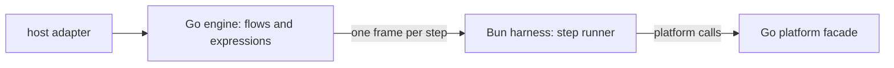

# windmill-lite design

**Current state:** first edition, proposed. Nothing in the repository
implements these records yet. This README covers `docs/design/`: this index
and the decision records it links. The records decide the architecture, the
equivalence contract with Windmill `v1.767.0`, the Go package layout and the
implementation milestones. They build on the
[semantics reference](../semantics/README.md) and cite its finding IDs.

The records are written by the build team under the clean-room rule of
[AGENTS.md](../../AGENTS.md): from the semantics reference, Windmill's public
documentation, the Apache-2.0 parts of Windmill, and observed behaviour.
Where a decision depends on a number, the number was measured with a
throwaway prototype outside this repository, and the record states the
hardware, versions and method. Milestone G1 turns those prototypes into
in-repository benchmarks.

## The architecture in one paragraph

A Go **engine** loads a **bundle** built from a `wmill sync` folder and is the
only flow interpreter: it runs Windmill's decision list, containers, retries,
waits, failure modules and cancellation, and evaluates every expression in
QuickJS-ng (the engine Windmill uses), compiled to WASM and run in wazero.
Steps run in warm **language harnesses** (Bun first), which are step runners:
they bind arguments, hydrate, call the entrypoint, and serialise results and
errors with the language's rules, one framed message per step over a
socketpair. Step code reaches the platform through the stock `windmill-client`,
which talks to a Go facade, intercepted in-process for Bun. Hosts drive the
engine through a Go library and thin adapters (go-plugin, a Bun host mode,
gRPC, HTTP, a CLI) and change runs through a fixed set of hooks.

## Decision records

| Record | Decision |
|---|---|
| [0001 Equivalence contract](0001-equivalence-contract.md) | Match every `core` finding for a successfully deployed flow run by path on one CE worker; reject out-of-scope features at load; list eight named deviations; implement each contested rule once with both readings selectable and a stated default. |
| [0002 IR, loader and validation](0002-ir-and-loader.md) | Hand-written OpenFlow types with Windmill's effective decoder and a schema-coverage test; normalise once to the deployed form; a typed IR with precomputed collapse, compiled expressions, harness class per leaf and segments; a script inventory with dependency-set ids. |
| [0003 Where semantics live](0003-semantics-placement.md) | One interpreter and one expression pipeline, in Go, with QuickJS-ng `be664ca1` in wazero and pre-warmed fresh contexts; harnesses are step runners; segments place work but do not execute in the harness; a three-level conformance suite (flow, step, expression) run by both sides. |
| [0004 Harness protocol](0004-harness-protocol.md) | Length-prefixed JSON frames on a socketpair with values embedded raw; per-invocation env, logs and `fetch` through `AsyncLocalStorage`; pools keyed by harness class, runtime pin, dependency set and module-state mode; the engine owns concurrency and deadlines; timed-out steps are abandoned and their process recycled when idle. |
| [0005 JSON at step boundaries](0005-json-step-boundaries.md) | Go holds every value as producer text plus a lazily computed jsonb text and never decodes what it passes through; a routing table says which consumer sees which; one streaming canonicaliser checked against PostgreSQL; the normalising walk is specified with a differential mode and kept for a gated residency optimisation. |
| [0006 Module state](0006-module-state.md) | Three modes: `fresh` (a process per invocation, Windmill-equivalent), `warm` (default: one module instance per script for the process lifetime) and `shared` (one build for all scripts); conformance runs `fresh`. |
| [0007 Platform interface](0007-platform-interface.md) | Go service interfaces with local defaults and host replacements; one interpolation walker with three modes and a host secret layer; a loopback facade plus in-process `fetch` interception; attribution by invocation; unsupported routes fail with `UnsupportedPlatformCall`; hybrid dispatch built behind interfaces, its remote adapter held for a licence decision. |
| [0008 Host hooks](0008-host-hooks.md) | Thirteen hooks with call-site selectors, as Go callbacks or TypeScript host plugins: interception, argument rewrites, a first-write signal, cancellation with a pre-write budget, run-fatal latches, observers, fatal error names, halt points, traces, an injectable clock, host scopes, environment overrides and per-run providers. |
| [0009 Host adapters](0009-host-adapters.md) | The `wl` Go library is the only engine API; adapters in order: go-plugin, a Bun host SDK, plain gRPC, HTTP, CLI; typed client methods generated from Windmill schemas over a generic wire, bound to the bundle digest. |
| [0010 Packaging](0010-packaging.md) | A bundle with a manifest of digests; a Bun build helper on the pinned Bun `1.3.10`; a bundle digest in every handshake, trace and build-info call; a single executable per platform; an OCI image written without Docker; a `verify` command. |
| [0011 Differential testing](0011-differential-testing.md) | The oracle harness as the reference designs it, in public CI only; a typed, injective site-path encoding shared by every comparison; `record`, `check` and `diff`; a stub mode for comparing orchestration without private systems; benchmarks and run spans for performance. |
| [0012 Layout and milestones](0012-layout-and-milestones.md) | `wl/` as the only public package and components under `internal/`; 28 milestones, six of them startable at once. |

## Measurements behind the decisions

Apple M4, macOS, Go 1.27.3, Bun 1.4.2 (details in each record):

| Question | Result | Used in |
|---|---|---|
| Go ↔ warm Bun round trip, one step | 12.5 µs p50 for 26 B, 18.4 µs for 3 KB, about 250 µs for 100 KB | 0003, 0004 |
| One QuickJS-ng evaluation with a fresh runtime | 250 µs in Go/wazero (46 µs of it evaluation), 188 µs native through cgo, 110 µs in Bun's WASM | 0003 |
| Normalising walk versus native JSON round trip in Bun | 2–3× faster; 0.08 µs versus 485 µs for a 1 MiB string | 0005 |
| Fresh module state per invocation in one process | 0.6–2.1 ms for 0.3–1.3 MB bundles; re-importing leaks module records | 0006 |
| Re-entering a run's async scopes per step | 16 of 16 concurrent invocations isolated | 0004, 0008 |

## Unsettled findings

Twenty-one findings of the reference are not settled. The design does not pick
sides silently: [0001](0001-equivalence-contract.md) §6 lists each contested
rule, its readings, the default and why, and the recording that settles it.
Both readings are implemented behind one switch per rule.

## Requests to the semantics team

Questions reach the semantics team as requests for the reference to cover a
behaviour ([AGENTS.md](../../AGENTS.md)). The design depends on these:

1. **Native boundary rules** for `bunnative` and `nativets` steps: how a
   result is serialised (in particular object properties holding
   `undefined`), the error object's fields, the timeout text, and which
   globals and APIs the native runtime offers. The reference covers the
   native runtime only in outline ([WR-31](../semantics/languages.md#wr-31))
   and puts it in `later` scope, while the language values are `core` for
   loading ([OF-13](../semantics/openflow.md#of-13)). Until it is covered, the
   harness's native mode ([0004](0004-harness-protocol.md)) has no public
   conformance cases.

## Changing the design

1. A record is changed by a pull request that edits it in place and says why
   in its Consequences; a reversed decision gets a new record that names the
   one it replaces.
2. New records take the next number.
3. Records cite finding IDs and conformance case IDs, never Windmill source.

## Decisions only the human can make

1. **Provision the `MEMORIA_AUTO_ACK_TOKEN` repository secret.** Until then,
   the Renovate auto-acknowledgement workflow stays installed but inactive,
   and Renovate pull requests need a manual Memoria acknowledgement
   ([docs/memoria.md](../memoria.md)).
2. **Packages labelled Apache only in their own metadata**
   ([Q-OF-7](../semantics/openflow.md#q-of-7)(a)): may the build team read,
   depend on or copy `windmill-yaml-validator`, `cli/windmill-utils-internal`,
   `rust-client` and the published `windmill-cli`? The design does not need
   them: the loader is written from the `SY-` findings, and the manifest guard
   rejects these packages until the question is answered. Running the `wmill`
   CLI as a black box for the oracle is unaffected.
3. **Hybrid dispatch under the CE terms**
   ([Q-OF-7](../semantics/openflow.md#q-of-7)(b)): does a client that delegates
   steps to a user's own Windmill count as "wrapping" it? Milestone R1 (the
   remote adapter) waits for this answer; nothing else does.
