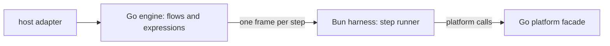

# windmill-lite design

**Current state:** first edition, proposed. Milestone A3 implements the
OpenFlow decoder of [0002](0002-ir-and-loader.md) in
[internal/openflow](../../internal/openflow/README.md), milestone A2 its YAML
dialect in [internal/yamlx](../../internal/yamlx/README.md), milestone A1 the
jsonb canonicaliser of [0005](0005-json-step-boundaries.md) in
[internal/jsonval](../../internal/jsonval/README.md), milestone A4 its
sync-folder loader in
[internal/syncfolder](../../internal/syncfolder/README.md), milestone A5 its
compiler in [internal/ir](../../internal/ir/README.md), milestone K1
the contracts of [0012](0012-layout-and-milestones.md) (the shared types and
interfaces under `internal/`), milestone B1a the QuickJS-ng engine of
[0003](0003-semantics-placement.md) in
[internal/expr/quickjs](../../internal/expr/quickjs/README.md), milestone
C1 the harness protocol of [0004](0004-harness-protocol.md) in
[internal/harness](../../internal/harness/README.md) with a skeleton Bun
harness, milestone C2a the Bun side of the build of
[0010](0010-packaging.md) in [internal/bundle](../../internal/bundle/README.md)
and [harnesses/bun/build](../../harnesses/bun/build/README.md), milestone E2
the oracle harness of
[0011](0011-differential-testing.md) in
[internal/oracle](../../internal/oracle/README.md), on which recording batches
E3c, E3b and E3d recorded the flow-execution error cases, its core and the
control-flow cases and settled contested rules of
[0001](0001-equivalence-contract.md) §6, and milestone E4a its stub mode.
Milestone F4 implements the bundle of [0010](0010-packaging.md) (the build,
the manifest and the bundle digest, `verify`) in
[internal/bundle](../../internal/bundle/README.md) and
[cmd/windmill-lite](../../cmd/windmill-lite/README.md), and put the
expression engine's heap on mimalloc. Milestone W1 is the walking skeleton:
one sequential flow at a time, in a spawned harness and in host mode,
scaffolding that tested the process model on the pinned Bun before the
engine milestones build on it; only it runs flows yet.
This README covers `docs/design/`: this index and the decision records it
links. The records decide the architecture, the equivalence contract with
Windmill `v1.767.0`, the Go package layout and the implementation
milestones. They build on the
[semantics reference](../semantics/README.md) and cite its finding IDs.

The records are written by the build team under the clean-room rule of
[AGENTS.md](../../AGENTS.md): from the semantics reference, Windmill's public
documentation, the Apache-2.0 parts of Windmill, and observed behaviour.
Where a decision depends on a number, the number was measured with a
throwaway prototype outside this repository, and the record states the
hardware, versions and method. Milestone G1 turns those prototypes into
in-repository benchmarks. The one exception so far is the native pool
under load, measured by milestone B1a's own load test.

## The architecture in one paragraph

A Go **engine** loads a **bundle** built from a `wmill sync` folder and is the
only flow interpreter: it runs Windmill's decision list, containers, retries,
waits, failure modules and cancellation, and evaluates every expression in
QuickJS-ng (the engine Windmill uses), embedded natively.
Steps run in warm **language harnesses** (Bun first), which are step runners:
they bind arguments, hydrate, call the entrypoint, and serialise results and
errors with the language's rules, one framed message per step over a
socketpair. Step code reaches the platform through the stock `windmill-client`,
which talks to a Go facade, intercepted in-process for Bun. Hosts drive the
engine through a Go library and thin adapters (go-plugin, a Bun host mode,
gRPC, HTTP, a CLI) and change runs through a fixed set of hooks.

## Decision records

| Record | Decision |
|---|---|
| [0001 Equivalence contract](0001-equivalence-contract.md) | Match every `core` finding for a successfully deployed flow run by path as a root on CE; reject out-of-scope features at load; fifteen named deviations (D1–D15), five of which `fresh` mode removes, and nine restrictions; contested findings recorded on the oracle early, with a stated default until then and no permanent switches; Rust location suffixes stripped only from generated messages. |
| [0002 IR, loader and validation](0002-ir-and-loader.md) | The CLI's YAML dialect over a YAML 1.1 parser, with named refusals; a sync-folder loader that reads each item on demand; hand-written OpenFlow types with Windmill's effective decoder and a schema-coverage test; normalise once to the deployed form; a typed IR with precomputed collapse, compiled expressions and a harness class per leaf; signatures of every export; a host contract whose mandatory provided sites make their targets opaque; codebase scripts bundled with esbuild and run on Bun (D13). |
| [0003 Where semantics live](0003-semantics-placement.md) | One interpreter and one expression pipeline, in Go; QuickJS-ng `be664ca1` embedded natively (a wazero backend deferred), built static with `zig cc` and a stack pinned at 1 MiB on threads the engine creates, its heap on mimalloc; a fresh runtime per evaluation from a bounded pool, bytecode cached, values bound as host strings; a budget gate before the engine merges; harnesses are step runners; no segments; a conformance suite of flow, step and expression cases plus OpenFlow decode cases, jsonb stored-form cases, sync-folder load cases, compile cases, harness protocol cases and Bun build cases, compared once in Go, in `fresh`, `warm` and host mode, with contextual expression cases written as flow fixtures. |
| [0004 Harness protocol](0004-harness-protocol.md) | Length-prefixed JSON frames on a socketpair, with canonical envelopes and large messages in base64 part streams; validated entrypoint names; a shared-process failure model (handlers that never exit, attribution without guessing, D9–D11); `fetch` as the only platform transport in warm processes (other transports refused, unrecorded); no in-flight cap unless a host sets one (D15); host mode never tainted, drained by the host, and killed by the engine's watchdog when its event loop stops answering. |
| [0005 JSON at step boundaries](0005-json-step-boundaries.md) | Go holds every value as producer text plus a lazily computed jsonb text and never decodes what it passes through; a routing table says which consumer sees which; one streaming canonicaliser checked against PostgreSQL; host-plugin results serialised by the steps' own function; the normalising walk dropped, because it was not equivalent. |
| [0006 Module state](0006-module-state.md) | Two modes: `fresh` (a process per invocation, Windmill-equivalent) and `warm` (default: one module instance per script for the process lifetime, `globalThis` shared), plus host-provided modules as the one shared exception; `shared` left out of the first edition. |
| [0007 Platform interface](0007-platform-interface.md) | Go service interfaces with local defaults and host replacements; one interpolation walker with three modes and a host secret layer; a facade reached by intercepted `fetch` (warm) or per-invocation tokens (`fresh`), never by a shared token; unsupported routes fail with `UnsupportedPlatformCall`; hybrid dispatch built behind interfaces, its remote adapter held for a licence decision. |
| [0008 Host hooks](0008-host-hooks.md) | Thirteen hooks with typed selectors, as Go callbacks or TypeScript host plugins; mandatory host-provided call sites that fail closed; scopes reach steps through host-provided modules; seams defined in the first engine milestone. |
| [0009 Host adapters](0009-host-adapters.md) | The `wl` Go library is the only engine API; adapters in order: go-plugin, a Bun host SDK, plain gRPC, HTTP, CLI; typed client methods generated from Windmill schemas over a generic wire, bound to the bundle digest. |
| [0010 Packaging](0010-packaging.md) | A bundle with a manifest of digests, tied to one exact engine version; a Bun build helper on the pinned Bun `1.3.10`; host-provided modules through a registry (D12), with one shim generator and one define table and support module for both bundlers; a bundle digest in every handshake, trace and build-info call; a single executable; an OCI image written without Docker; a `verify` command. |
| [0011 Differential testing](0011-differential-testing.md) | The oracle harness as the reference designs it, in public CI only; a typed, injective site-path encoding that also separates repeated module ids; `record`, `check` and `diff` in three configurations; only context-free cases lifted into one-step flows; a stub mode on the oracle and then on windmill-lite; benchmarks, a bounded-pool benchmark and run spans. |
| [0012 Layout and milestones](0012-layout-and-milestones.md) | `wl/` as the only public package and components under `internal/`; 51 milestones, each one pull request, whose "needs merged" covers everything their exit gates need; a contracts milestone first, a walking skeleton on the pinned Bun in wave 2, oracle recordings in batches, each before the milestone it gates, with a manifest that can name each run's gate. |

## Measurements behind the decisions

Apple M4, macOS, Go 1.27.3, Bun 1.4.2 unless a row names 1.3.10 (details in
each record):

| Question | Result | Used in |
|---|---|---|
| Go ↔ warm Bun round trip, one step | 12.5 µs p50 for 26 B, 18.4 µs for 3 KB, about 250 µs for 100 KB | 0003, 0004 |
| First QuickJS-ng evaluation on a never-used runtime (setup excluded), by bound input | wazero: 53 µs at 50 B, 79 µs at 4 KB, 427 µs at 64 KB; native: 87 µs, 91 µs, 162 µs | 0003 |
| Fresh runtime setup | 221 µs in wazero, 84 µs native | 0003 |
| Bounded pool (wazero prototype), 8 slots, 8 callers with pauses, 4 KB | 120 µs p50, 260 µs p95 | 0003 |
| Native pool (milestone B1a), 8 slots, 8 callers with pauses, by bound value | 4 KB: 95 µs p50, 152 µs p95; 64 KB: 350 µs, 539 µs; 256 KB: 1.32 ms, 2.10 ms | 0003 |
| Static musl engine's pool (milestone F4), 8 callers back to back, CPU per evaluation, musl's `malloc` against mimalloc | `linux/arm64`: 2.27 ms and 189 µs at 4 KB, 12.9 ms and 1.46 ms at 256 KB; `linux/amd64`: 1.74 ms and 340 µs, 8.45 ms and 2.82 ms; glibc's `malloc`: 261 µs, 1.69 ms, 433 µs, 3.04 ms | 0003 |
| Normalising walk versus native JSON round trip in Bun | faster, but not equivalent (top-level functions and symbols, own `__proto__` keys) | 0005 |
| Fresh module state per invocation in one process | 0.6–2.1 ms for 0.3–1.3 MB bundles; re-importing leaks module records | 0006 |
| Step code reading a host scope through a separately bundled copy of the module, on Bun 1.3.10 | `undefined`; through a host-provided module, 16 of 16 isolated, compiled host included | 0010 |
| One detached promise rejection in a shared Bun process, 1.3.10 and 1.4.2 | ends the process unless handlers are installed | 0004 |
| A host spinning forever, watched by a Go child that kills it after 1 s of missed heartbeats | killed 1.04 s after its last heartbeat; a restart-on-exit supervisor serves the next call | 0004 |
| esbuild CJS and ESM bundles resolving a host-provided module to the generated shim, Bun 1.3.10 and 1.4.2 | 16 of 16 isolated; `import.meta.env` rewritten in ESM only | 0010 |
| The Q-WA-4 env-view test (milestone W1), Bun 1.3.10, the stock `windmill-client@1.767.0`: 16 concurrent invocations per variant, steps unbundled, bundled by `Bun.build` and bundled with the define rewrite, by namespace and default import | 16 of 16 on every channel (`process.env`, `Bun.env`, `import.meta.env`, a copy of `process.env`, a written variable, a deleted process variable, an unbundled dependency's `Bun.env`, the client's call), with and without the variables in the process environment; `Bun.env` and `import.meta.env` are isolated at run time, without the define rewrite | 0004, 0010 |
| H11 through a host-provided module with a hand-written shim, in a host compiled with `bun build --compile`, Bun 1.3.10 (milestone W1) | 16 of 16 concurrent runs read their own scope; a separately bundled copy reads nothing | 0008, 0010 |
| The host-mode watchdog (milestone W1), `killAfter` 1 s, a step that spins forever | the host was killed 1.00 s after the step's run was sent; the restarted host served the next run | 0004 |
| Per-step latency of the walking skeleton (milestone W1), a one-step flow with one javascript transform, 300 sequential runs on Bun 1.3.10, engine built without the race detector | spawned warm harness: 56 µs p50, 120 µs p95 per run (invoke to result 31 µs p50); host mode in a compiled host, timed around `run`: 78 µs p50, 126 µs p95 | 0003, 0004 |

## Unsettled findings

Twenty-one findings of the reference are not settled. The design does not pick
sides silently: [0001](0001-equivalence-contract.md) §6 lists each contested
rule, its readings, the default and why, and the recording that settles it.
Recording batches E3a to E3e record them on the oracle (E3e holds the
contested `later` cases), each before the milestone that implements its
rules merges; until then the implementation
follows the stated default in one function per rule, and no build switch
keeps both readings. E3c has recorded two of them, FX-10/FX-V6 (Q-FX-15)
and FX-33 (Q-FX-19), both for the stated default. It also found one
confirmed finding contradicted, the id of a failure module copied into an
inline body (FX-34, FX-32). E3b recorded Q-FX-16 (FX-42) and the half of
Q-FX-15 that needs no failure module, also for the stated defaults. 0001 §6
gives the results. Batch E3d recorded CF-12 and FX-40 as reading (b), the
default each already had (request 6 below).

## Requests to the semantics team

Questions reach the semantics team as requests for the reference to cover a
behaviour ([AGENTS.md](../../AGENTS.md)). The design depends on these:

1. **Native boundary rules** for `bunnative` and `nativets` steps: how a
   result is serialised (in particular object properties holding
   `undefined`), the error object's fields, the timeout text, and which
   globals and APIs the native runtime offers. The reference covers the
   native runtime only in outline ([WR-31](../semantics/languages.md#wr-31))
   and puts it in `later` scope, while the language values are `core` for
   loading ([OF-13](../semantics/openflow.md#of-13)). Until it is covered, the
   harness's native mode ([0004](0004-harness-protocol.md)) has no public
   conformance cases, and milestone C3n cannot merge (gate S1).
2. **Codebase bundling details**: the default `format` of a codebase entry,
   the esbuild version the pinned CLI uses, how `inject` and `customBundler`
   are handled, where `assets` land at run time, and the Node version that
   runs CJS bundles. [WR-30](../semantics/languages.md#wr-30) gives the
   outline. Until it is answered, milestone C2b uses the CLI's documented
   defaults and records the esbuild version in the manifest; an answer
   refines those settings but does not hold C2b.
3. **The expression engine's stack limit**: which maximum stack size
   Windmill's QuickJS-ng embedding uses, since stack-overflow depth is
   observable. Answered by [JE-48](../semantics/expressions.md#je-48):
   QuickJS-ng's built-in default of 1 MiB, which windmill-lite pins and
   records in the manifest ([0003](0003-semantics-placement.md)).
4. **What `jsonb` rejects besides NUL**: PostgreSQL's `jsonb` input also
   rejects a UTF-16 surrogate escape without its pair (`"\ud83d"`) and a
   number outside `numeric`'s range (more than 131072 digits before the
   point or 16383 after it, or an exponent beyond 2³⁰−1 in magnitude). Does Windmill fail a step whose result or
   arguments hold one, as [FX-48](../semantics/execution.md#fx-48) and
   [OR-27](../semantics/oracle.md#or-27) say it does for NUL, and with which
   message? The reference covers only NUL. Until it is answered, `jsonval`
   rejects both as PostgreSQL does, and the eager NUL flag of
   [0005](0005-json-step-boundaries.md) covers NUL alone.
5. **Fold in recording batch E3c.** E3c recorded the catalogue cases of
   FX-12 to FX-15, FX-30 to FX-38 (FX-36's executor part), FX-V6/a and
   FX-10/a on the CE oracle (`conformance/flows/execution`, oracle run
   40685766017; FX-34/a's step-id run, run 40689442792). Every catalogue
   expectation it recorded held but one. A failure module copied into an
   inline body keeps its own id, `failure`, in its status and in
   `WM_FLOW_STEP_ID`; FX-34 (`failure-0-0`) and FX-32 say it is suffixed
   with the parent cursor and the iteration. Please correct both findings;
   [0001](0001-equivalence-contract.md) §6 lists the recorded behaviour.
   The reference still tags the recorded cases `source-derived` or
   `disputed`. Two disputes are now settled for their corrections: Q-FX-15
   (FX-V6) and Q-FX-19 (FX-33, SR-1). The recordings also show behaviour
   the reference does not state:
   - CE refuses a third workspace besides `admins`, so a fresh workspace per
     fixture ([OR-6](../semantics/oracle.md#or-6)) means deleting each one
     after its runs;
   - an empty flow's status holds one `Success` entry with id `failure` and
     a nil job ([FX-3](../semantics/execution.md#fx-3));
   - a completed `branchall` entry has no `branchall` field. Failure-module
     and preprocessor jobs are of kind `preview`, branch bodies
     `flowpreview` and loop bodies `flownode`
     ([OR-11](../semantics/oracle.md#or-11), [OR-28](../semantics/oracle.md#or-28));
   - a failure module whose retry its `skip_if` skips runs an identity job
     that is not marked skipped ([FX-17](../semantics/execution.md#fx-17),
     [FX-32](../semantics/execution.md#fx-32));
   - a preprocessor runs on a run-API start, and its job stores the args
     `{"reason":"PREPROCESSOR_ARGS_ARE_DISCARDED"}`
     ([FX-35](../semantics/execution.md#fx-35));
   - the exact error texts ([Q-FX-13](../semantics/execution.md#q-fx-13)).
     An input-transform error continues `QuickJS evaluation error: Error: …`
     with the engine's frames ([FX-14](../semantics/execution.md#fx-14)).
     Chaining errors end in Rust location suffixes, and at a child flow's
     pickup the message starts `Error: Error: ` and carries two suffixes
     ([FX-15](../semantics/execution.md#fx-15)).
6. **Batch E3d's recordings**
   ([conformance/flows/control-flow](../../conformance/flows/control-flow),
   [conformance/flows/execution/fx-40](../../conformance/flows/execution/fx-40)):
   the CF-2 to CF-15 and FX-40 cases they record can become
   `oracle-observed`, and they answer
   [Q-CF-14](../semantics/control-flow.md#q-cf-14) (reading (b)),
   [Q-CF-4](../semantics/control-flow.md#q-cf-4) (both predictions hold),
   [Q-FX-6](../semantics/execution.md#q-fx-6) (yes) and
   [Q-FX-17](../semantics/execution.md#q-fx-17). Three observations go
   beyond the reference's text. In FX-40/d, a deployed flow's inline
   rawscript body without an explicit `path` also shares an entry between
   collapsed iterations; it runs as `flowscript` jobs with one script hash,
   though their paths end in `/loop-<index>`, and the correction expected
   no sharing there (a body pinned by hash shares too, as both readings
   expect). The pinned CLI's `generate-metadata` writes container defaults
   into `flow.yaml`, as [CF-6](../semantics/control-flow.md#cf-6) says
   `sync pull` does; CF-6/a's recording holds its output beside the value
   the API answers after the dependency job. CF-7/d fails at pickup, with
   name `Anyhow` and the message
   `Error: Bad request: Cannot continue on same worker …` plus a location.
   The design waits on none of this.

## Changing the design

1. A record is changed by a pull request that edits it in place and says why
   in its Consequences; a reversed decision gets a new record that names the
   one it replaces.
2. New records take the next number.
3. Records cite finding IDs and conformance case IDs, never Windmill source.

## Decisions only the human can make

1. **Provision the `MEMORIA_AUTO_ACK_TOKEN` repository secret.** Until then,
   the Renovate auto-acknowledgement workflow stays installed but inactive,
   and Renovate pull requests need a manual Memoria acknowledgement
   ([docs/memoria.md](../memoria.md)).
2. **Packages labelled Apache only in their own metadata**
   ([Q-OF-7](../semantics/openflow.md#q-of-7)(a)): may the build team read,
   depend on or copy `windmill-yaml-validator`, `cli/windmill-utils-internal`,
   `rust-client` and the published `windmill-cli`? The design does not need
   them: the loader is written from the `SY-` findings, and the manifest guard
   rejects these packages until the question is answered. Running the `wmill`
   CLI as a black box for the oracle is unaffected.
3. **Hybrid dispatch under the CE terms**
   ([Q-OF-7](../semantics/openflow.md#q-of-7)(b)): does a client that delegates
   steps to a user's own Windmill count as "wrapping" it? Milestone R1 (the
   remote adapter) waits for this answer; nothing else does.
