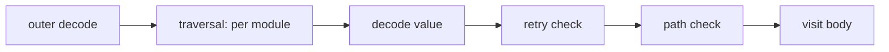

# internal/openflow

**Current state:** the package decodes a flow document and a flow value
by the reference's rules, defaults and error messages, and writes the
decoded form. The reference verifies most rules at `v1.767.0`; the decoder
also reads the fields that `v1.862.0`'s schema adds
([Fields that the v1.862.0 schema adds](#fields-that-the-v18620-schema-adds)).
It differs from `v1.862.0` on purpose in derived module ids
([Derived ids](#derived-ids)) and in rejecting the `question` tool and the
`aidecision` kind ([Decisions](#decisions-where-the-reference-is-silent)).

It decodes the AI-agent and `flowscript` kinds too, which the compiler
then refuses.

This README covers `internal/openflow/` and its `schema/` directory, the
vendored OpenFlow schema ([Vendored schema](#vendored-schema)).

The package holds windmill-lite's OpenFlow types and the *effective
decoder*: the rules by which Windmill accepts, rejects and defaults a
[flow](../../docs/glossary.md#flow) value, as the
[semantics reference](../../docs/glossary.md#semantics-reference) states
them, with the scope and differences of the current state above. Those rules differ from the OpenFlow schema in both directions
([OF-1](../../docs/semantics/openflow.md#of-1)). OpenFlow calls a
[step](../../docs/glossary.md#step) a module, and so do this package's
types.

- **Callers:** the sync-folder loader
  ([internal/syncfolder](../syncfolder/README.md)) decodes every
  `flow.yaml` with it, and the compiler ([internal/ir](../ir/README.md))
  compiles the decoded model. The oracle's tools
  ([internal/oracle](../oracle/README.md)) decode flows with it too.
- **It calls nothing** of windmill-lite's: it parses JSON itself.

What other packages do:

| What | Who does it |
|---|---|
| Read YAML or a sync folder, and resolve `!inline` references | [internal/yamlx](../yamlx/README.md), [internal/syncfolder](../syncfolder/README.md) |
| Apply what a successful deploy adds: the `bun` and `bunnative` switch, the virtual `<id>-v` steps, the lock policy, and the validation of features out of scope, including the refusal of `aiagent` and `flowscript` modules | [internal/ir](../ir/README.md), as the [IR, loader and validation](../../docs/design/0002-ir-and-loader.md) design record says |

## Files

| File | What it holds |
|---|---|
| `doc.go` | The package comment |
| `flow.go` | `DecodeFlow`, `DecodeFlowValue`, `FlowValue.AllModules`: the stages, the traversal and the two server checks |
| `json.go` | The JSON parser: a tree with input order, duplicates, number texts and JSON Pointers, and the nesting limit |
| `decode.go` | Struct decoding by serde's derive rules: known and unknown fields, required fields, scalars |
| `value.go` | Module values by kind, branches, AI-agent tools, the language and the script hash |
| `module.go` | Module envelopes, retries, derived ids |
| `transform.go` | Input transforms: ordinary and restricted slots |
| `types.go` | The decoded types and the skip flags' defaults |
| `language.go` | `Language`, `Languages` |
| `hash.go` | `ScriptHash`, `ParseScriptHash` |
| `encode.go` | The decoded form (`MarshalJSON`) |
| `errors.go` | `Error`, `ErrorKind` and Windmill's error texts |

## Public surface

### Decode and encode

| Name | Kind | What it does | Who calls it |
|---|---|---|---|
| `DecodeFlowValue` | func | Decodes a flow `value` from JSON text in Windmill's two stages, and runs its two server checks | tests (`DecodeFlow` decodes its `value` the same way) |
| `DecodeFlow`, `Flow` | func, struct | Decodes a flow document, the OpenFlow object of `flow.yaml`: `summary`, `description`, `value`, `schema`, `on_behalf_of_email` and `on_behalf_of`, plus the metadata field `timeout`. Other metadata keys are ignored, except that `ws_error_handler_muted: true` is rejected, as Windmill CE does | `internal/syncfolder`, `internal/oracle` |
| `FlowValue.MarshalJSON`, `Flow.MarshalJSON` | methods | Write the decoded form ([The decoded form](#the-decoded-form)) | the conformance tests, `encoding/json` callers |
| `FlowValue.AllModules` | method | Iterates over every module envelope, in the traversal order ([Stages and errors](#stages-and-errors)) | `internal/syncfolder`, `internal/oracle` |
| `Error`, `ErrorKind` | struct, int type | Every failure: `Kind` gives the stage, `Module` the module id that the message names, and `Pointer` the offending input value as an RFC 6901 JSON Pointer. The kinds are `ErrSyntax`, `ErrFlowValue`, `ErrModule`, `ErrRetryBase`, `ErrStepPath`, `ErrFlow`, `ErrEEOnly` | callers of the decoders |
| `ParseScriptHash`, `ScriptHash` | func, int64 type | The `script.hash` format ([OF-14](../../docs/semantics/openflow.md#of-14)) | the decoder; `ScriptHash` also `internal/ir` and `internal/oracle` |

### The decoded values

`internal/syncfolder` returns these types as a decoded `flow.yaml`, and
`internal/ir` compiles them. `internal/oracle`'s tools read them, the
engine reads `Language`, and the conformance tests compare their decoded
form.

| Name | Kind | What it holds |
|---|---|---|
| `FlowValue` | struct | A flow value: its modules, failure and preprocessor modules, `same_worker`, `flow_env` and the other flow-level fields |
| `Module` | struct | A module envelope: `id`, `summary`, `skip_if`, `stop_after_if`, `stop_after_all_iters_if`, `sleep`, `timeout`, `retry`, `mock`, `suspend`, `cache_ttl`, `continue_on_error` and the other envelope fields, `IDDerived`, and its `Value` |
| `Value`, `Kind` | interface, string type | A module value, one of `*RawScript`, `*PathScript`, `*PathFlow`, `*ForLoop`, `*WhileLoop`, `*BranchOne`, `*BranchAll`, `*Identity`, `*AIAgent` and `*FlowScript`. Its kind: `KindRawScript`, `KindScript`, `KindFlow`, `KindForLoop`, `KindWhileLoop`, `KindBranchOne`, `KindBranchAll`, `KindIdentity`, `KindAIAgent`, `KindFlowScript` |
| `RawScript`, `PathScript`, `PathFlow`, `ForLoop`, `WhileLoop`, `BranchOne`, `BranchAll`, `Branch`, `Identity`, `FlowScript` | structs | The module values. `ForLoop.SkipFailures` and `Branch.SkipFailure` record what was written; `EffectiveSkipFailures` gives `true` for an absent or null flag, and `EffectiveSkipFailure` gives `false` for an absent one |
| `AIAgent`, `AgentTool`, `ToolValue`, `ModuleTool`, `MCPTool`, `WebsearchTool` | structs, interface | An AI-agent module and its tools, decoded so that acceptance matches Windmill ([OF-9](../../docs/semantics/openflow.md#of-9)) |
| `InputTransform`, `TransformType`, `Transforms`, `NamedTransform` | struct, string type, slice, struct | An input, an iterator, a sleep, a timeout or a parallelism ([OF-10](../../docs/semantics/openflow.md#of-10)): `Static`, `JavaScript` or `AI`. `Transforms` keeps input order; a repeated name keeps its first position and its last transform |
| `Retry`, `ConstantRetry`, `ExponentialRetry`, `RetryIf`, `SkipIf`, `StopAfterIf`, `Mock`, `Suspend` | structs | The envelope's retry, predicates, mock and approval step. windmill-lite does not run approvals; `Suspend` is decoded so that acceptance matches Windmill |
| `Debouncing` | struct | The Enterprise Edition's debouncing configuration (EE), decoded and ignored |
| `EnvVar` | struct | One `flow_env` entry: the JSON text as written, which may hold `$var:` or `$res:` references, resolved at run time |
| `Language`, `Languages` | string type, var | A script language, and every language that the decoder accepts: `LangDeno`, `LangBun`, `LangBunNative`, `LangNativeTS`, `LangPython3`, `LangGo`, `LangBash`, and the others of [OF-13](../../docs/semantics/openflow.md#of-13) |

- **Verbatim JSON.** Static transform values, `flow_env` values, `schema`,
  mock return values and other free-form JSON are kept as the exact input
  text ([JE-40](../../docs/semantics/expressions.md#je-40)).
- **Order.** Maps keep input order.
- **Ownership.** Decoded values own their bytes: they are copies, so the
  caller may reuse its input buffer, and no two values share storage.

## The decoded form

The decoded form is windmill-lite's JSON rendering of a decoded value. It
is a lossy projection, not Windmill's stored full form.

- **What it writes.** It writes every default out, omits absent optional
  fields, and copies verbatim JSON as written. Conformance expectations
  address it with JSON Pointers.
- **What it loses.** Writing defaults out loses whether a field was
  written. An absent `skip_failures` or branch `skip_failure` is written
  out, and a derived id as an ordinary id.
- **Decoding it again** gives the same decoded form, but not an equal
  model: `ForLoop.SkipFailures` and `Branch.SkipFailure` are set where the
  original had them unset, and `Module.IDDerived` is cleared where the
  original had it set.
- **So never decode it** before a check that depends on presence, such as
  the compiler's `strict` option, which [internal/ir](../ir/README.md)
  applies to the decoded model.

## Decode rules

The input is JSON text, the form in which the `wmill` CLI sends a flow to
the server. Struct decoding follows the serde rules that the effective
decoder uses:

1. **Unknown names are ignored**, anywhere
   ([OF-4](../../docs/semantics/openflow.md#of-4)). Names are
   case-sensitive.
2. **Recognised fields are type-checked on every kind.** A module value is
   decoded with every field that any kind recognises, then `type` selects
   the kind, so a field that the kind does not use can still reject the
   value ([OF-V1](../../docs/semantics/openflow.md#of-v1)). Input transforms
   work the same way: `value` and `expr` are decoded whatever the `type`,
   which then selects the payload
   ([OF-10](../../docs/semantics/openflow.md#of-10)).
3. **A field given twice is an error**, also through an alias
   (`input_transform` for `input_transforms`, `custom_debounce_key` for
   `debounce_key`). A repeated map key keeps its first position and its
   last value.
4. **Null versus omission.** Optional fields, and every field of a module
   value, treat null as absent. Fields with a plain default reject null:
   branch `expr`, `skip_failure` and `parallel`, `same_worker`,
   `preserve_step_tags`, the retry sub-fields other than `random_factor`,
   and an envelope's `id`.
5. **Integers** are JSON integer literals within the field's width (`i8`,
   `i16`, `i32`, `u16`, `u32`, and `i64` for the debouncing fields). `1.0`,
   `1e3` and `-0` are floating point, and rejected.
6. **Two restricted slots,** module `timeout` (i32) and loop
   `parallelism` (u16), accept a bare integer as a static value. In object
   form they check every supplied `value` and `expr`, whatever the `type`
   ([OF-V2](../../docs/semantics/openflow.md#of-v2)).
7. **Nesting** is limited to 10000 levels, against stack exhaustion.

### Defaults

The decoder fills these when a field is absent:

| Field | Default | Finding |
|---|---|---|
| A module's `id` | Derived from its position ([Derived ids](#derived-ids)) | [OF-5](../../docs/semantics/openflow.md#of-5) |
| A `forloopflow`'s `skip_failures` | `true`; `null` also gives `true` (`EffectiveSkipFailures`) | [OF-6](../../docs/semantics/openflow.md#of-6) |
| A `whileloopflow`'s `skip_failures` | `false` | [OF-6](../../docs/semantics/openflow.md#of-6) |
| A `forloopflow`'s `parallel` | `false`; `parallelism` and `squash` none | [OF-6](../../docs/semantics/openflow.md#of-6) |
| A `branchall`'s `parallel` | `true` | [OF-6](../../docs/semantics/openflow.md#of-6) |
| A branch's `expr`, `skip_failure` and `parallel` | `""`, `false` (`EffectiveSkipFailure`) and `true`; `null` is rejected | [OF-6](../../docs/semantics/openflow.md#of-6) |
| A rawscript's `input_transforms` | `{}` | [OF-9](../../docs/semantics/openflow.md#of-9) |
| A `static` transform's `value`; a `javascript` transform's `expr` | `null`; `""` | [OF-10](../../docs/semantics/openflow.md#of-10) |
| A retry's sub-fields | `attempts` and `seconds` 0, `multiplier` 1, `random_factor` none. `{}` schedules no retry, but stays present in the decoded form, where the compiler reads its presence | [OF-11](../../docs/semantics/openflow.md#of-11) |
| A flow value's `same_worker` and `preserve_step_tags` | `false` | [OF-16](../../docs/semantics/openflow.md#of-16) |

- **Dropped fields.** `delete_after_use` and the while-loop `parallel`
  fields are type-checked and dropped
  ([OF-8](../../docs/semantics/openflow.md#of-8),
  [OF-12](../../docs/semantics/openflow.md#of-12)).
- **The skip flags.** The compiler's `strict` option must see whether the
  two skip flags were written
  ([Q-CF-13](../../docs/semantics/control-flow.md#q-cf-13)). So
  `ForLoop.SkipFailures` and `Branch.SkipFailure` record what was written,
  and `EffectiveSkipFailures` and `EffectiveSkipFailure` give the defaults
  of the table above.

### Derived ids

A module without an `id` gets `wl` plus the first 8 hex digits of the
SHA-256 of its position, its JSON Pointer within the flow value, and
`IDDerived` is set. Windmill generates 6 random characters instead; an id
derived from the position is a
[named deviation](../../docs/design/0001-equivalence-contract.md#5-named-deviations),
which keeps a bundle reproducible.

## Stages and errors

Validation runs in the stages of
[OF-2](../../docs/semantics/openflow.md#of-2), and the first failure wins.
For each module, the checks run in this order:

| `Kind` | Stage | Message |
|---|---|---|
| `ErrFlowValue` | The `FlowValue` fields, and the envelopes of the top-level, failure and preprocessor modules | `Invalid flow value: …` |
| `ErrModule` | A module value, with the envelopes of its body modules | `Module '<id>': …` |
| `ErrRetryBase` | An exponential retry with attempts and a zero base | `Module '<id>': Exponential backoff base (seconds) must be greater than 0. …` |
| `ErrStepPath` | A non-empty script or flow path outside `u/`, `f/`, `g/`, `hub/` | `step '<id>' references '<path>', which is not a workspace path …` |
| `ErrFlow` | A flow-document field outside `value` | `invalid flow: …`, with the field's JSON Pointer before the detail |
| `ErrEEOnly` | `ws_error_handler_muted: true` | windmill-lite's own text |
| `ErrSyntax` | The input is not JSON | `invalid JSON: …` |

- **The traversal** visits the main list, then `failure_module`, then
  `preprocessor_module`. It visits each module before its body: loop
  bodies, every branch in order, a `branchone`'s `default` after its
  branches, and the module values of AI-agent tools.
- **Messages** follow serde's wording where the reference quotes it, and
  are compared with Windmill by substring, as the reference does.

## Decisions where the reference is silent

Each is the smallest reading consistent with the reference.

| Question | The decoder's choice | Why | Pinned by |
|---|---|---|---|
| Is a null `expr` in an ordinary transform absent? | Yes | A restricted slot reads a null `expr` as absent; one reading for both kinds of slot | `TestInputTransforms` |
| Which `type` does a restricted slot take? | `static` or `javascript`; another is rejected with the ordinary transform's message. A loop's `parallelism` also takes `ai`, as the reference says that it decodes ([CF-7/e](../../docs/semantics/conformance.md#cf-7)). The reference says nothing of an `ai` timeout, which stays refused | Only what the reference says that the decoder accepts is accepted | `TestRestrictedTransforms` |
| In which order do one module's checks run? | The value decodes first, then the retry check, then the path check | [OF-2](../../docs/semantics/openflow.md#of-2) lists the retry check before the path check and decodes module values during the traversal; that the value decodes first is a reading | `TestStageOrder` |
| How wide are the debouncing fields? | `i64`. Rawscript `concurrent_limit` and `concurrency_time_window_s` are `i32` | The reference gives no width for the debouncing fields, and `i64` refuses nothing that a narrower width would accept; the rawscript fields take the width of the flow-level fields of the same name | `TestIntegerFields` (the envelope's debouncing, rawscript `concurrent_limit`); the other widths are code only |
| How are `assets` and AI-agent tools read? | `assets` is checked as a list and kept verbatim. An AI-agent tool's value is a module (no `tool_type`, a null one, or `flowmodule`), an `mcp` tool or a `websearch` tool ([OF-9](../../docs/semantics/openflow.md#of-9)). Another string is rejected as an unknown variant, and a `tool_type` that is not a string as an invalid type | Neither is run: the kind is out of scope, and nothing reads `assets`, so the decoder only needs to accept and reject as Windmill does | `TestKinds`, `TestCrossKindTypeChecks` (the list check); that `assets` is kept verbatim is code only |
| How are the fields that the `v1.862.0` schema adds decoded? | With the types that it declares, under the rules above ([Fields that the v1.862.0 schema adds](#fields-that-the-v18620-schema-adds)) | The schema is the only source for them | `TestFieldsAddedAtV1862`, `TestDecodeFlow` |
| What of the tool type `question` and the module kind `aidecision`, which the `v1.862.0` schema declares? | Rejected as unknown variants, so the question tool's own `timeout` is never read | The reference lists neither ([OF-9](../../docs/semantics/openflow.md#of-9)), and its variant lists and messages are kept as it gives them | `TestFieldsAddedAtV1862` (`question`); the `aidecision` rejection is code only |
| How deep may a document nest? | 10000 levels | Against stack exhaustion; the reference gives no limit | `TestParseJSONDepthLimit` |

## Tests

The tests need no environment variable.

### Run the tests

1. Run the package's tests, as CI's Go jobs do:
   `go test -race ./internal/openflow`
2. Fuzz the decoder. Without `-fuzztime` the fuzzer runs until you stop it
   or it finds a failure; this form stops after 60 s:
   `go test -run '^$' -fuzz FuzzDecodeFlowValue -fuzztime 60s ./internal/openflow`

CI runs the tests (not the fuzzer) in the Go buckets of `ubuntu-latest`
and `macos-latest` ([docs/ci.md](../../docs/ci.md#the-go-jobs)).

### Test files

| File | What it checks |
|---|---|
| `conformance_test.go` | The OpenFlow decode cases in [`conformance/openflow`](../../conformance/README.md); for each accepted case, that the decoded form decodes to the same decoded form. A second test reads the catalogue in `docs/semantics/conformance.md`, and fails unless every OF case is a decode case or is listed in `deferred.json` with a reason, and every cited case exists with the catalogue's provenance |
| `coverage_test.go` | The schema-coverage test ([LIC-3](../../docs/semantics/licensing.md#lic-3)): it walks every object schema that `OpenFlow` reaches in the vendored schema. It fails when a property is neither decoded by the decoder's field tables nor listed as ignored with a reason, or when a decoded name that the schema lacks has no reason. It also checks that the vendored file is unmodified |
| `decode_test.go` | The decode rules, stage order, error pointers, server checks, retries, kinds and languages. `TestDecodedValuesOwnTheirBytes`: no decoded value shares storage with another, with a later decode or with the input. `TestFieldsAddedAtV1862`: the fields that the `v1.862.0` schema adds, once decoded and again after an encode and a second decode, so an encoder that dropped one of them would fail |
| `flow_test.go` | The traversal order, derived ids, `DecodeFlow` (with `on_behalf_of` after an encode and a second decode), the decoded form's round trip and escaping, and that it is a projection. `FuzzDecodeFlowValue`: decoding never panics, and the decoded form of accepted input is stable |
| `json_test.go` | The JSON parser: malformed input, strings, end-of-file messages, syntax error positions, the depth limit, members and raw text, JSON Pointer escaping |

## Vendored schema

`schema/openflow.openapi.yaml` is Windmill's OpenFlow schema at
`v1.862.0`, unmodified.

- **Its source.** [`schema/NOTICE`](schema/NOTICE) records its source (the
  Windmill repository at tag `v1.862.0`, with its commit) and the file's
  SHA-256.
- **Its licence.** Windmill licenses its OpenAPI files under Apache-2.0, so
  the file keeps that licence, and `schema/LICENSE-APACHE` is the licence
  text. These files are not covered by the Unlicense of the rest of the
  repository.
- **Its use.** Only the coverage test reads the schema; no code is
  generated from it.

### Fields that the v1.862.0 schema adds

The schema is Windmill `v1.862.0`'s, while many of the reference's OpenFlow
findings are still verified at `v1.767.0` only
([Pinned version](../../docs/semantics/README.md#pinned-version)). The
coverage test finds every property that a flow document reaches in this
schema decoded, or listed as ignored. Of the nine properties that a flow
document reaches in this schema but not in `v1.767.0`'s, all but the
question tool's `timeout` are decoded:

| Field | Decoded as | At run time |
|---|---|---|
| `on_behalf_of` (flow) | A string | Decoded and ignored: the identity is [out of scope](../../docs/design/0001-equivalence-contract.md#3-out-of-scope) |
| `job_token_scopes`, on an envelope or an AI-agent tool | A list of strings; an empty list is kept, and differs from an absent one | Decoded and ignored: out of scope |
| `agent` | A string; every module kind type-checks it | A field of AI-agent modules, which the compiler refuses |
| `requires_approval` (an AI-agent tool) | A bool | The same |
| `tool_inputs` | A map, kept verbatim; every module kind type-checks it | The same |
| `suspend.skin` | Any string: the schema's two values are not enforced | A field of `suspend`, which the compiler refuses |
| `value.timeout` | An `i32`, the width of the metadata `timeout` | The flow's wall-clock limit, which the engine enforces ([FX-52](../../docs/semantics/execution.md#fx-52)) |
