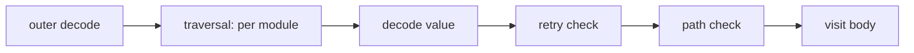

# internal/openflow

**Current state:** implemented (milestone A3 of
[0012](../../docs/design/0012-layout-and-milestones.md)); no other package
calls it yet. This README covers `internal/openflow/` and its `schema/`
directory. The package holds windmill-lite's OpenFlow types and the
*effective decoder*: the rules by which Windmill `v1.767.0` accepts, rejects
and defaults a flow value, which differ from the OpenFlow schema in both
directions ([OF-1](../../docs/semantics/openflow.md#of-1)). The sync-folder
loader (A4) and the compiler (A5), which will call it, do not exist yet.

What the package does not do:

- read YAML or a sync folder, or resolve `!inline` references (A2 and A4);
- apply what a successful deploy adds: the `bun` to `bunnative` switch,
  virtual `<id>-v` steps, the lock policy and validation of out-of-scope
  features (A5, per [0002](../../docs/design/0002-ir-and-loader.md)).

## API

| Name | What it does |
|---|---|
| `DecodeFlowValue(data)` | Decodes a flow `value` from JSON text in Windmill's two stages and runs its two server checks. |
| `DecodeFlow(data)` | Decodes a flow document, the OpenFlow object of `flow.yaml`: `summary`, `description`, `value`, `schema` and `on_behalf_of_email`, plus the metadata field `timeout`. Other metadata keys are ignored, except that `ws_error_handler_muted: true` is rejected as Windmill CE does. |
| `FlowValue`, `Module`, the value types | Decoded values. A module's `Value` is one of `*RawScript`, `*PathScript`, `*PathFlow`, `*ForLoop`, `*WhileLoop`, `*BranchOne`, `*BranchAll`, `*Identity`, `*AIAgent` and `*FlowScript`. |
| `(*FlowValue).AllModules()` | Iterates over every module envelope in the traversal order below. |
| `MarshalJSON` on `FlowValue` and `Flow` | Writes the *decoded form*: windmill-lite's JSON rendering of a decoded value, with the decoder's defaults written out. It is a lossy projection, not Windmill's stored full form: see [The decoded form](#the-decoded-form). |
| `*Error` | Every failure. `Kind` gives the stage, `Module` the module id the message names, and `Pointer` the offending input value as an RFC 6901 JSON Pointer. |
| `ParseScriptHash`, `ScriptHash` | The `script.hash` format ([OF-14](../../docs/semantics/openflow.md#of-14)). |

Static transform values, `flow_env` values, `schema`, mock return values and
other free-form JSON are kept as the exact input text
([JE-40](../../docs/semantics/expressions.md#je-40)). Maps keep input order.
Decoded values own their bytes: they are copies, so the caller may reuse its
input buffer, and no two values share storage.

## The decoded form

The decoded form writes every default out, omits absent optional fields, and
copies verbatim JSON as written. Conformance expectations address it with
JSON Pointers.

Writing defaults out loses whether a field was written. An absent
`skip_failures` or branch `skip_failure` is rendered `true`, and a derived id
as an ordinary id. Decoding the decoded form therefore gives the same
decoded form, but not an equal model: `ForLoop.SkipFailures`,
`Branch.SkipFailure` and `Module.IDDerived` are set where the original had
them unset. Never decode it before a check that depends on presence, such as
the compiler's `strict` option.

## Decode rules

The input is JSON text, the form in which the `wmill` CLI sends a flow to the
server. Struct decoding follows the serde rules the effective decoder uses:

1. **Unknown names are ignored**, anywhere
   ([OF-4](../../docs/semantics/openflow.md#of-4)). Names are case-sensitive.
2. **Recognised fields are type-checked on every kind.** A module value is
   decoded with every field any kind recognises, then `type` selects the kind,
   so a field the kind does not use can still reject the value
   ([OF-V1](../../docs/semantics/openflow.md#of-v1)). Input transforms work
   the same way: `value` and `expr` are decoded whatever the `type`, which
   then selects the payload
   ([OF-10](../../docs/semantics/openflow.md#of-10)).
3. **A field given twice is an error**, also through an alias
   (`input_transform` for `input_transforms`, `custom_debounce_key` for
   `debounce_key`). A repeated map key keeps its first position and its last
   value.
4. **Null versus omission.** Optional fields, and every field of a module
   value, treat null as absent. Fields with a plain default reject null:
   branch `expr`, `skip_failure` and `parallel`, `same_worker`,
   `preserve_step_tags`, the retry sub-fields other than `random_factor`,
   and an envelope's `id`.
5. **Integers** are JSON integer literals within the field's width (`i8`,
   `i16`, `i32`, `u16`, `u32`, and `i64` for the debouncing fields); `1.0`,
   `1e3` and `-0` are floating point and rejected.
6. **Two restricted slots**, module `timeout` (i32) and loop `parallelism`
   (u16), accept a bare integer as a static value, and in object form check
   every supplied `value` and `expr` whatever the `type`
   ([OF-V2](../../docs/semantics/openflow.md#of-v2)).

Defaults follow [OF-5](../../docs/semantics/openflow.md#of-5),
[OF-6](../../docs/semantics/openflow.md#of-6),
[OF-9](../../docs/semantics/openflow.md#of-9) to
[OF-11](../../docs/semantics/openflow.md#of-11) and
[OF-16](../../docs/semantics/openflow.md#of-16). `delete_after_use` and the
while-loop `parallel` fields are type-checked and dropped
([OF-8](../../docs/semantics/openflow.md#of-8),
[OF-12](../../docs/semantics/openflow.md#of-12)). For the two skip flags whose
absence the compiler's `strict` option must see
([Q-CF-13](../../docs/semantics/control-flow.md#q-cf-13)), `ForLoop.SkipFailures`
and `Branch.SkipFailure` record what was written and
`EffectiveSkipFailures`/`EffectiveSkipFailure` give the default.

A module without an `id` gets `wl` plus the first 8 hex digits of the SHA-256
of its position, its JSON Pointer within the flow value, and `IDDerived` is
set. This is deviation D6 of [0001](../../docs/design/0001-equivalence-contract.md);
Windmill generates 6 random characters instead.

## Stages and errors

Validation runs in the stages of
[OF-2](../../docs/semantics/openflow.md#of-2), and the first failure wins:



| `Kind` | Stage | Message |
|---|---|---|
| `ErrFlowValue` | FlowValue fields and the envelopes of top-level, failure and preprocessor modules | `Invalid flow value: …` |
| `ErrModule` | a module value, with the envelopes of its body modules | `Module '<id>': …` |
| `ErrRetryBase` | exponential retry with attempts and a zero base | `Module '<id>': Exponential backoff base (seconds) must be greater than 0. …` |
| `ErrStepPath` | non-empty script or flow path outside `u/`, `f/`, `g/`, `hub/` | `step '<id>' references '<path>', which is not a workspace path …` |
| `ErrFlow` | a flow-document field outside `value` | `invalid flow: …`, with the field's JSON Pointer before the detail |
| `ErrEEOnly` | `ws_error_handler_muted: true` | windmill-lite's own text |
| `ErrSyntax` | the input is not JSON | `invalid JSON: …` |

The traversal visits the main list, then `failure_module`, then
`preprocessor_module`; each module before its body; loop bodies, every
branch in order, a `branchone`'s `default` after its branches, and the module
values of AI-agent tools. Messages follow serde's wording where the reference
quotes it, and are compared with Windmill by substring, as the reference does.

## Readings the reference does not settle

Each is the smallest reading consistent with the reference; the milestone's
pull request lists them as open questions.

- A null `expr` in an ordinary transform counts as absent, as it does in a
  restricted slot.
- In a restricted slot, a `type` other than `static` or `javascript`,
  including `ai`, is rejected with the ordinary transform's message.
- Within one module, the value decodes first, then the retry check runs, then
  the path check.
- The integer widths of the debouncing fields are not in the reference; they
  are decoded as i64. Rawscript `concurrent_limit` and
  `concurrency_time_window_s` are i32, like the flow-level fields.
- `assets` is checked as a list and kept verbatim. AI-agent tools follow
  OF-9's outline; the kind is out of scope.
- Nesting is limited to 10000 levels, against stack exhaustion.

## Tests

- `conformance_test.go` runs the OpenFlow decode cases in
  [`conformance/openflow`](../../conformance/README.md). For each accepted
  case it also checks that the decoded form decodes to the same decoded
  form. A second test
  reads the catalogue in `docs/semantics/conformance.md` and fails unless
  every OF case is either a decode case or listed in `deferred.json` with a
  reason, and unless every cited case exists with the catalogue's provenance.
- `coverage_test.go` is the schema-coverage test
  ([LIC-3](../../docs/semantics/licensing.md#lic-3)). It walks every object
  schema that `OpenFlow` reaches in the vendored schema and fails when a
  property is neither decoded by the decoder's field tables nor listed as
  ignored with a reason, or when a decoded name the schema lacks has no
  reason. It also checks that the vendored file is unmodified.
- `decode_test.go`, `flow_test.go` and `json_test.go` cover the rules above,
  stage order, error pointers, derived ids, `DecodeFlow` and the parser.
  `TestDecodedValuesOwnTheirBytes` checks that no decoded value shares
  storage with another, with a later decode or with the input.
  `FuzzDecodeFlowValue` checks that decoding never panics and that the
  decoded form of accepted input is stable.

```sh
go test -race ./internal/openflow
go test -run '^$' -fuzz FuzzDecodeFlowValue ./internal/openflow
```

## Vendored schema

`schema/openflow.openapi.yaml` is Windmill's OpenFlow schema at `v1.767.0`,
unmodified. Windmill licenses its OpenAPI files under Apache-2.0, so the file
keeps that licence: [`schema/NOTICE`](schema/NOTICE) records its source,
commit and digest, and `schema/LICENSE-APACHE` is the licence text. These
files are not covered by the Unlicense of the rest of the repository. Only
the coverage test reads the schema; no code is generated from it.
