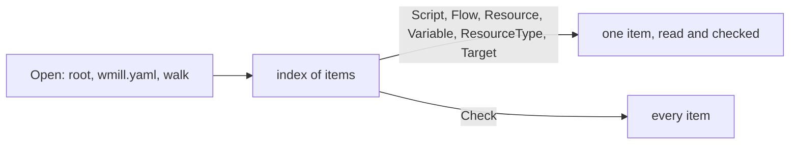

# internal/syncfolder

**Current state:** implemented (milestone A4 of
[0012](../../docs/design/0012-layout-and-milestones.md)); no other package
calls it yet. This README covers `internal/syncfolder/` and its `testdata/`.
The package reads a `wmill sync` folder the way the `wmill` CLI pushes it:
step 1 of the loader pipeline of
[0002](../../docs/design/0002-ir-and-loader.md). It finds the root, reads
`wmill.yaml`, maps files to Windmill paths, applies the filters, and reads
scripts, flows, resources, resource types and variables
([SY-1](../../docs/semantics/openflow.md#sy-1) to
[SY-15](../../docs/semantics/openflow.md#sy-15),
[SY-V1](../../docs/semantics/openflow.md#sy-v1) to
[SY-V4](../../docs/semantics/openflow.md#sy-v4)).

It parses YAML with [internal/yamlx](../yamlx/README.md) and decodes
`flow.yaml` with [internal/openflow](../openflow/README.md). It does not
compile flows, apply what a deploy adds, check a step's script `hash`,
bundle codebase scripts, resolve or decrypt secrets, or decide which items a
bundle needs. The compiler (`internal/ir`, milestone A5) does those, and does
not exist yet.

## Two stages



`Open` and `Load` fail only when the folder as a whole cannot be read: no
`wmill.yaml`, an invalid `wmill.yaml`, or an I/O error during the walk.
Everything about one item is checked when that item is read, so a build that
reads only what its roots reach fails only for those items, as 0002's host
contract requires. Problems found by the walk (two files for one path, a
dotted script path, a flow folder in the wrong style) also appear in
`Warnings`. `Check` reads every item that is not filtered out and joins the
errors, which refuses what `wmill sync push` refuses.

## API

| Name | What it does |
|---|---|
| `Find(dir)` | The sync root: the nearest directory from `dir` upwards that holds `wmill.yaml`. The search stops after the git root (a directory holding `.git`, file or directory) or the file system root. |
| `Open(dir)` | `Find`, then the walk over an `os.Root`, so no read leaves the root, symbolic links included. Close the folder when done. |
| `Load(fsys)` | The walk over any `fs.FS` whose root holds `wmill.yaml`. |
| `(*Folder).Script`, `Flow`, `Resource`, `Variable`, `ResourceType` | Read one item by Windmill path (a resource type by name). |
| `(*Folder).Target(from, module)` | Read the target of a `script` or `flow` step of flow `from`; errors name the step (SY-15). |
| `(*Folder).Paths(kind)`, `Filtered(kind)` | The sorted paths of the items of a kind that are kept, or filtered out. |
| `(*Folder).Check()` | Read every kept item and join the errors. |
| `(*Folder).FS()` | The folder's file system, for builders that read further files. |
| `Folder.Config`, `Skipped`, `Warnings` | `wmill.yaml` as read, the files recognised and not loaded, and diagnostics. |
| `HasNativeAnnotation(src)` | The `native` header annotation of TypeScript source (SY-V3), which the compiler also applies to rawscripts. |
| `*Error` | Every failure: `Kind`, the item, the step, the file and position, a message, and the wrapped `*yamlx.Error`, `*openflow.Error` or I/O error. |

Reads go to the files each time, and may run concurrently. The record types
(`Script`, `Flow`, …) marshal to the JSON the conformance cases address.

## The walk

The root is the directory of `wmill.yaml`. Items live under `u/`, `f/` and
`g/`; directories whose name starts with `.` and `node_modules` are skipped,
and a symbolic link to a directory is not followed. Under the item
directories:

| File or folder | Item |
|---|---|
| `P.flow/` (`P__flow/` with `nonDottedPaths: true`), holding `flow.yaml` | flow `P` |
| a script source, `P.<ext>` for an extension of SY-3, and `P.script.yaml` | script `P` |
| `P.resource.yaml`, `P.variable.yaml` | resource or variable `P` |
| `<name>.resource-type.yaml`, at the root only | resource type `name` |
| `P.script.lock` and the files inside a flow folder | read through the item that refers to them |
| `*.resource.file.*`, `*.fileset/` | the data of file and fileset resources, which are refused (below), so never read |

Schedules, triggers, native triggers, folder metadata, apps, raw apps, users,
groups, settings, the encryption key, workspace dependency files, datatable
migrations, `ui/`, per-workspace override files, a flat `*.flow.json`, the
CLI's `wmill-lock.yaml` and `.wmillignore` are listed in `Skipped`
([SY-12](../../docs/semantics/openflow.md#sy-12),
[SY-14](../../docs/semantics/openflow.md#sy-14),
[PA-1](../../docs/semantics/openflow.md#pa-1)). An override file is
`<base>.<workspace>.<type>.yaml` for a workspace declared under `workspaces`
or its deprecated spellings, matched in file-name form (`my.ws` is `my_ws`).
Other files are ignored; a `.yaml` file whose type is unknown gets a warning.

**Paths.** A flow, resource or variable path is its file's path without the
folder marker or type suffix, dots and all. A script's path is what the CLI
gives it: everything before the first dot of the file's path, so
`f/a/x.bun.ts` is `f/a/x`. When a dot comes earlier, in a folder or file name
(`f/my.dir/x.ts`, `f/a/types.d.ts`), the CLI renames the script by cutting
there; windmill-lite refuses the file instead (`dotted_path`), and a lookup of
the uncut path says why.

**Two files for one path** of a kind are an error naming both (`duplicate_path`):
two sources (`x.ts` and `x.py`, or `x.ts` and `x.test.ts`), a `.flow` and a
`__flow` folder, a YAML and a JSON file.

## Filters

The skip switches (`skipScripts`, `skipFlows`, `skipResources`,
`skipVariables`, `skipResourceTypes`, and `skipSecrets` for secret variables)
and the path filter of [SY-13](../../docs/semantics/openflow.md#sy-13) and
[SY-V2](../../docs/semantics/openflow.md#sy-v2) apply to each item's main
file: a script's source, a flow's `flow.yaml`, a resource or variable file.
The path filter is active only when `includes` or `excludes` has entries; a
file then passes when `includes` is absent or one of its globs matches, no
`excludes` glob matches, and `extraIncludes` is absent, empty, or has a glob
that matches. An empty `includes` list matches nothing. Resource types bypass
the path filter. A filtered item is reported as `filtered`, with the rule.
Whether a variable is a secret is known only once it is read, so `Paths`
lists a secret under `skipSecrets` and reading it reports `filtered`.

**Globs** are minimatch globs with default options. `glob.go` implements the
syntax on which minimatch 9 and 10 agree: `*`, `?`, classes with `!` or `^`
and ranges, `\` escapes, `**` segments, brace lists and sequences, a leading
`!` (negation) and `#` (a comment, which matches nothing). A segment that
starts with `.` is matched only by a pattern segment that starts with a
literal `.` (a one-character class such as `[.]` counts). It refuses, with
`unsupported_glob`:

- extglobs (`@(…)`, `!(…)`, `+(…)`, `?(…)`, `*(…)`) and POSIX classes;
- segments that read as `.` or `..`, which minimatch 10 resolves as directory
  steps;
- a trailing `\`, an escaped `\` (brace expansion turns it into an active
  one), and an escape in a segment that starts with `*` or `?` (minimatch 9
  and 10 compare those as text);
- braces that do not expand (`{}`, `{a}`, an unclosed `{`), `${`, and more
  than 4096 expansions.

## Scripts

- **Language** comes from the file name by SY-3's ordered suffix tests, with
  `defaultTs` (bun when `wmill.yaml` sets none, with a warning). A bare
  `.sql` fails with a dialect hint (`unknown_language`). A script whose name
  gives bun and whose source carries the `native` annotation is `bunnative`
  ([SY-V3](../../docs/semantics/openflow.md#sy-v3)).
- **Metadata** ([SY-4](../../docs/semantics/openflow.md#sy-4)): `summary`,
  `description`, `schema` (verbatim), `kind`, `envs`, `timeout`, `cache_ttl`,
  `delete_after_secs`, `restart_unless_cancelled` and `has_preprocessor` are
  type-checked; the whole file is also kept as JSON. Other keys are ignored. A
  script without metadata gets the CLI's defaults: empty summary and
  description, kind `script`, and its lock from `P.script.lock`.
- **Lock** ([SY-5](../../docs/semantics/openflow.md#sy-5)): an `!inline
  <file>` reference relative to the root, whose missing file is the empty
  lock; any other string as written; a list of strings joined with `\n`; or
  absent (nil).
- **Codebase** ([SY-8](../../docs/semantics/openflow.md#sy-8)): only a script
  whose name gives bun is matched against `codebases`, in order; an entry
  without `includes` selects every script, otherwise an include must match,
  and a matching exclude passes to the next entry. The entry's settings are
  kept as JSON for the bundler.

## Flows

`flow.yaml` is parsed by yamlx and decoded by `openflow.DecodeFlow`; decode
errors keep Windmill's message (`invalid_flow`). A flow folder in the style
`nonDottedPaths` does not select, or without `flow.yaml`, fails with
`flow_layout` ([SY-6](../../docs/semantics/openflow.md#sy-6)). Then every
rawscript, in the decoder's traversal order and including AI-agent tools, is
resolved ([SY-7](../../docs/semantics/openflow.md#sy-7),
[SY-V1](../../docs/semantics/openflow.md#sy-v1)):

1. Only content that starts with `!inline` is a reference; otherwise the lock
   stays as written, even an `!inline` string.
2. The file is the second space-separated token of the string, joined to the
   flow folder (`..` resolved, a leading `/` not special).
3. A missing content file is tried again as `<module id>.` plus everything
   after the first dot of the name. Every content file still missing is
   reported at once (`missing_inline_file`).
4. A lock is a reference when, after JavaScript's leading white space, it
   starts with `!inline `; its token comes from the untrimmed string, so
   `" !inline a.lock"` names `!inline`. A missing lock file is the empty lock.

`Flow.Inline` records which files each rawscript came from.

## Resources, resource types and variables

A resource has `resource_type`, `description` and its `value` as the JSON the
CLI sends, with `$var:` and `$res:` strings kept
([SY-10](../../docs/semantics/openflow.md#sy-10)). File and fileset resources
(`value.content: '!inline …'`, `value: '!inline_fileset …'`) are `later`
scope and fail with `unsupported_feature`. A variable has a string `value`,
`is_secret` and `description`; `Encrypted` marks a secret whose value is
ciphertext, which it is unless `wmill.yaml` sets `plainSecrets`
([SY-11](../../docs/semantics/openflow.md#sy-11)). Resolving secrets is the
platform's job (milestone PF2).

## Errors

| `Kind` | When |
|---|---|
| `wmill_yaml_not_found`, `invalid_config`, `unsupported_glob`, `io` | the folder cannot be read (`Open`, `Load`), or a file cannot |
| `yaml` | a file is not YAML that yamlx reads; the wrapped `*yamlx.Error` says whether the CLI rejects it too |
| `not_in_folder`, `filtered`, `hub_path` | the folder cannot supply the item or step target (SY-15) |
| `duplicate_path`, `dotted_path`, `flow_layout`, `missing_source` | the walk's problems with an item |
| `unknown_language`, `invalid_metadata`, `invalid_flow`, `invalid_text` | an item's files |
| `missing_inline_file`, `path_escape` | inline and lock references |
| `unsupported_feature` | `unsupported: <feature>`: multi-file (`__mod`) scripts, JSON-mode files, file and fileset resources |

## Divergences and restrictions

Each is labelled in its message. They are the loader divergences of 0002 and
restrictions of [0001](../../docs/design/0001-equivalence-contract.md) §5a:

- a script file the CLI would rename by cutting its path at an earlier dot is
  refused;
- the root is always the directory of `wmill.yaml`; under `noCdToRoot` the
  CLI walks the working directory instead, and `Open` warns
  ([SY-V4](../../docs/semantics/openflow.md#sy-v4));
- `!inline` references, and script lock references, that leave the root are
  refused (`path_escape`); an absolute script lock reference is refused too,
  and reads through `Open` never follow a link out of the root;
- script, inline and lock files must be UTF-8 (`invalid_text`);
- globs outside the syntax above, and `wmill.yaml` values of the wrong type,
  are refused.

## Readings the reference does not settle

Each is the smallest reading consistent with the reference; the milestone's
pull request lists them as open questions.

- **Glob version and options.** The reference says minimatch, not which
  version or options. The glob cases were observed on minimatch 10.2.6 and
  agree with 9.0.9; default options are assumed.
- **Which file an item is filtered by.** The CLI filters files; this package
  filters each item by its main file and reads the item's other files
  whatever the filter says.
- **The walk's extension list** is not enumerated in the reference. Script
  sources are the extensions of SY-3 plus a bare `.sql`; other files are
  ignored.
- **No `wmill.yaml`** is an error rather than defaults.
- **A codebase entry with `includes: []`** selects nothing, as an empty
  filter list does; the reference says only that an entry with no `includes`
  selects every script.
- **The content fallback for a name without a dot** is not tried.
- **Script lock references** use the inline-lock rule of SY-V1 (leading white
  space, then the second token).
- **Text files** keep a byte order mark as U+FEFF.
- **Variables and resources** without `value` read as `""` and `null`.
- Per-workspace overrides are recognised and skipped, never applied
  (SY-12 `later`).

## Tests

- `conformance_test.go` runs the sync-folder cases of
  [`conformance/syncfolder`](../../conformance/README.md): it writes each
  case's files to a temporary directory, opens it, and checks what the case
  expects. A second test reads the catalogue in
  `docs/semantics/conformance.md` and fails unless every SY and PA case is a
  case there or is listed in `deferred.json` with a reason; the SY-9 cases
  are yamlx's, and the test checks that its case file holds them.
- `glob_test.go` checks `testdata/minimatch.json`: glob observations made on
  npm minimatch as a black box, and the refused patterns.
  `TestMinimatchCrossCheck` re-derives every observation; it runs only when
  `SYNCFOLDER_MINIMATCH` names an installed minimatch package and `node` is on
  `PATH`:

  ```sh
  npm install --ignore-scripts --prefix "$D" minimatch@10.2.6
  SYNCFOLDER_MINIMATCH="$D/node_modules/minimatch" go test -run TestMinimatchCrossCheck ./internal/syncfolder
  ```

  `FuzzGlob` checks that compiling and matching never panic and that a
  negated pattern matches exactly what the pattern does not.
- `native_test.go` covers the annotation's spelling and position rules.
- `syncfolder_test.go` covers root discovery, symbolic links, configuration
  errors, error text, `Check`, duplicate and JSON-mode data files,
  concurrent reads, and lock-reference white space.
