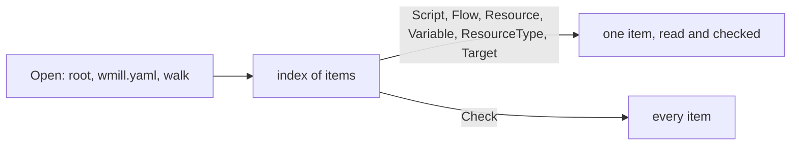

# internal/syncfolder

**Current state:** the package reads a sync folder as the `wmill` CLI
pushes it: the root, `wmill.yaml`, the walk, the filters, and the
scripts, flows, resources, resource types and variables. It refuses what
windmill-lite does not run or cannot read as the CLI would: JSON mode,
multi-file scripts, file and fileset resources, and the restrictions of
[Divergences and restrictions](#divergences-and-restrictions).

This README covers `internal/syncfolder/` and its `testdata/`:
`minimatch.json`, the glob observations.

The package reads a [sync folder](../../docs/glossary.md#sync-folder) the
way the `wmill` CLI pushes it. It is step 1 of the loader pipeline of the
[IR, loader and validation](../../docs/design/0002-ir-and-loader.md)
design record. It finds the root, reads `wmill.yaml`, maps files to
Windmill paths, applies the filters, and reads scripts, flows, resources,
resource types and variables
([SY-1](../../docs/semantics/openflow.md#sy-1) to
[SY-19](../../docs/semantics/openflow.md#sy-19),
[SY-V1](../../docs/semantics/openflow.md#sy-v1) to
[SY-V4](../../docs/semantics/openflow.md#sy-v4)).

- **Callers:** the compiler ([internal/ir](../ir/README.md)) reads folders
  through it; [internal/bundle](../bundle/README.md)'s build and `wltest`
  open the folder (`Find`, `Load`), and the oracle's stub reads one
  (`Open`).
- **What it calls:** [internal/yamlx](../yamlx/README.md) parses the YAML,
  and [internal/openflow](../openflow/README.md) decodes `flow.yaml`.

What other packages do:

| What | Who does it |
|---|---|
| Compile flows, apply what a deploy adds, check a step's script `hash`, decide which items a bundle needs | [internal/ir](../ir/README.md) |
| Bundle codebase scripts | [internal/bundle](../bundle/README.md) |
| Resolve and decrypt secrets | [internal/platform](../platform/README.md) |

## Files

| File | What it holds |
|---|---|
| `syncfolder.go` | `Find`, `Open`, `Load`, `Folder`, `Paths`, `Filtered`, `FS`, `Check` |
| `walk.go` | The walk: how files map to items, the filters, and the walk's problems |
| `config.go` | `wmill.yaml`: `Config`, `Codebase` |
| `glob.go` | The glob syntax that windmill-lite reads as minimatch does |
| `script.go` | `Folder.Script`: path scripts, their metadata, locks and references |
| `flow.go` | `Folder.Flow`, `FlowDocument`, `InlineScript`: flows, `!inline` references and inline scripts |
| `data.go` | `Folder.Resource`, `ResourceType`, `Variable`, `Target`, `TargetDocument`, `Item` |
| `text.go` | The CLI's text decoder and the UTF-8 rule |
| `native.go` | `HasNativeAnnotation`, `HasAnnotation` |
| `node.go` | Reading fields of a YAML mapping, with their errors |
| `errors.go` | `Error`, `ErrorKind` and the kinds |

## Two stages

- **`Open` and `Load` fail only when the folder as a whole cannot be
  read:** an invalid `wmill.yaml`, a tree pulled in JSON mode, or an I/O
  error during the walk.
- **No `wmill.yaml`.** They warn as the CLI does, and use every setting's
  absent value ([SY-13](../../docs/semantics/openflow.md#sy-13)).
- **Per item.** Everything about one item is checked when that item is
  read. So a build that reads only what its roots reach fails only for
  those items, as the design record's host contract requires.
- **Walk problems,** such as two files for one path, a dotted script path,
  or a flow folder in the wrong style, also appear in `Warnings`.
- **`Check`** does what `wmill sync push` does. It reads the first bytes of
  every file that the CLI's walk reads, and fails on a file that the CLI's
  decoder refuses, before any item
  ([SY-19](../../docs/semantics/openflow.md#sy-19)). Then it reads every
  item that is not filtered out, and joins the errors.

## Public surface

### Open a folder

| Name | Kind | What it does | Who calls it |
|---|---|---|---|
| `Find` | func | The sync root: the nearest directory from `dir` upwards that holds `wmill.yaml` (`ConfigFile`). The search stops after the git root (a directory that holds `.git`, file or directory) or the file system root. With no `wmill.yaml` up to there, the root is `dir` ([SY-13](../../docs/semantics/openflow.md#sy-13)) | `internal/bundle`, `wltest` |
| `Open` | func | `Find`, then the walk over an `os.Root`, so no read leaves the root, symbolic links included. Close the folder when done (`Folder.Close`) | the oracle's stub, tests |
| `Load` | func | The walk over any `fs.FS`, with the `wmill.yaml` at its root, or none | `internal/bundle`, `wltest` |
| `Folder` | struct | An opened folder: `Config` (`wmill.yaml` as read), `Skipped` (the files recognised and not loaded) and `Warnings` (diagnostics) | `internal/ir`, `internal/bundle`, `wltest`, the oracle's stub |
| `ConfigFile` | const | `wmill.yaml` | the package; no other package reads it |
| `Config`, `Codebase` | structs | `wmill.yaml`'s settings, and one `codebases` entry | `internal/bundle`; `internal/ir` reads `Codebase` through `Script.Codebase` |
| `Skipped` | struct | A file that the walk recognised and did not load, with its reason | `Folder.Skipped`; the tests |

### Read items

| Name | Kind | What it does | Who calls it |
|---|---|---|---|
| `Folder.Script`, `Folder.Flow`, `Folder.Resource`, `Folder.Variable`, `Folder.ResourceType` | methods | Read one item by Windmill path (a resource type by name) | `internal/ir` (scripts), `internal/bundle` (scripts and data items), `wltest`, the oracle's tools |
| `Folder.Target` | method | Read the target of a `script` or `flow` step of flow `from`; errors name the step ([SY-15](../../docs/semantics/openflow.md#sy-15)) | `internal/ir`, the oracle's tools |
| `Folder.FlowDocument`, `Folder.InlineScript`, `Folder.TargetDocument` | methods | Read a flow, or a flow step's target, with its `!inline` references unresolved, then resolve one rawscript at a time by the rules that `Flow` applies. The compiler uses them so that a host-provided inline step's files are never read | `internal/ir` |
| `Folder.Paths`, `Folder.Filtered` | methods | The sorted paths of the items of a kind that are kept, or filtered out | `Paths`: `internal/ir`, `internal/bundle`, `wltest`, the oracle's tools; `Filtered`: the tests |
| `Folder.Check` | method | Fail on the files of the walk that the decoder refuses, or read every kept item and join the errors | the tests; no other package calls it |
| `Folder.FS` | method | The folder's file system, for builders that read further files | no caller yet (`internal/bundle` and `wltest` pass `(*os.Root).FS` to `Load`) |
| `Item`, `ItemKind` | interface, string type | An item (`ItemKind`, `ItemPath`), and its kind: `KindScript`, `KindFlow`, `KindResource`, `KindVariable`, `KindResourceType` | the readers' callers |
| `Script`, `ScriptMetadata`, `ScriptKind` | structs, string type | A path script, its `.script.yaml`, and its `kind`: `ScriptKindScript`, `ScriptKindTrigger`, `ScriptKindFailure`, `ScriptKindApproval`, `ScriptKindPreprocessor` | the readers' callers |
| `Flow`, `InlineScript` | structs | A flow, with the files that each rawscript came from (`Flow.Inline`), and one inline script | the readers' callers |
| `Resource`, `ResourceType`, `Variable` | structs | The data items ([Resources, resource types and variables](#resources-resource-types-and-variables)) | the readers' callers |
| `HasNativeAnnotation` | func | The `native` header annotation of TypeScript source ([SY-V3](../../docs/semantics/openflow.md#sy-v3)), which the compiler also applies to rawscripts | `internal/ir`, the oracle's stub |
| `HasAnnotation` | func | Any header annotation, by the same rule ([WR-31](../../docs/semantics/languages.md#wr-31)). The compiler reads `nobundling`, the other flags and `schema_validation` with it | `internal/ir`; `internal/bundle`'s annotation cases |
| `Error`, `ErrorKind` | struct, string type | Every failure ([Errors](#errors)) | `internal/ir` wraps it in its `load` errors; `internal/bundle`, `wltest` |

- **Reads go to the files each time,** and may run concurrently.
- **JSON.** The record types (`Script`, `Flow`, …) marshal to the JSON that
  the conformance cases address.
- **Warnings.** `Script.Warnings` and `InlineScript.Warnings` hold what the
  CLI warns about while it reads an item's files.

## The walk

The root is the directory of `wmill.yaml`, or the start directory when
there is none. Items live under `u/`, `f/` and `g/`. Directories whose name
starts with `.`, and `node_modules`, are skipped, and a symbolic link to a
directory is not followed.

Under the item directories, the first rule that matches classifies each
file ([SY-18](../../docs/semantics/openflow.md#sy-18)). The data of file
and fileset resources (the last row) is tested first, so
`x.resource.file.ts` is resource content, not a script:

| File or folder | Item |
|---|---|
| Any file inside `P.flow/` (`P__flow/` with `nonDottedPaths: true`), at any depth | Flow `P`, without the one marker that ends the name: `report__flow.flow/` is flow `report__flow` |
| `P.<ext>`, for a last extension `.ts`, `.py`, `.go`, `.sh`, `.sql`, `.gql`, `.ps1`, `.js`, `.php`, `.rs`, `.cs`, `.nu`, `.java`, `.rb` or `.r`, or a name ending `.playbook.yml` | Script `P` (its source) |
| `P.script.yaml`, `P.script.lock` | Script `P` (its metadata and lock) |
| `P.resource.yaml`, `P.variable.yaml` | Resource or variable `P` |
| `<name>.resource-type.yaml`, at the root only | Resource type `name` |
| `*.resource.file.*`, `*.fileset/` | The data of file and fileset resources, which are refused (below). `Check` reads only the first bytes of a `*.resource.file.*` that the walk keeps |

- **Kept extensions.** The CLI's walk keeps a file only when the text after
  its last dot is one of `yaml`, `go`, `sh`, `ts`, `py`, `sql`, `gql`,
  `ps1`, `php`, `js`, `lock`, `rs`, `cs`, `yml`, `nu`, `java`, `rb` or `r`
  (resource content files aside). So a `README.md` in a flow folder is not
  a flow file.
- **`.json` files** are dropped too, since windmill-lite reads YAML mode
  only. A `*.resource.json`, `*.variable.json` or `*.resource-type.json`
  gets a warning and is not an item. A script's `P.script.json` is still
  paired with it, and refused as JSON-mode metadata.
- **JSON mode.** A `wmill.yaml` that sets `json: true` is refused.

### What the walk skips

- **Listed in `Skipped`** ([SY-12](../../docs/semantics/openflow.md#sy-12),
  [SY-14](../../docs/semantics/openflow.md#sy-14),
  [PA-1](../../docs/semantics/openflow.md#pa-1)): schedules, triggers,
  native triggers, folder metadata, apps, raw apps, users, groups,
  settings, the encryption key, workspace dependency files, datatable
  migrations, `ui/`, per-workspace override files, a flat `*.flow.json`,
  the CLI's `wmill-lock.yaml` and `.wmillignore`.
- **Override files.** An override file is `<base>.<workspace>.<type>.yaml`,
  for a workspace declared under `workspaces` or its deprecated spellings,
  matched in file-name form (`my.ws` is `my_ws`). Overrides are recognised
  and skipped, not applied. A top-level `overrides` in `wmill.yaml` is
  refused (`invalid_config`): overrides belong under `workspaces`.
- **Other files** are ignored. A `.yaml` file whose type is unknown gets a
  warning.
- **Names that are not UTF-8.** A file or folder whose name is not valid
  UTF-8 gets a warning, and is skipped: the CLI reads names as UTF-8 with
  replacement characters, and cannot open such a file again by that name.

### Paths

- **A flow, resource or variable path** is its file's path without the
  folder marker or type suffix, dots and all.
- **A script's path** is what the CLI gives it: everything before the first
  dot of the file's path, so `f/a/x.bun.ts` is `f/a/x`.
- **An earlier dot.** When a dot comes earlier, in a folder or file name
  (`f/my.dir/x.ts`, `f/a/types.d.ts`), the CLI renames the script by
  cutting there. windmill-lite refuses the file instead (`dotted_path`),
  and a lookup of the uncut path says why.
- **Two files for one path** of a kind are an error that names both
  (`duplicate_path`): two sources (`x.ts` and `x.py`, or `x.ts` and
  `x.test.ts`), or a `.flow` and a `__flow` folder.

## Filters

The skip switches (`skipScripts`, `skipFlows`, `skipResources`,
`skipVariables`, `skipResourceTypes`, and `skipSecrets` for secret
variables) and the path filter of
[SY-13](../../docs/semantics/openflow.md#sy-13) and
[SY-V2](../../docs/semantics/openflow.md#sy-v2) apply to each file on its
own ([SY-17](../../docs/semantics/openflow.md#sy-17)). A file that passes
pushes its whole item, whose other files are read whatever the filter
says.

A windmill-lite build is a fresh deploy, so every file is new, and a new
file selects its item as follows:

| Item | The files that select it |
|---|---|
| Script | Its source |
| Flow | Any file of its folder that the walk keeps, except metadata (`*.script.yaml`), locks (`*.lock`) and resource content files: `flow.yaml`, an inline script, or a file that the flow never refers to |
| Resource, variable, resource type | Its file |

- **A flow folder with no such file** is not a flow, with a warning.
- **The path filter** is active only when `includes` or `excludes` has
  entries. A file then passes when all of these hold:
  - `includes` is absent, or one of its globs matches;
  - no `excludes` glob matches;
  - `extraIncludes` is absent, empty, or has a glob that matches.
- **An empty `includes` list** matches nothing.
- **Resource types** bypass the path filter.
- **A filtered item** is reported as `filtered`, with the rule.
- **Secrets.** Whether a variable is a secret is known only once it is
  read. So `Paths` lists a secret under `skipSecrets`, and reading it
  reports `filtered`.

### Globs

Globs are minimatch globs with default options, matched against the
file's path relative to the root
([SY-16](../../docs/semantics/openflow.md#sy-16)). `glob.go` implements the
syntax on which minimatch 9 and 10 agree.

- **The syntax:** `*`, `?`, classes with `!` or `^` and ranges, `\`
  escapes, `**` segments, brace lists and sequences, a leading `!`
  (negation), and `#` (a comment, which matches nothing).
- **Dot segments.** A segment that starts with `.` is matched only by a
  pattern segment that starts with a literal `.`; a one-character class
  such as `[.]` counts.
- **UTF-16 units.** Characters are UTF-16 code units, as in minimatch's
  JavaScript regular expressions. A character outside the Basic
  Multilingual Plane, such as `😀`, is two units, its surrogate halves.
- **`?` and classes.** `?` matches one unit: `f/?.ts` does not match
  `f/😀.ts`, and `f/??.ts` does. The class `[😀]` holds both halves and
  matches either one, but never the whole character: `f/[😀].ts` does not
  match `f/😀.ts`, while `f/[😀]?.ts`, `f/?[😀].ts` and `f/[😀][😀].ts` do.
  `testdata/minimatch.json` holds these observations.
- **Time.** Matching takes time polynomial in the pattern and the path: a
  mismatch lets only the last `*` take one more unit, and `**` states are
  memoized.
- **Sequences.** A sequence's step ignores its sign, counts 0 as 1, and
  gives only the start when it exceeds the distance between the ends, as
  minimatch does, even for `{a..z..-9223372036854775808}`.

The glob code refuses these with `unsupported_glob`:

- extglobs (`@(…)`, `!(…)`, `+(…)`, `?(…)`, `*(…)`) and POSIX classes;
- segments that read as `.` or `..`, which minimatch 10 resolves as
  directory steps;
- a trailing `\`, an escaped `\` (brace expansion turns it into an active
  one), and an escape in a segment that starts with `*` or `?` (minimatch 9
  and 10 compare those as text);
- braces that do not expand (`{}`, `{a}`, an unclosed `{`), `${`, and more
  than 4096 expansions;
- sequence ends beyond ±2^53, and a step beyond 2^53 that does not exceed
  the ends' distance, which JavaScript would round.

## Scripts

- **Language.** The file name gives the language, by
  [SY-3](../../docs/semantics/openflow.md#sy-3)'s ordered suffix tests,
  with `defaultTs` (bun when `wmill.yaml` sets none, with a warning).
  - A bare `.sql` fails with a dialect hint, and a `.js` source with the
    CLI's `The item <file> has an unrecognized type ending script`
    (`unknown_language`).
  - A script whose name gives bun and whose source carries the `native`
    annotation is `bunnative`
    ([SY-V3](../../docs/semantics/openflow.md#sy-v3)).
- **Metadata** ([SY-4](../../docs/semantics/openflow.md#sy-4)).
  - `summary`, `description`, `schema` (verbatim), `kind`, `envs`,
    `timeout`, `cache_ttl`, `delete_after_secs`,
    `restart_unless_cancelled` and `has_preprocessor` are type-checked. The
    whole file is also kept as JSON. Other keys are ignored.
  - A metadata file without `schema` has none (`null`).
  - A script without metadata gets the CLI's default file on push, whose
    schema and lock the push then regenerates. The schema comes from
    `main`'s parameters, which the loader does not infer, so it stays
    `null`. The lock is `P.script.lock`, as the default file names it,
    since windmill-lite never generates one.
- **Lock** ([SY-5](../../docs/semantics/openflow.md#sy-5)).
  - A list of strings is joined with `\n` first.
  - A string that starts with exactly `!inline ` is a reference to the file
    named by its second space-separated token, relative to the root.
  - A missing or unreadable file is the empty lock, with the CLI's warning
    `Error reading inline path: <file>, <error>` in `Script.Warnings`,
    `<file>` as written. `<error>` is Node's text,
    `Error: ENOENT: no such file or directory, open '<file>'`, for a missing
    file, and `Error: ` with the decoder's message for a refused one.
  - The reference gives no text for other failures, such as a file without
    read permission: `<error>` is then `Error: ` and Go's error.
  - Any other string, ` !inline …` with its leading space included, is the
    lock as written. An absent lock is nil.
- **Codebase** ([SY-8](../../docs/semantics/openflow.md#sy-8)).
  - Only a script whose name gives bun is matched against `codebases`, in
    order.
  - An entry without `includes` selects every script, and `includes: []`
    none. Otherwise an include must match, and a matching exclude passes to
    the next entry.
  - A single string in `includes` or `excludes` is a one-element list.
  - The entry's settings are kept as JSON for the bundler.

## Flows

`flow.yaml` is parsed by yamlx and decoded by `openflow.DecodeFlow`; decode
errors keep Windmill's message (`invalid_flow`). A flow folder in the style
that `nonDottedPaths` does not select, or without `flow.yaml`, fails with
`flow_layout` ([SY-6](../../docs/semantics/openflow.md#sy-6)).

Then every rawscript, in the decoder's traversal order and including
AI-agent tools, is resolved
([SY-7](../../docs/semantics/openflow.md#sy-7),
[SY-V1](../../docs/semantics/openflow.md#sy-v1)):

1. **Content.** Only content that starts with `!inline` is a reference.
   Otherwise the lock stays as written too, even an `!inline` string.
2. **The file** is the second space-separated token of the string, joined
   to the flow folder (`..` resolved, a leading `/` not special).
3. **A missing content file** is tried again as `<module id>.` plus
   everything after the first dot of the reference (nothing when it has
   none), with the CLI's `Script file <file> not found`. Every content file
   still missing is reported at once (`missing_inline_file`).
4. **A lock** is a reference when, after JavaScript's leading white space,
   it starts with `!inline `. Its token comes from the untrimmed string, so
   `" !inline a.lock"` names `!inline`. A lock file that is missing or
   cannot be read, a refused one included, is the empty lock, with the
   CLI's `Lock file <file> not found, treating as empty`, `<file>` as
   written.

`Flow.Inline` records which files each rawscript came from.

## Resources, resource types and variables

- **A resource** has `resource_type`, `description`, and its `value` as the
  JSON that the CLI sends, with `$var:` and `$res:` strings kept
  ([SY-10](../../docs/semantics/openflow.md#sy-10)).
- **A resource without `value`,** or whose `value` is null, fails as the
  CLI's push does, with its `TypeError`. One without `resource_type` fails
  as the server refuses it.
- **File and fileset resources** (`value.content: '!inline …'`,
  `value: '!inline_fileset …'`) are not supported yet; they are later work,
  and fail with `unsupported_feature` (the message says `later scope`).
- **A variable** has a string `value`, `is_secret` and `description`, all
  three required. The server refuses a new variable without one, naming the
  first missing as ``missing field `value` `` and so on
  ([SY-11](../../docs/semantics/openflow.md#sy-11)).
- **`Encrypted`** marks a secret whose value is ciphertext, which it is
  unless `wmill.yaml` sets `plainSecrets`. Resolving secrets is the
  platform's job ([internal/platform](../platform/README.md)).

## Text files

Every text file goes through the CLI's decoder
([SY-19](../../docs/semantics/openflow.md#sy-19)). A leading UTF-8 byte
order mark is removed, and a leading UTF-16 or UTF-32 one is refused with
`File <file> is encoded as UTF-16 LE, which is not supported. Please convert it to UTF-8.`
(`invalid_text`). What a refusal does depends on how the file is reached:

| The refused file | Outcome |
|---|---|
| One that the CLI's walk reads: kept, and passing the filter | `Check` fails before any item; reading the item fails too when the item reads that file |
| `wmill.yaml` | `Open` and `Load` fail, inside `YAML syntax error in wmill.yaml` |
| A script's source or metadata, `flow.yaml`, a resource, variable or resource-type file | Reading the item fails |
| A script lock reference that the walk does not read | The empty lock, with a warning in `Script.Warnings` |
| A flow's inline content file that the walk does not read | Read as missing, so the fallback name is tried |
| A flow's inline lock file that the walk does not read | The empty lock, with the missing-file warning in `InlineScript.Warnings` |

The last three rows hold for a file that cannot be read for any other
reason too, such as its permissions, since the CLI's reference readers
catch every failure ([SY-5](../../docs/semantics/openflow.md#sy-5),
[SY-7](../../docs/semantics/openflow.md#sy-7)). The exception is a read
through a symbolic link that fails for a reason other than permissions:
reads never follow a link out of the root, so it fails the item.

## Errors

Every failure of `Find`, `Open`, `Load` and the item readers is an
`*Error`; `Check` joins them, and `Folder.Close` returns the closer's own
error unchanged.

An `*Error` holds its `Kind`, then, where they apply, the
item (`script f/a/x`), the step whose target it is, the file and its
position, a message, and the wrapped `*yamlx.Error`, `*openflow.Error` or
I/O error. A field that does not apply is empty, and `Err` is nil when
nothing is wrapped. `Error()` writes the step, the item and the file
before the message.

- **`Open` and `Load`** return one `*Error`, for the folder as a whole.
- **An item reader** (`Script`, `Flow`, `Target`, …) returns one `*Error`
  about that item. A problem that the walk found with the item's files is
  returned when the item is read.
- **`Check`** returns the errors joined with `errors.Join`: first those of
  the files that the decoder refuses, and only when there are none, those
  of every kept item. A secret that `skipSecrets` filters out is not an
  error there.

| `Kind` (constant) | When it is raised | Returned by |
|---|---|---|
| `invalid_config` (`ErrConfig`) | `wmill.yaml` has a value of the wrong type, holds a value other than a mapping (an empty or null file is an empty mapping), or has a non-empty top-level `overrides` | `Open`, `Load` |
| `unsupported_glob` (`ErrGlob`) | A `wmill.yaml` glob outside the syntax of [Globs](#globs) | `Open`, `Load` |
| `io` (`ErrIO`) | The root cannot be found or walked; or a source, metadata or data file that an item names is missing (`the file is missing`), or a file it reads cannot be read. A missing lock is not an error, and an unreadable one is a warning unless the walk read it or the read goes through a symbolic link | `Find`, `Open`, `Load`; an item reader |
| `yaml` (`ErrYAML`) | A file is not YAML that yamlx reads. The wrapped `*yamlx.Error` says whether the CLI rejects it too | `Open`, `Load` for `wmill.yaml`; an item reader |
| `not_in_folder` (`ErrNotInFolder`) | No item of that kind has the path; or, from `Target` and `TargetDocument`, a step that has no by-path target (not a `script` or `flow` step) | An item reader, `Target`, `TargetDocument` |
| `filtered` (`ErrFiltered`) | `wmill.yaml`'s filters or skip switches exclude the item ([SY-15](../../docs/semantics/openflow.md#sy-15)) | An item reader, `Target`, `TargetDocument` |
| `hub_path` (`ErrHubPath`) | A step's target is a `hub/` path, which a folder cannot supply | `Target`, `TargetDocument` |
| `duplicate_path` (`ErrDuplicate`) | Two files define one item | An item reader; also a warning of the walk, unless the item is filtered out |
| `dotted_path` (`ErrDottedPath`) | A script file whose path the CLI would cut at its first dot ([Divergences and restrictions](#divergences-and-restrictions)) | The same |
| `flow_layout` (`ErrFlowLayout`) | A flow folder whose suffix style is not the one that `nonDottedPaths` selects (also a warning of the walk), or that has no `flow.yaml` (found only when the flow is read) | An item reader |
| `missing_source` (`ErrMissingSource`) | Script metadata without a source file | The same |
| `unknown_language` (`ErrLanguage`) | A script's language cannot be inferred from its file name, or its source is a `.js` file | An item reader |
| `invalid_metadata` (`ErrMetadata`) | A metadata, resource, variable or resource-type file has a value of the wrong type, or lacks one that the push needs | An item reader |
| `invalid_flow` (`ErrFlow`) | The flow document does not decode; the wrapped `*openflow.Error` has Windmill's message | An item reader |
| `missing_inline_file` (`ErrMissingInline`) | An `!inline` content reference that names no file, or whose file is missing under its own name and under the fallback name of [Flows](#flows) rule 3 (with a warning). A missing inline lock file is no error: the lock is empty, with a warning | An item reader, `InlineScript` |
| `path_escape` (`ErrPathEscape`) | An `!inline` or lock reference that leaves the root, or an absolute lock reference | An item reader |
| `invalid_text` (`ErrText`) | A file that the CLI's decoder refuses for its UTF-16 or UTF-32 byte order mark, `wmill.yaml` included; or a script, inline or lock file that is not UTF-8 | `Open`, `Load`, an item reader, `Check` |
| `unsupported_feature` (`ErrUnsupported`) | `unsupported: <feature>`: multi-file (`__mod`) scripts, JSON mode and JSON-mode metadata, file and fileset resources | `Open`, `Load` (JSON mode); an item reader |

## Divergences and restrictions

`dotted_path` and `path_escape` name the IR and loader design record in
their messages, and the `noCdToRoot` warning names [SY-V4](../../docs/semantics/openflow.md#sy-v4); the others carry
no label. They are the loader's divergences of the
[IR, loader and validation](../../docs/design/0002-ir-and-loader.md) design
record, and the
[restrictions](../../docs/design/0001-equivalence-contract.md#5a-restrictions)
of the equivalence contract:

| windmill-lite | The `wmill` CLI |
|---|---|
| Refuses a script file whose path has an earlier dot (`dotted_path`) | Renames the script, cutting its path at that dot |
| Always takes the root as the directory of `wmill.yaml`; under `noCdToRoot`, `Open` warns ([SY-V4](../../docs/semantics/openflow.md#sy-v4)) | Under `noCdToRoot`, walks the working directory |
| Refuses `!inline` references and script lock references that leave the root, and an absolute script lock reference (`path_escape`) | Reads them |
| Never follows a link out of the root through `Open`, so a lock or inline reference whose read fails through a link fails | Reads the link's target |
| Requires script, inline and lock files to be UTF-8 (`invalid_text`) | Reads an invalid sequence as U+FFFD |
| Refuses a tree pulled in JSON mode (`json: true`) | Reads it |
| Refuses globs outside the syntax of [Globs](#globs), and `wmill.yaml` values of the wrong type | Takes them |

## Decisions where the reference is silent

Each is the smallest reading consistent with the reference.

| Question | The loader's choice | Why | Pinned by |
|---|---|---|---|
| What is the schema of a script without metadata? | `null` | The push infers it from `main`'s parameters, which nothing in windmill-lite does | `conformance/syncfolder` |
| Which files does the walk's read cover? | The files of the items that this package loads. Files that it lists in `Skipped` are not read, so their encoding is not checked. A file that the walk keeps that cannot be read at all is reported by reading its item, not by `Check`'s first pass | A file that nothing loads cannot change what runs; an unreadable file has no bytes for the decoder to refuse | `syncfolder_test.go` (`TestUnreadableReferences`: the item fails), `conformance/syncfolder` ([SY-19](../../docs/semantics/openflow.md#sy-19)); the rest is code only |
| What do the warning for a script lock file that cannot be read for a reason other than missing or refused, the warning for a refused inline lock file, and the error for a null variable field say? | windmill-lite's own wording | The reference gives the CLI's text only where these messages quote it | `conformance/syncfolder`, `syncfolder_test.go` |
| What happens to per-workspace overrides? | They are recognised and skipped, not applied | Applying them is not implemented yet; skipping keeps the base items as the folder holds them ([SY-12](../../docs/semantics/openflow.md#sy-12)) | `conformance/syncfolder` (`sy-12.json`), `syncfolder_test.go` |

## Tests

The tests need no Bun. The minimatch cross-check skips unless
`SYNCFOLDER_MINIMATCH` is set; once it is set, the test fails without
`node` or the package.

### Run the tests

1. Run the package's tests, as CI's Go jobs do:
   `go test -race ./internal/syncfolder`
2. To cross-check the glob observations against npm's minimatch, install
   it in a directory `$D` of your own:
   `npm install --ignore-scripts --prefix "$D" minimatch@10.2.6`
3. Run the cross-check with `SYNCFOLDER_MINIMATCH` set, and `node` on
   `PATH`:
   `SYNCFOLDER_MINIMATCH="$D/node_modules/minimatch" go test -run TestMinimatchCrossCheck ./internal/syncfolder`
4. Fuzz the glob code. Without `-fuzztime` the fuzzer runs until you stop
   it or it finds a failure; this form stops after 60 s:
   `go test -run '^$' -fuzz FuzzGlob -fuzztime 60s ./internal/syncfolder`

CI runs the tests (not the cross-check or the fuzzer) in
`Go (ubuntu-latest)` and `Go (macos-latest, packages)`
([docs/ci.md](../../docs/ci.md#the-go-jobs)).

| Variable | Value | Tests that need it | When it is not set |
|---|---|---|---|
| `SYNCFOLDER_MINIMATCH` | The directory of an installed `minimatch` package | `TestMinimatchCrossCheck`, which also needs `node` on `PATH` | The test skips. Set without `node` on `PATH` or the package, it fails |

### Test files

| File | What it checks |
|---|---|
| `conformance_test.go` | The sync-folder cases of [`conformance/syncfolder`](../../conformance/README.md): it writes each case's files to a temporary directory, opens it, and checks what the case expects. A second test reads the catalogue in `docs/semantics/conformance.md`, and fails unless every catalogue case of the reference's [sync-folder findings](../../docs/semantics/openflow.md#b-sync-folder) and [prior-art findings](../../docs/semantics/openflow.md#c-prior-art-windmill-ts) is a case there or is listed in `deferred.json` with a reason. The cases of the YAML dialect ([SY-9](../../docs/semantics/openflow.md#sy-9)) are yamlx's, and the test checks that its case file holds them |
| `glob_test.go` | `testdata/minimatch.json`: glob observations made on npm minimatch as a black box, and the refused patterns. `TestMinimatchCrossCheck` derives every observation again. `TestGlobMatchingIsBounded` checks a step bound on patterns that make a backtracking matcher exponential, and `TestSequenceLimits` the sequence ends and steps at the integer limits. `TestGlobNegationAndComments` and `TestBraceExpansionBound` check negation, comments and the 4096-expansion bound |
| `glob_test.go`, `FuzzGlob` | Compiling and matching never panic; a negated pattern matches exactly what the pattern does not; on short inputs the matcher agrees with a plain backtracking one |
| `native_test.go` | The annotation's spelling and position rules, for `native` and for other keys |
| `syncfolder_test.go` | Root discovery, with and without `wmill.yaml`; symbolic links; configuration errors; error text; `Check`; `.json` data files and overrides; concurrent reads; lock-reference white space; names that are not UTF-8; the two-step reading of `FlowDocument`, `InlineScript` and `TargetDocument`. Also unreadable references (`TestUnreadableReferences`), problems as warnings (`TestProblemsAreWarnings`), and the targets of other steps (`TestTargetOfOtherSteps`) |
