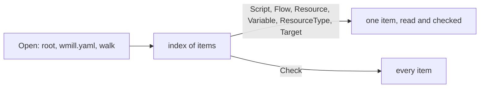

# internal/syncfolder

**Current state:** implemented (milestone A4 of
[0012](../../docs/design/0012-layout-and-milestones.md)); the compiler,
[internal/ir](../ir/README.md), reads folders through it. This README covers
`internal/syncfolder/` and its `testdata/`.
The package reads a `wmill sync` folder the way the `wmill` CLI pushes it:
step 1 of the loader pipeline of
[0002](../../docs/design/0002-ir-and-loader.md). It finds the root, reads
`wmill.yaml`, maps files to Windmill paths, applies the filters, and reads
scripts, flows, resources, resource types and variables
([SY-1](../../docs/semantics/openflow.md#sy-1) to
[SY-19](../../docs/semantics/openflow.md#sy-19),
[SY-V1](../../docs/semantics/openflow.md#sy-v1) to
[SY-V4](../../docs/semantics/openflow.md#sy-v4)).

It parses YAML with [internal/yamlx](../yamlx/README.md) and decodes
`flow.yaml` with [internal/openflow](../openflow/README.md). It does not
compile flows, apply what a deploy adds, check a step's script `hash`,
bundle codebase scripts, resolve or decrypt secrets, or decide which items a
bundle needs. The compiler ([internal/ir](../ir/README.md)) does all but the
bundling, which is the build's, and the secrets, which are the platform's.

## Two stages



`Open` and `Load` fail only when the folder as a whole cannot be read: an
invalid `wmill.yaml`, a tree pulled in JSON mode, or an I/O error during the
walk. Without a `wmill.yaml` they warn as the CLI does and use every setting's
absent value ([SY-13](../../docs/semantics/openflow.md#sy-13)). Everything
about one item is checked when that item is read, so a build that reads only
what its roots reach fails only for those items, as 0002's host contract
requires. Problems found by the walk (two files for one path, a dotted script
path, a flow folder in the wrong style) also appear in `Warnings`. `Check`
does what `wmill sync push` does: it reads the first bytes of every file the
CLI's walk reads, and fails on a file the CLI's decoder refuses before any
item ([SY-19](../../docs/semantics/openflow.md#sy-19)); then it reads every
item that is not filtered out and joins the errors.

## API

| Name | What it does |
|---|---|
| `Find(dir)` | The sync root: the nearest directory from `dir` upwards that holds `wmill.yaml`. The search stops after the git root (a directory holding `.git`, file or directory) or the file system root; with no `wmill.yaml` up to there, the root is `dir` (SY-13). |
| `Open(dir)` | `Find`, then the walk over an `os.Root`, so no read leaves the root, symbolic links included. Close the folder when done. |
| `Load(fsys)` | The walk over any `fs.FS`, with the `wmill.yaml` at its root, or none. |
| `(*Folder).Script`, `Flow`, `Resource`, `Variable`, `ResourceType` | Read one item by Windmill path (a resource type by name). |
| `(*Folder).Target(from, module)` | Read the target of a `script` or `flow` step of flow `from`; errors name the step (SY-15). |
| `(*Folder).FlowDocument`, `InlineScript`, `TargetDocument` | Read a flow, or a flow step's target, with its `!inline` references unresolved, then resolve one rawscript at a time by the rules `Flow` applies. The compiler uses them so that a host-provided inline step's files are never read (0002, host contract). |
| `(*Folder).Paths(kind)`, `Filtered(kind)` | The sorted paths of the items of a kind that are kept, or filtered out. |
| `(*Folder).Check()` | Fail on the files of the walk that the decoder refuses, or read every kept item and join the errors. |
| `(*Folder).FS()` | The folder's file system, for builders that read further files. |
| `Folder.Config`, `Skipped`, `Warnings` | `wmill.yaml` as read, the files recognised and not loaded, and diagnostics. |
| `HasNativeAnnotation(src)` | The `native` header annotation of TypeScript source (SY-V3), which the compiler also applies to rawscripts. |
| `HasAnnotation(src, key)` | Any header annotation by the same rule (WR-31): the compiler reads `nobundling`, the other flags and `schema_validation` with it. |
| `*Error` | Every failure: `Kind`, the item, the step, the file and position, a message, and the wrapped `*yamlx.Error`, `*openflow.Error` or I/O error. |

Reads go to the files each time, and may run concurrently. The record types
(`Script`, `Flow`, …) marshal to the JSON the conformance cases address.
`Script.Warnings` and `InlineScript.Warnings` hold what the CLI warns about
while it reads an item's files.

## The walk

The root is the directory of `wmill.yaml`, or the start directory when
there is none. Items live under `u/`, `f/` and
`g/`; directories whose name starts with `.` and `node_modules` are skipped,
and a symbolic link to a directory is not followed. Under the item
directories, each file is classified by the first rule that matches
([SY-18](../../docs/semantics/openflow.md#sy-18)):

| File or folder | Item |
|---|---|
| any file inside `P.flow/` (`P__flow/` with `nonDottedPaths: true`), at any depth | flow `P`, without the one marker that ends the name: `report__flow.flow/` is flow `report__flow` |
| `P.<ext>`, for a last extension `.ts`, `.py`, `.go`, `.sh`, `.sql`, `.gql`, `.ps1`, `.js`, `.php`, `.rs`, `.cs`, `.nu`, `.java`, `.rb` or `.r`, or a name ending `.playbook.yml` | script `P` (its source) |
| `P.script.yaml`, `P.script.lock` | script `P` (its metadata and lock) |
| `P.resource.yaml`, `P.variable.yaml` | resource or variable `P` |
| `<name>.resource-type.yaml`, at the root only | resource type `name` |
| `*.resource.file.*`, `*.fileset/` | the data of file and fileset resources, which are refused (below); `Check` reads only the first bytes of a `*.resource.file.*` the walk keeps |

The CLI's walk keeps a file only when the text after its last dot is one of
`yaml`, `go`, `sh`, `ts`, `py`, `sql`, `gql`, `ps1`, `php`, `js`, `lock`,
`rs`, `cs`, `yml`, `nu`, `java`, `rb` or `r` (resource content files aside),
so a `README.md` in a flow folder is not a flow file. `.json` files are
dropped too, since windmill-lite reads YAML mode only: a `*.resource.json`,
`*.variable.json` or `*.resource-type.json` gets a warning and is not an
item. A script's `P.script.json` is still paired with it, and refused as
JSON-mode metadata. A `wmill.yaml` that sets `json: true` is refused.

Schedules, triggers, native triggers, folder metadata, apps, raw apps, users,
groups, settings, the encryption key, workspace dependency files, datatable
migrations, `ui/`, per-workspace override files, a flat `*.flow.json`, the
CLI's `wmill-lock.yaml` and `.wmillignore` are listed in `Skipped`
([SY-12](../../docs/semantics/openflow.md#sy-12),
[SY-14](../../docs/semantics/openflow.md#sy-14),
[PA-1](../../docs/semantics/openflow.md#pa-1)). An override file is
`<base>.<workspace>.<type>.yaml` for a workspace declared under `workspaces`
or its deprecated spellings, matched in file-name form (`my.ws` is `my_ws`).
Other files are ignored; a `.yaml` file whose type is unknown gets a warning,
and so does a file or folder whose name is not valid UTF-8, which is skipped:
the CLI reads names as UTF-8 with replacement characters, and cannot open
such a file again by that name.

**Paths.** A flow, resource or variable path is its file's path without the
folder marker or type suffix, dots and all. A script's path is what the CLI
gives it: everything before the first dot of the file's path, so
`f/a/x.bun.ts` is `f/a/x`. When a dot comes earlier, in a folder or file name
(`f/my.dir/x.ts`, `f/a/types.d.ts`), the CLI renames the script by cutting
there; windmill-lite refuses the file instead (`dotted_path`), and a lookup of
the uncut path says why.

**Two files for one path** of a kind are an error naming both (`duplicate_path`):
two sources (`x.ts` and `x.py`, or `x.ts` and `x.test.ts`), or a `.flow` and a
`__flow` folder.

## Filters

The skip switches (`skipScripts`, `skipFlows`, `skipResources`,
`skipVariables`, `skipResourceTypes`, and `skipSecrets` for secret variables)
and the path filter of [SY-13](../../docs/semantics/openflow.md#sy-13) and
[SY-V2](../../docs/semantics/openflow.md#sy-v2) apply to each file on its own
([SY-17](../../docs/semantics/openflow.md#sy-17)). A file that passes pushes
its whole item, whose other files are read whatever the filter says. A
windmill-lite build is a fresh deploy, so every file is new, and a new file
selects its item as follows:

| Item | The files that select it |
|---|---|
| script | its source |
| flow | any file of its folder that the walk keeps, except metadata (`*.script.yaml`), lock (`*.lock`) and resource content files: `flow.yaml`, an inline script, or a file the flow never refers to |
| resource, variable, resource type | its file |

A flow folder that has no such file at all is not a flow, with a warning.

The path filter is active only when `includes` or `excludes` has entries; a
file then passes when `includes` is absent or one of its globs matches, no
`excludes` glob matches, and `extraIncludes` is absent, empty, or has a glob
that matches. An empty `includes` list matches nothing. Resource types bypass
the path filter. A filtered item is reported as `filtered`, with the rule.
Whether a variable is a secret is known only once it is read, so `Paths`
lists a secret under `skipSecrets` and reading it reports `filtered`.

**Globs** are minimatch globs with default options, matched against the
file's path relative to the root
([SY-16](../../docs/semantics/openflow.md#sy-16)). `glob.go` implements the
syntax on which minimatch 9 and 10 agree: `*`, `?`, classes with `!` or `^`
and ranges, `\` escapes, `**` segments, brace lists and sequences, a leading
`!` (negation) and `#` (a comment, which matches nothing). A segment that
starts with `.` is matched only by a pattern segment that starts with a
literal `.` (a one-character class such as `[.]` counts).

Characters are UTF-16 code units, as in minimatch's JavaScript regular
expressions. A character outside the Basic Multilingual Plane, such as `😀`,
is two units, its surrogate halves. `?` matches one unit: `f/?.ts` does not
match `f/😀.ts`, and `f/??.ts` does. The class `[😀]` holds both halves and
matches either one, but never the whole character: `f/[😀].ts` does not
match `f/😀.ts`, while `f/[😀]?.ts`, `f/?[😀].ts` and `f/[😀][😀].ts` do.
`testdata/minimatch.json` holds these observations.

Matching takes time polynomial in the pattern and the path: a mismatch lets
only the last `*` take one more unit, and `**` states are memoized.

A sequence's step ignores its sign, counts 0 as 1, and gives only the start
when it exceeds the distance between the ends, as minimatch does even for
`{a..z..-9223372036854775808}`. It refuses, with `unsupported_glob`:

- extglobs (`@(…)`, `!(…)`, `+(…)`, `?(…)`, `*(…)`) and POSIX classes;
- segments that read as `.` or `..`, which minimatch 10 resolves as directory
  steps;
- a trailing `\`, an escaped `\` (brace expansion turns it into an active
  one), and an escape in a segment that starts with `*` or `?` (minimatch 9
  and 10 compare those as text);
- braces that do not expand (`{}`, `{a}`, an unclosed `{`), `${`, and more
  than 4096 expansions;
- sequence ends beyond ±2^53, and a step beyond 2^53 that does not exceed
  the ends' distance, which JavaScript would round.

## Scripts

- **Language** comes from the file name by SY-3's ordered suffix tests, with
  `defaultTs` (bun when `wmill.yaml` sets none, with a warning). A bare
  `.sql` fails with a dialect hint and a `.js` source with the CLI's
  `The item <file> has an unrecognized type ending script`
  (`unknown_language`). A script whose name gives bun and whose source
  carries the `native` annotation is `bunnative`
  ([SY-V3](../../docs/semantics/openflow.md#sy-v3)).
- **Metadata** ([SY-4](../../docs/semantics/openflow.md#sy-4)): `summary`,
  `description`, `schema` (verbatim), `kind`, `envs`, `timeout`, `cache_ttl`,
  `delete_after_secs`, `restart_unless_cancelled` and `has_preprocessor` are
  type-checked; the whole file is also kept as JSON. Other keys are ignored. A
  metadata file without `schema` has none (`null`). A script without metadata
  gets the CLI's default file on push, whose schema and lock the push then
  regenerates: the schema from `main`'s parameters, which the loader does
  not infer, so it stays `null`, and the lock, which windmill-lite never
  generates, so the lock is `P.script.lock` as the default file names it.
- **Lock** ([SY-5](../../docs/semantics/openflow.md#sy-5)): a list of strings
  is joined with `\n` first. A string that starts with exactly `!inline `
  is a reference to the file named by its second space-separated token,
  relative to the root; a missing or unreadable file is the empty lock, with
  the CLI's warning `Error reading inline path: <file>, <error>` in
  `Script.Warnings`, `<file>` as written. `<error>` is Node's text,
  `Error: ENOENT: no such file or directory, open '<file>'` for a missing
  file and `Error: ` with the decoder's message for a refused one. The
  reference gives no text for other failures, such as a file without read
  permission; `<error>` is then `Error: ` and Go's error. Any other string,
  ` !inline …` with its leading space included, is the lock as written; an
  absent lock is nil.
- **Codebase** ([SY-8](../../docs/semantics/openflow.md#sy-8)): only a script
  whose name gives bun is matched against `codebases`, in order; an entry
  without `includes` selects every script, `includes: []` none, otherwise an
  include must match, and a matching exclude passes to the next entry. A
  single string in `includes` or `excludes` is a one-element list. The
  entry's settings are kept as JSON for the bundler.

## Flows

`flow.yaml` is parsed by yamlx and decoded by `openflow.DecodeFlow`; decode
errors keep Windmill's message (`invalid_flow`). A flow folder in the style
`nonDottedPaths` does not select, or without `flow.yaml`, fails with
`flow_layout` ([SY-6](../../docs/semantics/openflow.md#sy-6)). Then every
rawscript, in the decoder's traversal order and including AI-agent tools, is
resolved ([SY-7](../../docs/semantics/openflow.md#sy-7),
[SY-V1](../../docs/semantics/openflow.md#sy-v1)):

1. Only content that starts with `!inline` is a reference; otherwise the lock
   stays as written, even an `!inline` string.
2. The file is the second space-separated token of the string, joined to the
   flow folder (`..` resolved, a leading `/` not special).
3. A missing content file is tried again as `<module id>.` plus everything
   after the first dot of the reference, nothing when it has none, with the
   CLI's `Script file <file> not found`. Every content file still missing is
   reported at once (`missing_inline_file`).
4. A lock is a reference when, after JavaScript's leading white space, it
   starts with `!inline `; its token comes from the untrimmed string, so
   `" !inline a.lock"` names `!inline`. A lock file that is missing or
   cannot be read, a refused one included, is the empty lock, with the
   CLI's `Lock file <file> not found, treating as empty`, `<file>` as
   written.

`Flow.Inline` records which files each rawscript came from.

## Resources, resource types and variables

A resource has `resource_type`, `description` and its `value` as the JSON the
CLI sends, with `$var:` and `$res:` strings kept
([SY-10](../../docs/semantics/openflow.md#sy-10)). A resource without `value`,
or whose `value` is null, fails as the CLI's push does, with its `TypeError`;
one without `resource_type` fails as the server refuses it. File and fileset
resources (`value.content: '!inline …'`, `value: '!inline_fileset …'`) are
`later` scope and fail with `unsupported_feature`. A variable has a string
`value`, `is_secret` and `description`, all three required: the server
refuses a new variable without one, naming the first missing as
``missing field `value` `` and so on
([SY-11](../../docs/semantics/openflow.md#sy-11)). `Encrypted` marks a
secret whose value is ciphertext, which it is unless `wmill.yaml` sets
`plainSecrets`. Resolving secrets is the platform's job (milestone PF2).

## Text files

Every text file goes through the CLI's decoder
([SY-19](../../docs/semantics/openflow.md#sy-19)): a leading UTF-8 byte order
mark is removed, and a leading UTF-16 or UTF-32 one is refused with
`File <file> is encoded as UTF-16 LE, which is not supported. Please convert it to UTF-8.`
(`invalid_text`). What a refusal does depends on how the file is reached:

| The refused file | Outcome |
|---|---|
| one the CLI's walk reads: kept, and passing the filter | `Check` fails before any item, and reading the item it belongs to fails |
| `wmill.yaml` | `Open` and `Load` fail, inside `YAML syntax error in wmill.yaml` |
| a script's source or metadata, `flow.yaml`, a resource, variable or resource-type file | reading the item fails |
| a script lock reference the walk does not read | the empty lock, with a warning in `Script.Warnings` |
| a flow's inline content file the walk does not read | read as missing, so the fallback name is tried |
| a flow's inline lock file the walk does not read | the empty lock, with the missing-file warning in `InlineScript.Warnings` |

The last three rows hold for a file that cannot be read for any other
reason too, such as its permissions, as the CLI's reference readers catch
every failure (SY-5, SY-7). The exception is a read through a symbolic
link that fails for a reason other than permissions: reads never follow a
link out of the root, so it fails the item.

## Errors

| `Kind` | When |
|---|---|
| `invalid_config`, `unsupported_glob`, `io` | the folder cannot be read (`Open`, `Load`), or a file cannot |
| `yaml` | a file is not YAML that yamlx reads; the wrapped `*yamlx.Error` says whether the CLI rejects it too |
| `not_in_folder`, `filtered`, `hub_path` | the folder cannot supply the item or step target (SY-15) |
| `duplicate_path`, `dotted_path`, `flow_layout`, `missing_source` | the walk's problems with an item |
| `unknown_language`, `invalid_metadata`, `invalid_flow`, `invalid_text` | an item's files; `invalid_text` also for a refused `wmill.yaml` |
| `missing_inline_file`, `path_escape` | inline and lock references |
| `unsupported_feature` | `unsupported: <feature>`: multi-file (`__mod`) scripts, JSON mode and JSON-mode metadata, file and fileset resources |

## Divergences and restrictions

Each is labelled in its message. They are the loader divergences of 0002 and
restrictions of [0001](../../docs/design/0001-equivalence-contract.md) §5a:

- a script file the CLI would rename by cutting its path at an earlier dot is
  refused;
- the root is always the directory of `wmill.yaml`; under `noCdToRoot` the
  CLI walks the working directory instead, and `Open` warns
  ([SY-V4](../../docs/semantics/openflow.md#sy-v4));
- `!inline` references, and script lock references, that leave the root are
  refused (`path_escape`); an absolute script lock reference is refused too,
  and reads through `Open` never follow a link out of the root, so a lock
  or inline reference whose read fails through a link fails, where the CLI
  would read the target;
- script, inline and lock files must be UTF-8 (`invalid_text`), where the
  CLI reads an invalid sequence as U+FFFD;
- a tree pulled in JSON mode (`json: true`) is refused;
- globs outside the syntax above, and `wmill.yaml` values of the wrong type,
  are refused.

## Readings the reference does not settle

The reference's revision of 2026-10-28 settled the readings A4 took, and
this package follows it (SY-4, SY-5, SY-7, SY-8, SY-10, SY-11, SY-13, SY-16
to SY-19). What it still leaves open, each the smallest reading consistent
with it:

- **The schema of a script without metadata** is `null`: the push infers it
  from `main`'s parameters, which nothing in windmill-lite does yet.
- **The walk's read** covers the files of the items this package loads.
  Files it lists in `Skipped` are not read, so their encoding is not
  checked, and a file the walk keeps that cannot be read at all is reported
  by reading its item, not by `Check`'s first pass.
- **Wording.** The warning for a missing script lock file and for a refused
  inline lock file, and the error for a null variable field, are
  windmill-lite's; the reference gives the CLI's text only where these
  messages quote it.
- Per-workspace overrides are recognised and skipped, never applied
  (SY-12 `later`).

## Tests

- `conformance_test.go` runs the sync-folder cases of
  [`conformance/syncfolder`](../../conformance/README.md): it writes each
  case's files to a temporary directory, opens it, and checks what the case
  expects. A second test reads the catalogue in
  `docs/semantics/conformance.md` and fails unless every SY and PA case is a
  case there or is listed in `deferred.json` with a reason; the SY-9 cases
  are yamlx's, and the test checks that its case file holds them.
- `glob_test.go` checks `testdata/minimatch.json`: glob observations made on
  npm minimatch as a black box, and the refused patterns.
  `TestMinimatchCrossCheck` re-derives every observation; it runs only when
  `SYNCFOLDER_MINIMATCH` names an installed minimatch package and `node` is on
  `PATH`:

  ```sh
  npm install --ignore-scripts --prefix "$D" minimatch@10.2.6
  SYNCFOLDER_MINIMATCH="$D/node_modules/minimatch" go test -run TestMinimatchCrossCheck ./internal/syncfolder
  ```

  `TestGlobMatchingIsBounded` checks a step bound on patterns that make a
  backtracking matcher exponential, and `TestSequenceLimits` the sequence
  ends and steps at the integer limits. `FuzzGlob` checks that compiling and
  matching never panic, that a negated pattern matches exactly what the
  pattern does not, and that on short inputs the matcher agrees with a plain
  backtracking one.
- `native_test.go` covers the annotation's spelling and position rules, for
  `native` and for other keys.
- `syncfolder_test.go` covers root discovery, with and without
  `wmill.yaml`, symbolic links, configuration errors, error text, `Check`,
  `.json` data files and overrides, concurrent reads, lock-reference white
  space, names that are not UTF-8, and the two-step reading of
  `FlowDocument`, `InlineScript` and `TargetDocument`.
